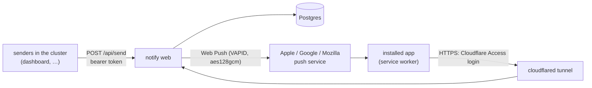

# notify

The homelab's one place for notifications. Other apps send a message on a topic, and notify delivers it to everyone who wants that topic, for now as web push to the devices where they installed the app. Built for iPhones: a Home Screen web app at **https://notify.shillyshally.org**.



- **Who you are:** Cloudflare Access signs every request it lets through with a JWT (`Cf-Access-Jwt-Assertion`); the app verifies it against the team's keys, issuer and the application's audience tag, and creates the person on their first visit (name from the email, editable). There is no other login, and the app answers nothing but `/healthz` and `/api/` without that token.
- **Not on `lab.internal`:** web push needs HTTPS, so the only way in for people is the tunnel. Its `/api/` paths are routed to a 404 in `platform/components/cloudflared/config.yaml`; senders reach the API inside the cluster only.
- **Topics** are declared in `deploy/topics.json` (`id`, `name`, `description`, `default`: whether people get it until they choose). Each person switches topics on or off for themselves.
- **Devices:** one push subscription per installed app. The app re-sends its subscription on every open, so a rotated one is picked up; subscriptions the push service reports gone (404/410) are deleted on the next send.
- **History:** every message is kept 90 days (`HISTORY_DAYS`) with its recipients; the app shows each person the last 50 sent to them.

## Using it (iPhone)

1. Open https://notify.shillyshally.org in Safari and sign in (email, then the code Cloudflare emails).
2. *Share → Add to Home Screen*, then open **Notify** from the Home Screen. iOS allows web push only there.
3. *Turn on notifications* and allow. *Send a test* checks the whole path.

Topic switches, the device list and recent messages are on the same page. Turning off on a device unsubscribes it; *Remove* forgets another device (an old phone).

## Sending API

Inside the cluster: `POST http://web.notify.svc:3000/api/send`, `Authorization: Bearer <sender token>`, JSON body:

| Field | |
|---|---|
| `topic` | required; an id from `deploy/topics.json` (else 400) |
| `title` | required, up to 120 characters |
| `body` | up to 1000 characters |
| `url` | `http(s)://…`, opened when the notification is tapped; the app itself when omitted |
| `to` | optional list of emails: only those people (if they have the topic on) |

Answer `200 {"id", "recipients", "devices", "delivered", "failed"}`; `401` for an unknown token. The body must be JSON (`content-type: application/json`): SvelteKit refuses form-encoded POSTs without a matching `Origin`. Delivery is attempted once (push services queue for offline devices for 24 h, `TTL`); a failure is recorded on the device (shown in the app) and not retried.

Current senders: `dashboard` (topic `packages`: package ready for pickup, [apps/dashboard](../dashboard/README.md)), `telescope` (topic `telescope`, off by default: the cabin telescope's imaging started, finished, or stopped producing frames, [apps/telescope](../telescope/README.md)).

### Adding a sender

1. Add its topic(s) to `deploy/topics.json` if new.
2. Give it a token, stored on both sides (the senders secret is mounted as files, so notify needs no restart):

   ```sh
   T=$(openssl rand -hex 32)
   kubectl -n notify get secret notify-senders -o json | jq --arg t "$(printf %s "$T" | base64 -w0)" '.data["<app>"] = $t' | kubectl apply -f -
   kubectl -n <app-namespace> create secret generic <app>-notify --from-literal=NOTIFY_TOKEN="$T"
   unset T
   ```
3. Allow it in `deploy/networkpolicy.yaml` (`web-from-senders`), and in the sender's own policy if its egress is restricted.
4. Update the architecture diagram (`apps/homelab/src/lib/architecture.ts`, shown at http://homelab.lab.internal/components).

## Secrets (not in git)

| Secret | Keys |
|---|---|
| `notify-db` | `POSTGRES_PASSWORD` |
| `notify-vapid` | `VAPID_PUBLIC_KEY`, `VAPID_PRIVATE_KEY`: the server's push identity. Changing it invalidates every subscription (each device must turn notifications on again) |
| `notify-senders` | one key per sending app (key = sender name, `a-z0-9-`), value = its token (at least 32 characters) |

First-time setup:

```sh
kubectl apply -f apps/notify/deploy/namespace.yaml
kubectl -n notify create secret generic notify-db --from-literal=POSTGRES_PASSWORD="$(openssl rand -hex 24)"
V=$(cd apps/notify && node -e "console.log(JSON.stringify(require('web-push').generateVAPIDKeys()))")
kubectl -n notify create secret generic notify-vapid \
  --from-literal=VAPID_PUBLIC_KEY="$(echo "$V" | jq -r .publicKey)" --from-literal=VAPID_PRIVATE_KEY="$(echo "$V" | jq -r .privateKey)"
unset V
kubectl -n notify create secret generic notify-senders   # then add senders as above
```

Non-secret settings are literals in `deploy/kustomization.yaml`: `ORIGIN`, `VAPID_SUBJECT` (the contact push services see), and `ACCESS_TEAM_DOMAIN` / `ACCESS_AUD` (the Cloudflare Access team and application; without them every page answers 503).

## Cloudflare

- **Tunnel** `homelab` (`platform/components/cloudflared`): `notify.shillyshally.org` → `http://web.notify.svc:3000`, `/api/` → 404. DNS: proxied `CNAME notify` → `<tunnel id>.cfargotunnel.com`.
- **Access application** *Notify* on `notify.shillyshally.org`: the reusable policy *Family* (allow the listed emails; shared with the *Dashboard* application), one-time PIN login, 730 h session. A second application, *Notify install files*, on the same host's `/manifest.webmanifest`, `/sw.js` and `/icons/*` with the reusable *bypass* policy *Everyone: app install files*: iOS fetches those without the Access cookie while installing the app.
- Adding a person: add their email to the *Family* policy (*Zero Trust → Access controls → Policies*); that lets them into Notify and the dashboard. They appear in Notify on their first visit.

## Develop

```sh
cd apps/notify
npm install
npm run check   # svelte-check / TypeScript
npm run build
```

The app needs Postgres (`DATABASE_URL`), the VAPID keys, and an Access issuer: without Cloudflare, point `ACCESS_TEAM_DOMAIN` at a local server that serves a JWKS at `/cdn-cgi/access/certs` and mint RS256 tokens with `iss` = that address and `aud` = `ACCESS_AUD`, sent as `Cf-Access-Jwt-Assertion`. `localhost` counts as a secure context, so Chromium can subscribe to real push (FCM) against a local server.

## Deploy

```sh
./apps/notify/deploy.sh   # podman build, import into k3s (sudo), apply, wait for rollout
```

Commit the updated `newTag` in `deploy/kustomization.yaml`.
