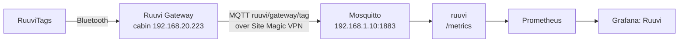

# ruuvi

RuuviTag readings from the cabin for Prometheus and Grafana. The Ruuvi Gateway at the cabin (`RuuviGateway942E`, `192.168.20.223`, firmware 1.16.3) relays every tag it hears to Mosquitto at home over the Site Magic VPN; this service keeps the latest reading per tag and serves it as metrics. Grafana dashboard: *Ruuvi* (http://grafana.lab.internal/d/ruuvi/ruuvi).



Cluster-internal only (`http://ruuvi.ruuvi.svc:8080`, no Ingress); a NetworkPolicy admits only Prometheus. Node 22 running the TypeScript sources directly; runtime dependency `mqtt` (MQTT.js).

## Ruuvi Gateway settings

In the gateway's web page (http://192.168.20.223, from home over the VPN or on the cabin network), *Cloud Options* → *Use Ruuvi Cloud and/or a custom server* → *MQTT(S)*:

| Setting | Value |
|---|---|
| MQTT(S) | on |
| MQTT transport type | *MQTT over unencrypted TCP* (the broker has no TLS; the traffic stays inside the VPN) |
| Server / Port | `192.168.1.10` / `1883` |
| Data format | *Send only decoded data* (or *raw and decoded*; raw only is not read) |
| Sending interval | on, `60` seconds: the latest reading of each tag once a minute (instead of every advertisement, about one per second per tag, over the cabin's mobile link) |
| Username / Password | `ruuvigateway` / `kubectl -n mosquitto get secret mqtt-ruuvigateway -o jsonpath='{.data.password}' \| base64 -d` |
| Client ID | empty (the gateway's MAC) |
| Retained messages | leave enabled (the checkbox *disables* them): the gateway's online/offline status is retained, with offline as its last will |
| Topic prefix | *Use 'ruuvi' on the prefix* and *Use Ruuvi Gateway's MAC address on the topic prefix* on, no custom prefix: `ruuvi/<gateway MAC>/` |

*Ruuvi Cloud* can stay on alongside if the Ruuvi Station app is in use. Leave *Bluetooth Scanning* at its default (Ruuvi devices only).

Check: `kubectl -n ruuvi logs deploy/ruuvi` shows `gateway <MAC> online` and `tag <MAC> (<name>) seen` for each tag within a minute; the dashboard fills in.

## Naming tags

Unnamed tags appear by MAC. Names go in `TAGS` in `deploy/kustomization.yaml`, `MAC=Name` comma-separated (`C9:3A:12:4B:5C:6D=Sauna,E2:01:7F:AA:10:42=Lake`); apply with `kubectl apply -k apps/ruuvi/deploy` (the pod rolls). The Ruuvi Station app shows each tag's MAC in its settings. Renaming starts a new series in Prometheus (the old name stays in history).

Current tags: `curl -s http://prometheus.lab.internal/api/v1/query --data-urlencode 'query=ruuvi_last_seen_timestamp_seconds' | jq -r '.data.result[].metric | "\(.mac) \(.name)"'`.

## Metrics

Labels `mac` and `name` (the MAC while unnamed). A tag unheard for `STALE_AFTER_MIN` (10 min) drops out of the readings; its last-seen time stays until the service restarts.

| Metric | |
|---|---|
| `ruuvi_temperature_celsius`, `ruuvi_humidity_percent`, `ruuvi_pressure_pascals` | Measurements |
| `ruuvi_battery_volts` | CR2477 coin cell, about 3.0 V new; sags in frost |
| `ruuvi_acceleration_g{axis}`, `ruuvi_movement_counter` | Accelerometer; the counter steps when the tag moves and wraps after 254 |
| `ruuvi_tx_power_dbm`, `ruuvi_rssi_dbm` | Transmit power, signal strength at the gateway |
| `ruuvi_last_seen_timestamp_seconds` | Last message from the tag |
| `ruuvi_gateway_up{gateway}` | 1 while the gateway reports online (its retained status; the broker publishes its offline last will when the connection drops) |
| `ruuvi_mqtt_up` | 1 while this service is connected to the broker |

## Troubleshooting

Watch the gateway's messages (needs podman; as the read-only `ruuvi` user, since `ruuvigateway` may only publish):

```sh
P=$(kubectl -n ruuvi get secret ruuvi-mqtt -o jsonpath='{.data.MQTT_PASSWORD}' | base64 -d); export P
podman run --rm -it --network host -e P docker.io/library/eclipse-mosquitto:2.0.22 \
  sh -c 'mosquitto_sub -h 192.168.1.10 -u ruuvi -P "$P" -t "ruuvi/#" -v'
```

Nothing arriving: the gateway's own status page shows the MQTT connection state; `kubectl -n mosquitto logs deploy/mosquitto` shows refused logins. The log line `messages carry raw data only` means the data format is still the default raw.

## Deploy

`./apps/ruuvi/deploy.sh` (image build, import into k3s, apply; commit the new tag it writes). Needs secret `ruuvi-mqtt` from `platform/components/mosquitto/users.sh`.
