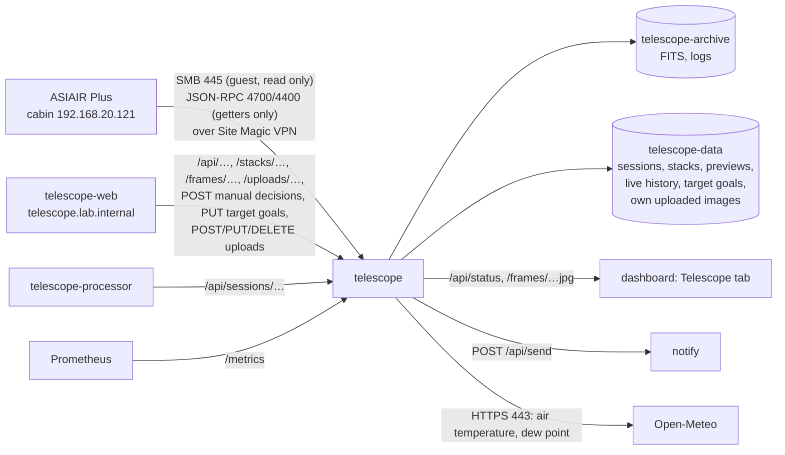

# telescope

The cabin telescope's imaging sessions for the dashboard's *Telescope* tab and the [telescope web app](#web-app): the ZWO ASIAIR Plus (`192.168.20.121` on the cabin Wi-Fi, firmware 13.41; main camera ZWO ASI533MC Pro, guide camera ASI120MM Mini) is read over the Site Magic VPN. Every file it saves is copied home into an archive (lights, calibration frames, logs); every light frame gets a stretched colour preview, sky-quality and star-shape numbers and an automatic accept/reject decision, and is aligned and added to its session's live stack; the ASIAIR's own control ports give what it is doing right now (exposure, plan progress, guiding, telemetry) and are recorded into the session's history; notifications go out through [apps/notify](../notify/) (topic `telescope`).

Cluster-internal only (`http://telescope.telescope.svc:8080`, no Ingress); a NetworkPolicy admits the dashboard, the web app (`app.kubernetes.io/name: telescope-web`, the only caller of the POSTs, PUTs and DELETEs), the telescope processor (`app.kubernetes.io/name: telescope-processor`: session reports with the frames' `archivePath`, GETs only) and Prometheus; out: the ASIAIR, apps/notify, DNS and the internet on 443 (Open-Meteo, for the dew notification only). Python 3.13 on `python:3.13-slim`: `numpy` and `scipy` (frames, registration, stacking), `pillow` (JPEG, PNG), `tifffile` with `imagecodecs` (uploaded TIFFs; LZW needs the latter), `smbprotocol` (the shares). It only reads from the ASIAIR: files, and its state through getter methods; it never calls anything that changes the ASIAIR and never deletes anything there.

## What it reads

The ASIAIR shares its storage over SMB with a guest login: `EMMC Images` (internal) and `Udisk Images` (a USB disk, under `ASIAIR\`), both in `ROOTS`. Inside: `Autorun|Plan|Live\Light\<target>\Light_<target>_<exposure>s_Bin1_<time>[_<angle>deg]_<n>.fit` (16-bit FITS, 3008×3008, 18 MB, with a 200 px `_thn.jpg` beside each), calibration frames under `Autorun|Plan|Live\Bias|Dark|Flat\` (directly or one folder down), and `log\Autorun_Log_<date>_<time>.txt` (and PHD2 guide logs, `PHD2_GuideLog_…txt`, if it writes them there).

| | |
|---|---|
| Poll | Every 30 s (`POLL_S`): the light frame listings (about 5 s over the VPN for ~350 frames) and the logs; every 10th poll also the calibration folders and the shares' free space. The newest Autorun log is read when its size changed |
| Session | As in the status: the frames in a target folder without a gap over 2 h. The status's `session` is the newest one if its last frame is under 12 h old; `active` while a frame is due and the run has not ended |
| Plan log | The run's Autorun log: plan name, target, planned and taken frames, state (`finished`, `stopped`), what it did (auto focus, centering, meridian flip, guiding) and its lines. **The ASIAIR puts the log on its share only when the run ends** (seen 2026-10-17: no log file during a running plan); while running, `plan` comes from the live state below. Times in the log and file names are the ASIAIR's clock (`ASIAIR_TZ`) |

### Live state (`live.py`, `LIVE=off` disables it)

The ASIAIR app talks to two JSON-RPC servers on the ASIAIR (one JSON object per line). This service keeps a connection to each and only calls getters, every 5 s (a client that sends nothing is dropped after ~18 s). Found on 2026-10-17 (firmware 13.41) with the app connected at the same time; the app showed no disconnects, warnings or slowness with this service connected alongside it:

| Port | |
|---|---|
| 4700 imager | `get_app_state`: the page (`plan`, …) and what is working: `capture` (state `expose`, `lapse_ms`/`total_ms` of the current frame, plan progress: targets, frames per target and plan, `plan_end`), `auto_focus` (with its V-curve), `merid_flip`, `auto_goto`, `solve`, `find_star`, `pa`, `stack`. Events: `Temperature` (sensor), `CoolerPower` (%), `PiStatus` (board temperature, `is_undervolt`, `is_overtemp`), `Station` (Wi-Fi dBm), `Exposure`, `AutoFocus`, `FocuserMove`. New event types are logged once (`live event …`) |
| 4400 guider | PHD2-style: `get_app_state` (`Guiding`, `Looping`, …), `get_pixel_scale` (3.106″/px for the guide camera), events `GuideStep` every ~3 s (`RADistanceRaw`/`DECDistanceRaw` in guide pixels, `IsSettle`, `IsDither`, `SNR`), `GuidingDithered`, `SettleBegin`, `StarLost`, `GuideStarLostTooMuch`, `StartGuiding`, `GuidingStopped` |

From these: `live.activity` (Exposing, Meridian flip, Auto focus, GoTo, Plate solving, Finding star, Polar alignment, Live stacking, Idle), the current exposure's progress, plan progress, telemetry (`sensorTempC`, `coolerPowerPct`, `controllerTempC`, `underVoltage`, `overTemp`, `wifiDbm`) and guiding RMS (PHD2's: spread around the mean, over the last 50 steps without settling/dithering) with the last 120 steps for the graph.

**History** (`journal.py`): every guide step and guider event, what the ASIAIR starts doing (activity changes), plan progress changes and telemetry once a minute are appended to `/data/live/<night>.jsonl` (~1–2 MB per night of guiding), independent of sessions. A session's guiding, telemetry and live timeline are the records in its window: 30 min before its first frame (GoTo, centering, auto focus; not before the previous session's last frame) to 10 min after its last one (now while active).

## What is stored where

| Where | What | Size |
|---|---|---|
| PVC `telescope-archive` (`/archive`, local-path, request 500 Gi, **not backed up**: `EXCLUDE` in [backup](../../platform/components/backup/README.md)) | Every file byte for byte as on the ASIAIR, by night (local date of the evening; before noon counts as the previous evening) and target: `<YYYY>/<night>/<target>/Light_….fit`, `<YYYY>/<night>/Bias|Dark|Flat/….fit`, `<YYYY>/<night>/Autorun_Log_….txt` (and PHD2 guide logs). Written to a temporary name and renamed with the ASIAIR's modification time; a file the ASIAIR rewrites (new size or newer time) is copied again | ~1.8 GB per 100 frames |
| PVC `telescope-data` (`/data`, local-path, request 20 Gi, backed up nightly) | `sessions/<id>/session.json` (frames: file, numbers, transform, automatic and manual decision; the reference frame's stars and plate solve; the stack's numbers), `sessions/<id>/stack.fits` (32-bit float, superpixel size 1504×1504×3, NaN where no frame covers), `stack.jpg` (full superpixel size 1504 px, JPEG quality 92), `stack-small.jpg` (300 px); `previews/<ab>/<frame id>[-small].jpg` for every frame; `live/<night>.jsonl`; `targets.json` (integration goals, wishlist and notes per target, from the web app); `uploads/<id>/` (the owner's own images, see [Own uploads](#own-uploads)) | ~0.5 MB per frame, ~28 MB per stack, ~2 MB per night; an upload ~2–3 × its file |
| emptyDir `cache` (`/cache`, sizeLimit 20 Gi) | Aligned frames for restacking (`<session>/<frame id>.npy`, float16, sky-subtracted, 13.6 MB each), the least recently used sessions pruned above `CACHE_MAX_GB` (15); rebuilt from the archive when missing | up to 15 GB |

local-path neither enforces nor resizes a request (the StorageClass has no `allowVolumeExpansion`): `telescope-data` is a directory on the node's `/var/lib/rancher` (~790 GB free), so the uploads are bounded by the host's disk, not by the 20 Gi in `deploy/storage.yaml`. An upload is refused (507) when less than 1 GiB would remain on the volume.

At start the service scans the archive and loads every `session.json`: sessions, decisions and stacks survive restarts; light frames in the archive that no session knows (a deleted `session.json`, an older backup) are grouped into sessions again and analysed from the archive. Sessions are grouped when a frame is first seen and never regrouped; the id is the local time of the first frame and the target (`20261017-2034-c-9`).

### Work order and backfill

One worker thread (`sessions.py`), highest priority first: the newest session's frames (newest first) and its restack; the logs; then the backfill: older sessions newest first (their frames oldest first, so the early, usually good frames choose the reference), re-copies of rewritten files, calibration frames, with a 2 s pause after each backfill file fetched over the VPN. A running session's new frame therefore waits at most for the one file being fetched. A frame younger than 15 s on the ASIAIR is left alone (the ASIAIR writes it again after saving); one that is still incomplete, or unreadable over SMB, is retried a minute later; a file that cannot be parsed is marked failed and listed with the reason. With the ASIAIR off, only archived files are processed. Everything already on the ASIAIR is backfilled on the first start (~350 frames, 6 GB: about 40 min over the VPN).

## Processing a frame

Download (or read from the archive) and archive, then:

| Step | |
|---|---|
| Preview | 2×2 superpixel debayer (RGGB → R, mean of the two G, B at 1504²), per-channel screen stretch (black point below the sky, background at 20 %, which also removes the light-pollution colour cast), JPEG 1504 px and 300 px |
| Sky quality | Background median (ADU; rises with moonlight, clouds lit from below, dawn), stars (local maxima 8σ above the sky, not saturated, not single hot pixels), median HFR of the brightest 400 in camera pixels (focus and seeing) |
| Star shape | On the green plane: stars 6σ above the sky (5×5 local maxima, not saturated, not lone hot pixels), centroids of the brightest 300 for registration; second moments of the bright ones (25σ, up to 150) give the median FWHM (camera pixels, Gaussian equivalent) and elongation `1 − minor/major` (0 = round) |
| Guiding | RMS of the guide steps recorded during the exposure (`DATE-OBS` … + `EXPTIME`, at least 5 steps), else null |
| Registration | See below; the aligned frame goes to the cache |
| Decision | All frames of the session are judged again (see Rejection), then the session restacks |

Measured on the server (4 cores) with synthetic 3008² frames: analysis and previews ~0.2 s, registration < 0.1 s, warping ~0.7 s: **~1 s per frame** after the download.

### Registration

Every frame is aligned onto the session's reference frame (its geometry only; it need not be in the stack). Transforms are affine maps between superpixel coordinates (`register.py`):

1. **Plate solve first:** if both frames carry a TAN WCS (CD matrix, or CDELT with CROTA2/PC), the frame's pixels go to the sky and back into the reference's pixels; an affine fit over a 6×6 grid is the guess. Meridian flips (180°) come out of the solves directly.
2. **Refine by stars:** frame stars are paired with the nearest reference stars around the guess (radius 8 → 4 → 2 px), an affine transform is fitted (a similarity while fewer than 20 pairs), pairs off by more than 3 × the median residual are dropped and the fit repeated. It must keep at least a quarter of the stars (min. 8) and a scale within 5 %.
3. **Without a solve, or when the guess does not hold** (Live frames): triangles of each of the 40 brightest stars with pairs of its 6 nearest neighbours are compared by side ratios (invariant to shift, rotation and scale); each matching triangle proposes a similarity, the one that brings the most stars within 2 px of a reference star wins, and step 2 refines it.

A frame that does not align is rejected ("not aligned: …"). The reference is the first frame with enough stars; while no more than 20 frames are aligned, an accepted frame 25 % better by stars / HFR becomes the reference (stars capped at 1.25 × the session median, so a satellite trail counted as "stars" does not win; transforms are composed, the cache is re-warped from the archive). Warping: cubic spline (`scipy.ndimage.affine_transform`) of the sky-subtracted planes; pixels outside the frame are NaN.

### Stacking

`stacking.py`: the accepted aligned frames are combined row band by row band (24 MB of float32 per band), so memory does not grow with the number of frames: per pixel the median and the MAD (× 1.4826) of all frames give a robust spread, which never goes below the frames' sky noise (so a handful of frames do not mistake noise for outliers); values more than 3 spreads above the median (satellites, planes, cosmic rays, hot pixels that move with dithering) or 4 below are dropped and the rest averaged. Fewer than 3 frames: plain mean. The median sky of the stacked frames is added back (ADU in the FITS). Preview: the same per-channel stretch as the frames.

Restacked after every new frame of the newest session (at most once a minute while frames are still waiting), after every manual decision, and once per older session when its backfill is done. Measured combine times on the server (1504²×3 frames): 7 frames 1.5 s, 10 frames 2.9 s, 30 frames 7.5 s, 60 frames 13.7 s, 100 frames 21.8 s; a reference change or a missing cache adds ~0.7 s per frame to re-warp. Memory: peak resident 510 MB in a synthetic run (analysing, restacking, serving); the memory-mapped aligned frames add only reclaimable page cache. Limit 2 Gi.

### Rejection

`rejection.py`, against the session's own median, re-judged whenever the session changes (so the first frames, judged on absolute limits only while fewer than 5 are analysed, get the full verdict later). Reasons are in plain words and joined with `;`:

| Constant | Value | Rejects | Reason (example) |
|---|---|---|---|
| `MIN_STARS` | 15 | always | `only 4 stars: clouds or not on target` |
| `STARS_MIN_RATIO` | 0.5 | stars below half the median | `stars 35 % of session median: clouds` |
| `HFR_MAX_RATIO` | 1.35 | HFR above 1.35 × median | `HFR 1.6× session median: focus or seeing` |
| `BACKGROUND_MAX_RATIO` | 1.5 | background above 1.5 × median | `background 1.8× session median: clouds lit, moon or dawn` |
| `ELONGATION_MAX`, `ELONGATION_MARGIN` | 0.35, 0.15 | elongation above max(0.35, median + 0.15) (0.5 before statistics) | `stars elongated 0.45 (session 0.12): trailing or wind` |
| `GUIDING_RMS_MIN_ARCSEC`, `GUIDING_RMS_RATIO` | 1.5″, 2 | guiding RMS during the exposure above 1.5″ and above 2 × the median | `guiding RMS 3.1″ (session 0.8″)` |
| `MIN_FRAMES` | 5 | frames needed for session statistics | |

**Manual override:** `POST /api/sessions/<id>/frames/<frame id>` with `{"accepted": true}` or `false` sets `manual: true` and restacks; `{"accepted": null}` returns to the automatic decision. A frame that did not align cannot be put into the stack.

## Notifications

Topic `telescope` (off by default: turn it on in the notify app). Each links to the dashboard's Telescope tab (`NOTIFY_LINK`). The first four are decided in `main.py` at every poll, the rest in `alerts.py` every 10 s (`CHECK_S`) from the live state, the current session and its analysed frames; thresholds are named constants at the top of `alerts.py`. Unless noted, only while a session is active (a frame due, the ASIAIR busy, the run not ended).

| Notification (title — text) | When | Said again |
|---|---|---|
| Imaging started: *target* — "40 × 300 s, target 1 of 2" | A new run's first frames appear (a frame less than 30 min old in a new folder or after a 2 h gap) | Per run |
| Imaging finished (or stopped): *target* — "34 frames, 2 h 50 min in total" | Live says the plan ended, or the run's Autorun log appears (*Finish*, or stopped by hand) | Per run |
| Imaging stopped: *target* — "The ASIAIR is idle; last frame at 01:12" | Live: the ASIAIR has been idle for `STALL_MIN` (15 min) during a run that has not ended. Meridian flips and refocusing (22 min on 2026-10-17) count as busy | Per idle spell |
| No new frames: *target* — "Last frame at 01:12; the ASIAIR is not answering" | Without live (control ports not answering): an Autorun/Plan run that has not ended and no frame for one exposure + 2 × `STALL_MIN`: clouds, the mount, power, or the ASIAIR off the network (said in the text). Not for Live stacking, which is ended by hand without a log | Per last frame |
| Clouds over *target* — "Stars down to 30 % of the session median (2 frames in a row)." | The newest `CLOUDS_FRAMES` (2) analysed frames in a row have collapsed: fewer than `rejection.MIN_STARS` (15) stars, or under `CLOUDS_STARS_RATIO` (0.5, the rejection's "clouds" limit) of the session median (once 5 frames give a median). The newest frame must have ended within `FRESH_S` (15 min), so a backlog analysed later says nothing | Once per cloudy spell |
| Clear again over *target* — "Stars back to 95 % of the session median." | After a *Clouds* notification: the newest `CLEAR_FRAMES` (2) frames are back at `CLEAR_STARS_RATIO` (0.7) of the median or better (a margin, so a veil hovering at the limit does not flap) | Once per cloudy spell |
| Dew suspected: *target* — "Stars are swelling: HFR up 32 % over the last 6 frames, and the air at the site is 1.4 °C from its dew point (3.0 °C, dew point 1.6 °C). Check the dew heater." | HFR rising steadily over the newest `DEW_FRAMES` (6) frames (at least `DEW_RISING_SHARE` 80 % of the steps up, the fitted line up `DEW_HFR_RISE` 15 % or more) **and** the air within `DEW_SPREAD_C` (2 °C) of its dew point at the site in the FITS header (`SITELAT`/`SITELONG`; Open-Meteo `current` temperature and dew point, asked only while the HFR climbs, cached 15 min; no internet: no dew notification) | Once per session |
| Guiding lost: *target* — "The guider has not been guiding for 60 s (star lost) while the camera is exposing: frames will trail until it recovers." | The guider's state (port 4400, `get_app_state`) not `Guiding` (`LostLock` after a lost star, `Stopped`, `Looping`, …) for `GUIDING_LOST_S` (60 s) while live says *Exposing*, in a session that has been guided (unguided imaging is no alarm). Flips, auto focus, GoTo and centering are not *Exposing* | Once per loss; again after guiding resumed |
| Meridian flip done: *target* — "Imaging again after the flip (3 min)." | After live showed *Meridian flip*: an exposure started after the flip has run `FLIP_CONFIRM_S` (20 s), or a frame is saved more than a minute after the flip began | Per flip |
| Meridian flip: *target* not imaging again — "20 min since the meridian flip began and no new frame; the ASIAIR shows: Meridian flip. Check it in the ASIAIR app." | Neither within `FLIP_RESUME_S` (20 min) of the flip's start (cancelled when the run ends). If it does resume later: *Meridian flip done* — "Imaging again, 34 min after the flip began." | Per flip |
| ASIAIR storage low: *share* — "12.0 GB free of 58 GB (21 %), room for about 660 more frames. Copy and delete old frames on the ASIAIR." | The share the newest frames are saved to has less than `STORAGE_MIN_BYTES` (15 GB) or `STORAGE_MIN_FRACTION` (10 %) free (free space is listed every 10th poll, ~5 min). Any time the ASIAIR answers: it only fills while it saves frames | Once per crossing; again after it was above |
| Sensor not cooling: *target* — "The sensor has been at -16.5 °C for 15 min, set point -20 °C with the cooler at 100 %. Darks taken at the set point will not match these frames." | Live sensor temperature above the set point (`SET-TEMP` of the session's frames) + `WARM_MARGIN_C` (2 °C) for `WARM_S` (15 min) | Once per warm spell |
| ASIAIR under-voltage — "The ASIAIR reports a low supply voltage: frames may be lost or it may restart. Check the power supply and its cable." | `PiStatus` `is_undervolt` on the imager port, any time the ASIAIR's control ports answer (not only in a session) | Once per occurrence; a new one after `UNDERVOLT_QUIET_S` (10 min) without |

A restart does not repeat notifications for what was already there: the run, the clouds and HFR trend of the session's frames as loaded, the live state at the first answer from the control ports and the storage at its first listing are taken as known (a guiding loss or a warm sensor already going on then is not announced).

## Images: full resolution, plate solve, star measurement

For the web app's viewer (zoom to 1:1 and beyond, annotation, star clicks) every image has a metadata endpoint, `GET /api/images/<kind>/<id>`, in one shape shared with the processor's finals (`kind` `stack` here with the session id, `upload` here, `final` in the processor). Pixel convention for all of them: the displayed image shows FITS data row 1 at the **top** (as every preview so far and the ASIAIR's own thumbnails); `wcs` is in FITS terms of the data array (1-based, `y` in data rows) with `rowsTopDown: true`; display pixel = FITS pixel − 1, i.e. the array's column/row index with pixel centres at integers. The star endpoint takes and returns display pixels.

| Field | Live stack (`stack`) | Own upload (`upload`) |
|---|---|---|
| `url`, `smallUrl` | `/stacks/<id>.jpg?v=<imageId>` (the stack at full superpixel size, 1504², quality 92; no downscaling), `/stacks/<id>-small.jpg?v=…` (300 px) | `/uploads/<id>.jpg` (full resolution, quality 92), `/uploads/<id>-small.jpg` (600 px) |
| `wcs` | FITS keywords `CTYPE1/2` (`RA---TAN`, `DEC--TAN`), `CRVAL1/2`, `CRPIX1/2`, `CD1_1…CD2_2`: the reference frame's ASIAIR plate solve moved to the superpixel grid (`fits.Wcs.plane`: plane pixel p spans camera pixels 2p, 2p+1, so `CD × 2` and `CRPIX = (CRPIX_camera + 0.5) / 2`). The stack is on the reference's grid, so that is its solution; if the reference has no solve (Live frames), the first aligned frame that has one, carried through its transform onto the reference grid (`fits.Wcs.through`, exact for an affine map). Null when no frame is solved (`sessions.stack_wcs`) | From an uploaded FITS with a TAN solution (CD, or CDELT with PC/CROTA2 turned into CD; `-SIP` keywords `A_ORDER`, `A_p_q`, `B_…`, `AP_…`, `BP_…` passed through). Null for JPEG/PNG/TIFF (XISF and "align to a final" are not supported) |
| `pixelScaleArcsec` | From the solution, else the header's `XPIXSZ` and `FOCALLEN` × 2 (sessions analysed since this field exists), else null | From the solution, else null |
| `histogram`, `stats` | From `stack.fits` (the linear data), computed once per stack version | Computed at upload from the decoded pixels (larger images row-sampled to ~4 MP per channel) |
| `takenAt`, `integrationS`, `frames`, `measurable` | First stacked frame's start, accepted exposure, accepted frames; `measurable` while `stack.fits` exists | The form's `takenAt` (else FITS `DATE-OBS`), FITS `LIVETIME`/`EXPTIME` and `STACKCNT`/`NCOMBINE`, else null; `measurable` false for 8-bit files (a stretched image only; stars are still measured, `linear: false`) |

`histogram`: `{ bins: 256, scale, min, max, r, g, b }`, integer counts over one range for all channels (`min`…`max` in the data's units: the finite data range for the stack, 0…full scale for uploads: 255, 65535, 1.0 for 0–1 float data, else the data maximum); mono data as r = g = b. `stats`: per channel `{ median, noise }` in the same normalised 0–1 scale (noise: MAD of horizontal neighbour differences × 1.4826 / √2).

**Star measurement** (`measure.py`, numpy only; the processor uses the same file): on the stack the mean of the three linear planes of `stack.fits`, read through a memory map in a ±100 px window; on an upload the mean of the channels of `pixels.npy`. The brightest peak (3×3 mean) within 12 px of the click, 5σ above the local background (sigma-clipped median and MAD of a ±48 px box). An elliptical Moffat profile (β free, each pixel integrated by 3×3 sub-samples, saturated pixels left out) fitted by Levenberg–Marquardt gives the centroid, `fwhmPx` = √(major·minor), `elongation` = 1 − minor/major (0 = round) and `angleDeg` (the major axis, clockwise from +x on the screen, 0–180); second moments if the fit fails. `hfrPx` is the flux-weighted mean radius within 3 × FWHM (the frames' HFR formula without clipping noise at zero); `snr` the flux within 1.5 × FWHM over σ·√pixels (background-limited, no gain known for a stack); `peak` the highest pixel within 2 px; `saturated` at 60000 ADU on the stack (as the frames' analysis), 98 % of full scale on uploads; `profile` the mean value above the background in 0.5 px rings out to max(8, 3 × FWHM) px; `fwhmArcsec` with `pixelScaleArcsec`. Tested on synthetic Gaussian and Moffat stars (FWHM 2.2–10 px within 5 %); ~5–400 ms per click.

## Own uploads

The owner's own processed images (PixInsight, Siril exports) for the web app's gallery, `uploads.py`, under `/data/uploads/<id>/` on the backed-up volume: `meta.json` (target, title, note, dates, publish flag, the original's name/size/type, size, bit depth, solution, histogram), `original` (byte for byte), `pixels.npy` (the decoded pixels in their own type, memory-mapped for star clicks: about the uncompressed image size), `display.jpg` (full resolution, quality 92), `small.jpg` (600 px). Ids are 16 random hex characters; the image of an id never changes (a new version is a new upload), so its JPEGs are cacheable forever.

- **Streaming:** the multipart body is parsed in 1 MiB chunks and the file written to `/data/uploads/.tmp-<id>/` as it arrives (never whole in memory); `Content-Length` is required and checked against 300 MB before reading. A failed or interrupted upload leaves nothing (the temporary folder is removed, also at start).
- **Formats:** recognised by content, not name: JPEG, PNG (Pillow; 16-bit grey kept, 16-bit RGB PNG comes out as 8-bit), TIFF (`tifffile`: 8/16-bit integer, 32-bit float, RGB or grey, planar or interleaved, uncompressed, LZW, Deflate, PackBits; first page; alpha dropped), FITS (BITPIX 8/16/32/−32/−64, BZERO/BSCALE, 2-D or 3 colour planes, converted in row bands). One conversion at a time; measured locally: a 261 MB 16-bit RGB TIFF (6600²) in 1.6 s with a peak resident size of 800 MB for the whole service.
- **Display:** data deeper than 8 bits whose median lies under 8 % of full scale is linear (an unstretched stack): it gets the frames' per-channel screen stretch and counts as `linear` for star measurements; anything else (the usual stretched export) is scaled to 8 bits as it is. No downscaling.
- **Publishing** is only a flag here (`published`, false on upload); the web app decides what its public gallery shows.

## API

JSON, times in unix seconds, nulls where unknown. Shapes in `src/main.py` (`status`), `src/live.py` (`snapshot`) and `src/sessions.py` (`summary`, `detail`, `frame_json`).

| Path | |
|---|---|
| `GET /api/status` | `{ online, lastContact, error, session, plan, live, frames, stack, storage, updatedAt }`. `session.id` is the same session in `/api/sessions`; `frames` the newest 40 analysed frames; `stack` the live stack of the current (or most recent) session `{ sessionId, target, accepted, rejected, integrationS, updatedAt, width, height, imageId }`; `storage` `[{ name, freeBytes, totalBytes }]` per share; `live` (null while the control ports do not answer) includes `coolerPowerPct`, `underVoltage`, `overTemp` |
| `GET /api/sessions` | `[{ id, night, target, mode, firstFrameAt, lastFrameAt, frames, accepted, rejected, integrationS, active, hasStack, ra, dec, exposureS, gain }]`, newest first. `frames` counts every frame seen, `accepted`/`rejected` the analysed ones, `integrationS` the accepted exposure; `mode` is null for sessions known only from the archive; `ra`, `dec` (degrees) and `gain` from the FITS header of the first analysed frame (null until one is analysed), `exposureS` the most common exposure |
| `GET /api/sessions/<id>` | The list fields and `camera, focalLengthMm`, `site {lat, lon}`, `plan {planned, current, targetIndex, targets}` (live while active, else from the Autorun log or the recorded plan progress), `frames [{ id, number, at, exposureS, backgroundAdu, stars, hfr, fwhmPx, elongation, guidingRmsArcsec, accepted, rejectReason, manual, aligned, sensorTempC, archivePath, rotatorDeg }]` (analysed or failed frames; `archivePath` relative to the archive volume's root, e.g. `2026/2026-10-17/C 9/Light_C 9_300.0s_Bin1_20261017-221416_93deg_0001.fit`, null until archived; `rotatorDeg` the camera angle from `ROTATOR`, else from the file name), `pending` (frames not analysed yet), `stack`, `guiding { rmsArcsec, rmsRaArcsec, rmsDecArcsec, samples, history [[t, ra″, dec″, settling]] (≤ 2000), events [{at, kind}] }`, `timeline [{at, kind, text}]` (from the Autorun log when there is one, else from the live history; plus guiding lost and every frame), `telemetry { sensorTempC, setTempC, coolerPowerPct, boardTempC, wifiDbm, underVoltage }` (series ≤ 500 points), `archive { frames, bytes }`. Sessions from before this release have no guiding, telemetry or live events |
| `POST /api/sessions/<id>/frames/<frame id>` | `{"accepted": true\|false\|null}` → `{ frame, restacking: true }`; the restack runs in the background (watch `stack.imageId`) |
| `POST /api/sessions/<id>/reprocess` | Analyse, align and stack the session again from the archive (manual decisions stay) → 202 |
| `GET /api/targets` | `{ "targets": { "<key>": { goalHours, wishlist, note, updatedAt } } }`: integration goals (hours), wishlist and notes per target, keyed by the web app's catalog id (`NGC 7000`, `M 31`, `Sh2-155`) |
| `PUT /api/targets/<key>` | URL-encoded key, up to 64 of `A-Z a-z 0-9 space + . _ ( ) -`; JSON `{ "goalHours"?, "wishlist"?, "note"? }` (goal 0 < h ≤ 1000, note ≤ 500 characters): only the named fields change, null clears one, an entry with everything cleared is removed → 200 the entry (`{ goalHours: null, wishlist: false, note: null, updatedAt }` once removed); 400 with the reason in text |
| `GET /frames/<id>.jpg`, `/frames/<id>-small.jpg` | Previews of every frame; ids change with the file, so they are cacheable forever |
| `GET /stacks/<session id>.jpg`, `-small.jpg`, `.fits` | The stack; with `?v=<imageId>` cacheable forever, without it revalidated |
| `GET /api/images/stack/<session id>`, `GET /api/images/upload/<id>` | Image metadata for the web app's viewer (the processor answers the same shape for `final`): `{ kind, id, target, width, height, url, smallUrl, wcs, rowsTopDown: true, pixelScaleArcsec, histogram, stats, takenAt, integrationS, frames, measurable }` (uploads also `title`), see [Images](#images-full-resolution-plate-solve-star-measurement) |
| `GET /api/images/stack/<session id>/star?x=&y=`, `…/upload/<id>/star?x=&y=` | The brightest star within 12 px of display pixel (x, y): `{ found, x, y, fwhmPx, fwhmArcsec, hfrPx, elongation, angleDeg, peak, background, snr, saturated, linear, profile }`; 400 without numeric x/y, 404 for an unknown image |
| `GET /api/uploads` | `[{ id, target, title, note, createdAt, takenAt, published, width, height, url, smallUrl, original { filename, bytes, contentType }, imageKind: "upload" }]`, newest first; `GET /api/uploads/<id>` one of them |
| `POST /api/uploads` | `multipart/form-data`: `file` (JPEG, PNG, TIFF 8/16/32-bit, FITS; ≤ 300 MB), `target` (a catalog id as in `/api/targets`), `title`? (≤ 200), `note`? (≤ 2000), `takenAt`? (unix seconds or ISO 8601; else the FITS `DATE-OBS`) → 201 the upload (unpublished). Needs `Content-Length` (411 without), 413 over 300 MB, 415 not an image, 400 with the reason in text, 507 disk full |
| `PUT /api/uploads/<id>` | JSON `{ "target"?, "title"?, "note"?, "published"?, "takenAt"? }` (null clears title, note, takenAt) → 200 the upload; 400 with the reason |
| `DELETE /api/uploads/<id>` | The upload and its files → 204 |
| `GET /uploads/<id>.jpg`, `-small.jpg`, `/uploads/<id>/original` | An upload's display JPEG (full resolution), 600 px version (both immutable, cacheable forever) and the file as uploaded (`Content-Disposition: attachment`) |
| `GET /metrics` | `telescope_asiair_up`, `telescope_live_up`, `telescope_guiding_rms_arcsec{axis}` (`total`, `ra`, `dec`) while guiding; for the newest frame `telescope_last_frame_timestamp_seconds{target}`, `telescope_frame_background_adu`, `telescope_frame_stars`, `telescope_frame_hfr_pixels`, `telescope_sensor_temperature_celsius`; `telescope_stack_frames{target,decision}` and `telescope_stack_integration_seconds{target}` for the current stack; `telescope_archive_files`, `telescope_archive_bytes`, `telescope_backfill_remaining` (files on the ASIAIR not yet archived or analysed), `telescope_asiair_storage_free_bytes{share}` |

NetworkPolicy is per port, not per path: the dashboard, the processor and Prometheus could reach the POSTs, PUTs and DELETEs too, but only the web app calls them.

Logs: `kubectl -n telescope logs deploy/telescope` (one line per frame with its numbers, alignment and decision, one per stack with its time; archived logs and calibration frames; the ASIAIR and its control ports going away and coming back; each new kind of live event once; manual decisions; target goal changes; uploads (file, size, bit depth, linear or not, plate solved or not, conversion time), their edits, deletes and refusals; notifications sent; a failed Open-Meteo request).

## Operations

**Reprocess a session** (after changing thresholds or registration): `kubectl -n telescope port-forward deploy/telescope 8080 &` then `curl -X POST localhost:8080/api/sessions/<id>/reprocess`. Everything again from the archive; manual decisions are kept. Another way: delete `/data/sessions/<id>/` and restart the pod; the frames are found in the archive (or on the ASIAIR) and form the session again, without manual decisions.

**Restore.** `telescope-data` comes back from the nightly backup like any volume; on start the service reloads the sessions, re-finds any newer archived frames and rebuilds the cache. The archive is not backed up: if it is lost, frames still on the ASIAIR are backfilled again, the rest are gone (their previews, numbers and stacks remain in `telescope-data`). Copy the archive elsewhere by hand if a night matters (`/var/lib/rancher/k3s/storage/pvc-…_telescope_telescope-archive/`).

**Tests** (registration, rejection decisions, the stack's outlier rejection, the notification detectors in `alerts.py`, the live stack's plate solution against synthetic debayered frames (< 0.5 px), star measurement on synthetic PSFs (FWHM within 5 %), uploads: the streamed multipart parser, 16-bit TIFF and FITS-with-WCS round trips, edits, delete, reload; numpy, scipy, pillow and tifffile needed): from `apps/telescope`, `python -m unittest discover -s tests` (or `python -m pytest tests`), e.g. in the image: `podman run --rm -v $PWD:/app:Z -w /app localhost/telescope:<tag> python -m unittest discover -s tests`.

## ASIAIR side

- Joined to the cabin Wi-Fi (station mode) with a fixed address `192.168.20.121` in the UCG Max; also in `deploy/kustomization.yaml` and `deploy/networkpolicy.yaml`.
- Frames must be saved as FITS (the ASIAIR default).
- Nothing is ever deleted there: free space on its storage is shown (`storage`) and is the user's to manage.

## Deploy

`./apps/telescope/deploy.sh` (image build, import into k3s, apply; commit the new tag it writes). The PVCs `telescope-archive` and `telescope-data` are created by the same apply. Notification token: secret `telescope-notify` (`NOTIFY_TOKEN`), created as in [apps/notify](../notify/README.md#adding-a-sender); without it nothing is sent.

## Web app

[web/](web/README.md): the telescope's own web app at http://telescope.lab.internal (Deployment `telescope-web` in this namespace): the live stack against the latest frame, the session's timeline, guiding over the session with the wind, every frame with its rejection reason and the manual override, telemetry, tonight's conditions and aurora, and the observing log. It reads this service's API only; deploy with `./apps/telescope/web/deploy.sh`.
