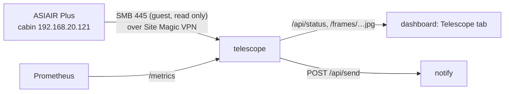

# telescope

The cabin telescope's imaging session for the dashboard's *Telescope* tab: the ZWO ASIAIR Plus (`192.168.20.121` on the cabin Wi-Fi, firmware 13.41; main camera ZWO ASI533MC Pro, guide camera ASI120MM Mini) is read over the Site Magic VPN. Each new light frame becomes a stretched colour preview with sky-quality numbers; the ASIAIR's Autorun log gives plan progress; notifications go out through [apps/notify](../notify/) (topic `telescope`).

Cluster-internal only (`http://telescope.telescope.svc:8080`, no Ingress); a NetworkPolicy admits the dashboard and Prometheus. Python 3.13: `numpy` (frames), `pillow` (JPEG), `smbprotocol` (the shares). It only reads files: nothing it does can disturb a running session.

## What it reads

The ASIAIR shares its storage over SMB with a guest login: `EMMC Images` (internal) and `Udisk Images` (a USB disk, under `ASIAIR\`), both in `ROOTS`. Inside: `Autorun|Plan|Live\Light\<target>\Light_<target>_<exposure>s_Bin1_<time>[_<angle>deg]_<n>.fit` (16-bit FITS, 3008×3008, 18 MB, with a 200 px `_thn.jpg` beside each) and `log\Autorun_Log_<date>_<time>.txt`.

| | |
|---|---|
| Poll | Every 30 s (`POLL_S`): the folder listings (about 5 s over the VPN for ~350 frames) and the newest Autorun log when its size changed |
| Frames | Every new light frame is downloaded (about 5 s each) and rendered: 2×2 superpixel debayer (RGGB, 1504² preview and a 300 px one), per-channel screen stretch (black point below the sky, background at 20 %, which also removes the light-pollution colour cast). At start the newest 12 (`STARTUP_FRAMES`); after an outage the newest 5. The latest 40 are kept in memory. A frame still being written is retried at the next poll |
| Sky quality | Per frame: background median (ADU; rises with moonlight, clouds lit from below, dawn), stars (local maxima 8σ above the sky, not saturated, not single hot pixels), median HFR of the brightest 400 in camera pixels (focus and seeing) |
| Session | The frames in the newest frame's folder without a gap over 2 h, if the last is under 12 h old: target, mode, count, total exposure. `active` while a frame is due and the run has not ended |
| Plan | The run's Autorun log: plan name, target, planned and taken frames, state (`finished`, `stopped`), what it did (auto focus, centering, guiding) and its recent lines. **The ASIAIR puts the log on its share only when the run ends** (seen 2026-10-17: no log file during a running plan), so there is no plan progress while imaging: `plan` is null during a run and filled in at its end. Times in the log and file names are the ASIAIR's clock (`ASIAIR_TZ`) |

Not used: the ASIAIR app's own TCP ports (4400 guider, 4700 imager: JSON events). They are the only live source of plan progress, guiding and exposure state, but a second client on the app's control channel is not something to try without being at the telescope.

## Notifications

Topic `telescope` (off by default: turn it on in the notify app). Each links to the dashboard's Telescope tab (`NOTIFY_LINK`).

| When | |
|---|---|
| Imaging started: *target* | A new run's first frames appear (a frame less than 30 min old in a new folder or after a 2 h gap) |
| Imaging finished: *target* | The run's Autorun log appears with *Finish* (at the end of a plan or autorun) |
| No new frames: *target* | An Autorun/Plan run whose log has not appeared yet (so it has not ended) and no frame for one exposure + `STALL_MIN` (15 min): clouds stopping the plate solve or guiding, the mount, power, or the ASIAIR off the network (said in the text). Once per stall. Not for Live stacking, which is ended by hand without a log |

A restart does not repeat notifications for what was already there.

## API

| Path | |
|---|---|
| `GET /api/status` | `{ online, lastContact, error, session, plan, frames, updatedAt }`, shapes in `src/main.py` (`status`) |
| `GET /frames/<id>.jpg`, `/frames/<id>-small.jpg` | Previews; ids change with the file, so they are cacheable forever |
| `GET /metrics` | `telescope_asiair_up`, and for the newest frame `telescope_last_frame_timestamp_seconds{target}`, `telescope_frame_background_adu`, `telescope_frame_stars`, `telescope_frame_hfr_pixels`, `telescope_sensor_temperature_celsius` |

Logs: `kubectl -n telescope logs deploy/telescope` (one line per rendered frame with its numbers; the ASIAIR going away and coming back; notifications sent).

## ASIAIR side

- Joined to the cabin Wi-Fi (station mode) with a fixed address `192.168.20.121` in the UCG Max; also in `deploy/kustomization.yaml` and `deploy/networkpolicy.yaml`.
- Frames must be saved as FITS (the ASIAIR default).

## Deploy

`./apps/telescope/deploy.sh` (image build, import into k3s, apply; commit the new tag it writes). Notification token: secret `telescope-notify` (`NOTIFY_TOKEN`), created as in [apps/notify](../notify/README.md#adding-a-sender); without it nothing is sent.
