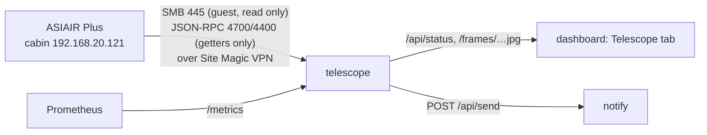

# telescope

The cabin telescope's imaging session for the dashboard's *Telescope* tab: the ZWO ASIAIR Plus (`192.168.20.121` on the cabin Wi-Fi, firmware 13.41; main camera ZWO ASI533MC Pro, guide camera ASI120MM Mini) is read over the Site Magic VPN. Each new light frame becomes a stretched colour preview with sky-quality numbers; the ASIAIR's own control ports give what it is doing right now (exposure, plan progress, guiding); notifications go out through [apps/notify](../notify/) (topic `telescope`).

Cluster-internal only (`http://telescope.telescope.svc:8080`, no Ingress); a NetworkPolicy admits the dashboard and Prometheus. Python 3.13: `numpy` (frames), `pillow` (JPEG), `smbprotocol` (the shares). It only reads: files, and the ASIAIR's state through its getter methods; it never calls anything that changes the ASIAIR.

## What it reads

The ASIAIR shares its storage over SMB with a guest login: `EMMC Images` (internal) and `Udisk Images` (a USB disk, under `ASIAIR\`), both in `ROOTS`. Inside: `Autorun|Plan|Live\Light\<target>\Light_<target>_<exposure>s_Bin1_<time>[_<angle>deg]_<n>.fit` (16-bit FITS, 3008×3008, 18 MB, with a 200 px `_thn.jpg` beside each) and `log\Autorun_Log_<date>_<time>.txt`.

| | |
|---|---|
| Poll | Every 30 s (`POLL_S`): the folder listings (about 5 s over the VPN for ~350 frames) and the newest Autorun log when its size changed |
| Frames | Every new light frame is downloaded (about 5 s each) and rendered: 2×2 superpixel debayer (RGGB, 1504² preview and a 300 px one), per-channel screen stretch (black point below the sky, background at 20 %, which also removes the light-pollution colour cast). At start the newest 12 (`STARTUP_FRAMES`); after an outage the newest 5. The latest 40 are kept in memory. A frame still being written is retried at the next poll |
| Sky quality | Per frame: background median (ADU; rises with moonlight, clouds lit from below, dawn), stars (local maxima 8σ above the sky, not saturated, not single hot pixels), median HFR of the brightest 400 in camera pixels (focus and seeing) |
| Session | The frames in the newest frame's folder without a gap over 2 h, if the last is under 12 h old: target, mode, count, total exposure. `active` while a frame is due and the run has not ended |
| Plan log | The run's Autorun log: plan name, target, planned and taken frames, state (`finished`, `stopped`), what it did (auto focus, centering, guiding) and its lines. **The ASIAIR puts the log on its share only when the run ends** (seen 2026-10-17: no log file during a running plan); while running, `plan` comes from the live state below. Times in the log and file names are the ASIAIR's clock (`ASIAIR_TZ`) |

### Live state (`live.py`, `LIVE=off` disables it)

The ASIAIR app talks to two JSON-RPC servers on the ASIAIR (one JSON object per line). This service keeps a connection to each and only calls getters, every 5 s (a client that sends nothing is dropped after ~18 s). Found on 2026-10-17 (firmware 13.41) with the app connected at the same time:

| Port | |
|---|---|
| 4700 imager | `get_app_state`: the page (`plan`, …) and what is working: `capture` (state `expose`, `lapse_ms`/`total_ms` of the current frame, plan progress: targets, frames per target and plan, `plan_end`), `auto_focus` (with its V-curve), `merid_flip`, `auto_goto`, `solve`, `find_star`, `pa`, `stack`. Events: `Temperature` (sensor), `CoolerPower`, `PiStatus` (board temperature, under-voltage), `Station` (Wi-Fi dBm), `Exposure`, `AutoFocus`, `FocuserMove`. New event types are logged once (`live event …`) |
| 4400 guider | PHD2-style: `get_app_state` (`Guiding`, `Looping`, …), `get_pixel_scale` (3.106″/px for the guide camera), events `GuideStep` every ~3 s (`RADistanceRaw`/`DECDistanceRaw` in guide pixels, `IsSettle`, `IsDither`, `SNR`), `LoopingExposures` |

From these: `live.activity` (Exposing, Meridian flip, Auto focus, GoTo, Plate solving, Finding star, Polar alignment, Live stacking, Idle), the current exposure's progress, plan progress, and guiding RMS (PHD2's: spread around the mean, over the last 50 steps without settling/dithering) with the last 120 steps for the graph.

## Notifications

Topic `telescope` (off by default: turn it on in the notify app). Each links to the dashboard's Telescope tab (`NOTIFY_LINK`).

| When | |
|---|---|
| Imaging started: *target* | A new run's first frames appear (a frame less than 30 min old in a new folder or after a 2 h gap) |
| Imaging finished (or stopped): *target* | Live says the plan ended, or the run's Autorun log appears (*Finish*, or stopped by hand) |
| Imaging stopped: *target* | Live: the ASIAIR has been idle for `STALL_MIN` (15 min) during a run that has not ended. Meridian flips and refocusing (22 min on 2026-10-17) count as busy |
| No new frames: *target* | Without live (control ports not answering): an Autorun/Plan run that has not ended and no frame for one exposure + 2 × `STALL_MIN`: clouds, the mount, power, or the ASIAIR off the network (said in the text). Not for Live stacking, which is ended by hand without a log |

A restart does not repeat notifications for what was already there.

## API

| Path | |
|---|---|
| `GET /api/status` | `{ online, lastContact, error, session, plan, live, frames, updatedAt }`, shapes in `src/main.py` (`status`) and `src/live.py` (`snapshot`); `live` is null while the control ports do not answer |
| `GET /frames/<id>.jpg`, `/frames/<id>-small.jpg` | Previews; ids change with the file, so they are cacheable forever |
| `GET /metrics` | `telescope_asiair_up`, `telescope_live_up`, `telescope_guiding_rms_arcsec{axis}` (`total`, `ra`, `dec`) while guiding, and for the newest frame `telescope_last_frame_timestamp_seconds{target}`, `telescope_frame_background_adu`, `telescope_frame_stars`, `telescope_frame_hfr_pixels`, `telescope_sensor_temperature_celsius` |

Logs: `kubectl -n telescope logs deploy/telescope` (one line per rendered frame with its numbers; the ASIAIR and its control ports going away and coming back; each new kind of live event once; notifications sent).

## ASIAIR side

- Joined to the cabin Wi-Fi (station mode) with a fixed address `192.168.20.121` in the UCG Max; also in `deploy/kustomization.yaml` and `deploy/networkpolicy.yaml`.
- Frames must be saved as FITS (the ASIAIR default).

## Deploy

`./apps/telescope/deploy.sh` (image build, import into k3s, apply; commit the new tag it writes). Notification token: secret `telescope-notify` (`NOTIFY_TOKEN`), created as in [apps/notify](../notify/README.md#adding-a-sender); without it nothing is sent.
