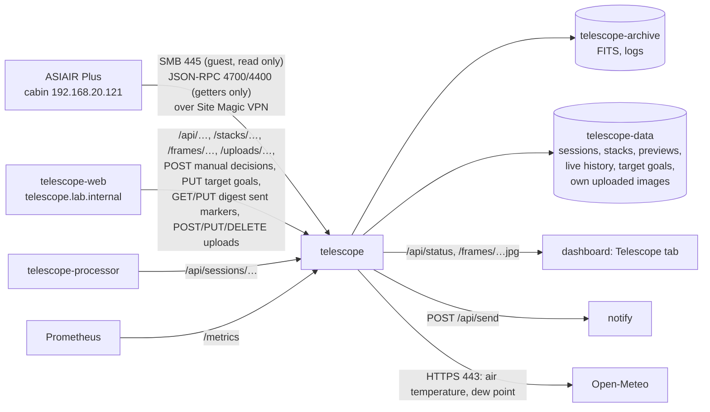

# telescope

The cabin telescope's imaging sessions for the dashboard's *Telescope* tab and the [telescope web app](#web-app): the ZWO ASIAIR Plus (`192.168.20.121` on the cabin Wi-Fi, firmware 13.41; main camera ZWO ASI533MC Pro, guide camera ASI120MM Mini) is read over the Site Magic VPN. Every file it saves is copied home into an archive (lights, calibration frames, logs); every light frame gets a stretched colour preview, sky-quality and star-shape numbers and an automatic accept/reject decision, and is aligned and added to its session's live stack; the ASIAIR's own control ports give what it is doing right now (exposure, plan progress, guiding, telemetry) and are recorded into the session's history; notifications go out through [apps/notify](../notify/) (topic `telescope`).

Cluster-internal only (`http://telescope.telescope.svc:8080`, no Ingress); a NetworkPolicy admits the dashboard, the web app (`app.kubernetes.io/name: telescope-web`, the only caller of the POSTs, PUTs and DELETEs), the telescope processor (`app.kubernetes.io/name: telescope-processor`: session reports with the frames' `archivePath`, GETs only) and Prometheus; out: the ASIAIR, apps/notify, DNS and the internet on 443 (Open-Meteo, for the dew notification only). Python 3.13 on `python:3.13-slim`: `numpy` and `scipy` (frames, registration, stacking), `pillow` (JPEG, PNG), `tifffile` with `imagecodecs` (uploaded TIFFs; LZW needs the latter), `smbprotocol` (the shares). It only reads from the ASIAIR: files, and its state through getter methods; it never calls anything that changes the ASIAIR and never deletes anything there.

Plate solving for frames and uploads without a solution: ASTAP (`astap_cli` and its D05 star database, MPL-2.0) in the image, see [Plate solving](#plate-solving-astap).

## What it reads

The ASIAIR shares its storage over SMB with a guest login: `EMMC Images` (internal) and `Udisk Images` (a USB disk, under `ASIAIR\`), both in `ROOTS`. Inside: `Autorun|Plan|Live\Light\<target>\Light_<target>_<exposure>s_Bin1_<time>[_<angle>deg]_<n>.fit` (16-bit FITS, 3008×3008, 18 MB, with a 200 px `_thn.jpg` beside each), calibration frames under `Autorun|Plan|Live\Bias|Dark|Flat\` (directly or one folder down), and `log\Autorun_Log_<date>_<time>.txt` (and PHD2 guide logs, `PHD2_GuideLog_…txt`, if it writes them there).

| | |
|---|---|
| Poll | Every 30 s (`POLL_S`): the light frame listings (about 5 s over the VPN for ~350 frames) and the logs; every 10th poll also the calibration folders and the shares' free space. The newest Autorun log is read when its size changed |
| Session | As in the status: the frames in a target folder without a gap over 2 h. The status's `session` is the newest one if its last frame is under 12 h old; `active` while a frame is due and the run has not ended |
| Plan log | The run's Autorun log: plan name, target, planned and taken frames, state (`finished`, `stopped`), what it did (auto focus, centering, meridian flip, guiding) and its lines. **The ASIAIR puts the log on its share only when the run ends** (seen 2026-10-17: no log file during a running plan); while running, `plan` comes from the live state below. Times in the log and file names are the ASIAIR's clock (`ASIAIR_TZ`) |

### Live state (`live.py`, `LIVE=off` disables it)

The ASIAIR app talks to two JSON-RPC servers on the ASIAIR (one JSON object per line). This service keeps a connection to each and only calls getters, every 5 s (a client that sends nothing is dropped after ~18 s). Found on 2026-10-17 (firmware 13.41) with the app connected at the same time; the app showed no disconnects, warnings or slowness with this service connected alongside it:

| Port | |
|---|---|
| 4700 imager | `get_app_state`: the page (`plan`, …) and what is working: `capture` (state `expose`, `lapse_ms`/`total_ms` of the current frame, plan progress: targets, frames per target and plan, `plan_end`), `auto_focus` (with its V-curve), `merid_flip`, `auto_goto`, `solve`, `find_star`, `pa`, `stack`. Events: `Temperature` (sensor), `CoolerPower` (%), `PiStatus` (board temperature, `is_undervolt`, `is_overtemp`), `Station` (Wi-Fi dBm), `Exposure`, `AutoFocus`, `FocuserMove`. New event types are logged once (`live event …`) |
| 4400 guider | PHD2-style: `get_app_state` (`Guiding`, `Looping`, …), `get_pixel_scale` (3.106″/px for the guide camera), events `GuideStep` every ~3 s (`RADistanceRaw`/`DECDistanceRaw` in guide pixels, `IsSettle`, `IsDither`, `SNR`), `GuidingDithered`, `SettleBegin`, `StarLost`, `GuideStarLostTooMuch`, `StartGuiding`, `GuidingStopped` |

From these: `live.activity` (Exposing, Meridian flip, Auto focus, GoTo, Plate solving, Finding star, Polar alignment, Live stacking, Idle), the current exposure's progress, plan progress, telemetry (`sensorTempC`, `coolerPowerPct`, `controllerTempC`, `underVoltage`, `overTemp`, `wifiDbm`) and guiding RMS (PHD2's: spread around the mean, over the last 50 steps without settling/dithering) with the last 120 steps for the graph.

**History** (`journal.py`): every guide step and guider event, what the ASIAIR starts doing (activity changes), plan progress changes and telemetry once a minute are appended to `/data/live/<night>.jsonl` (~1–2 MB per night of guiding), independent of sessions. A session's guiding, telemetry and live timeline are the records in its window: 30 min before its first frame (GoTo, centering, auto focus; not before the previous session's last frame) to 10 min after its last one (now while active).

### Filter

The imaging train has a **Baader UHC-L** (Ultra-L-Booster) since 2026-02-13 (the first night with its zero point; 2025-12-30 was without: 1.6 mag more light reached the sensor). It is screwed into the train, not in a filter wheel, so the ASIAIR writes no `FILTER` keyword: `FILTERS` (`deploy/kustomization.yaml`, `src/filters.py`) is the history, `<night>=<filter>` entries separated by `;`, each from that night on, `none` for taking it out (`FILTERS=2026-02-13=Baader UHC-L`; a new filter: add `;<night>=<name>`). A `FILTER` keyword in a header wins. Sessions carry `filter` (null: none). The processor reads the same setting (its flats must match the lights' filter). The UHC-L is a wide dual-band filter (Hβ and [OIII], Hα and [NII]) that blocks most airglow, sodium, mercury and LED light and UV/IR while keeping star colours (Baader's description; the product page gives no band edges): the sky brightness below is the sky in its passbands, darker than an unfiltered reading, and only sessions through the same filter compare.

## What is stored where

| Where | What | Size |
|---|---|---|
| PVC `telescope-archive` (`/archive`, local-path, request 500 Gi, **not backed up**: `EXCLUDE` in [backup](../../platform/components/backup/README.md)) | Every file byte for byte as on the ASIAIR, by night (local date of the evening; before noon counts as the previous evening) and target: `<YYYY>/<night>/<target>/Light_….fit`, `<YYYY>/<night>/Bias|Dark|Flat/….fit`, `<YYYY>/<night>/Autorun_Log_….txt` (and PHD2 guide logs). Written to a temporary name and renamed with the ASIAIR's modification time; a file the ASIAIR rewrites (new size or newer time) is copied again | ~1.8 GB per 100 frames |
| PVC `telescope-data` (`/data`, local-path, request 20 Gi, backed up nightly) | `sessions/<id>/session.json` (frames: file, numbers, transform, automatic and manual decision; the reference frame's stars and plate solve; the stack's numbers), `sessions/<id>/stack.fits` (32-bit float, superpixel size 1504×1504×3, NaN where no frame covers), `stack.jpg` (full superpixel size 1504 px, JPEG quality 92), `stack-small.jpg` (300 px); `previews/<ab>/<frame id>[-small].jpg` for every frame; `live/<night>.jsonl`; `targets.json` (integration goals, wishlist and notes per target, from the web app); `notices.json` (sent markers of the web app's [digests](web/README.md#notifications), `{ "<key>": sentAt }`, markers older than 90 days dropped on each write, `notices.py`); `uploads/<id>/` (the owner's own images, see [Own uploads](#own-uploads)) | ~0.5 MB per frame, ~28 MB per stack, ~2 MB per night; an upload ~2–3 × its file |
| emptyDir `cache` (`/cache`, sizeLimit 20 Gi) | Aligned frames for restacking (`<session>/<frame id>.npy`, float16, sky-subtracted, 13.6 MB each) and the session's [timelapse](#timelapse) (`<session>/timelapse/`, 16–43 MB for 50–60 frames), the least recently used sessions pruned above `CACHE_MAX_GB` (15, counting the timelapses); rebuilt from the archive when missing. `.solve/`: ASTAP's working files (its `.ini`/`.wcs`, an upload's mono FITS), removed after each solve. `guidelogs/<log>-<size>.json`: each [PHD2 guide log's analysis](#guide-logs-the-mount-d7) (160–180 kB; an older size of a growing log is removed) | up to 15 GB |
| A6 and A7 (tilt inspection, trails) | `telescope-data`: `sessions/<id>/inspect.json` (the session's [tilt and backfocus](#tilt-and-backfocus-a6) summary, ~3 kB, kept until its choice of frames changes); each frame's `trails` in `session.json` (~70 bytes a trail). `cache`: `inspect/<frame id>.json` and `.jpg` (a frame's inspection, ~3 kB, and its crop mosaic, ~230 kB; only frames someone inspected) | small |
| R6 (sky brightness, sensor) | `telescope-data`: each frame's `skyq` in `session.json` (~100 bytes); `sensor.json` (per night with bias frames: gain, offset, ADC step, e-/ADU, bias level, read noise, dark current, the files measured, ~400 bytes a night). Lost with the volume: measured again from the archive | small |

local-path neither enforces nor resizes a request (the StorageClass has no `allowVolumeExpansion`): `telescope-data` is a directory on the node's `/var/lib/rancher` (~790 GB free), so the uploads are bounded by the host's disk, not by the 20 Gi in `deploy/storage.yaml`. An upload is refused (507) when less than 1 GiB would remain on the volume.

At start the service scans the archive and loads every `session.json`: sessions, decisions and stacks survive restarts; light frames in the archive that no session knows (a deleted `session.json`, an older backup) are grouped into sessions again and analysed from the archive. Sessions are grouped when a frame is first seen and never regrouped; the id is the local time of the first frame and the target (`20261017-2034-c-9`).

### Work order and backfill

One worker thread (`sessions.py`), highest priority first: the newest session's frames (newest first) and its restack; the logs; then the backfill: older sessions newest first (their frames oldest first, so the early, usually good frames choose the reference), re-copies of rewritten files, calibration frames, with a 2 s pause after each backfill file fetched over the VPN. A running session's new frame therefore waits at most for the one file being fetched. A frame younger than 15 s on the ASIAIR is left alone (the ASIAIR writes it again after saving); one that is still incomplete, or unreadable over SMB, is retried a minute later; a file that cannot be parsed is marked failed and listed with the reason. With the ASIAIR off, only archived files are processed. Everything already on the ASIAIR is backfilled on the first start (~350 frames, 6 GB: about 40 min over the VPN).

A second thread, the **solver**, plate solves frames that were analysed without a solution ([Plate solving](#plate-solving-astap)), one at a time and only while the worker is idle; uploads have their own solver thread.

Last, after everything else: frames analysed before `focusPos` was kept get it from their archived file's header (2880-byte blocks until `END`, 3 blocks for the ASIAIR's: 60 frames in 18 ms on the server), one session per job with the backfill's 2 s pause, saved in `session.json` (null when the header has no `FOCUSPOS`).

After that, the [trails](#trails-a7) of frames analysed before trails were marked: one frame per job from the archive (~0.15 s each, newest session first) with the backfill's 2 s pause, saved in `session.json`; a frame whose scan fails is tried again 10 min later.

Then (R6, [Sky brightness](#sky-brightness-and-exposure-r6)): each night's bias and dark frames not measured yet (read noise, bias level, dark current into `/data/sensor.json`), and every frame's zero point and sky brightness from the archive, one frame per job (~0.1 s with the read, newest session first) with the 2 s pause. The solver runs beside these last backfills as beside the trails.

## Processing a frame

Download (or read from the archive) and archive, then:

| Step | |
|---|---|
| Preview | 2×2 superpixel debayer (RGGB → R, mean of the two G, B at 1504²), per-channel screen stretch (black point below the sky, background at 20 %, which also removes the light-pollution colour cast), JPEG 1504 px and 300 px |
| Sky quality | Background median (ADU; rises with moonlight, clouds lit from below, dawn), stars (local maxima 8σ above the sky, not saturated, not single hot pixels), median HFR of the brightest 400 in camera pixels (focus and seeing) |
| Star shape | On the green plane: stars 6σ above the sky (5×5 local maxima, not saturated, not lone hot pixels), centroids of the brightest 300 for registration; second moments of the bright ones (25σ, up to 150) give the median FWHM (camera pixels, Gaussian equivalent) and elongation `1 − minor/major` (0 = round) |
| Trails | Satellite, plane and meteor trails on the planes, marked only (see [Trails](#trails-a7)); ~0.07 s |
| Guiding | RMS of the guide steps recorded during the exposure (`DATE-OBS` … + `EXPTIME`, at least 5 steps), else null |
| Plate solve | From the header (ASIAIR `CTYPE`/`CRVAL`/`CRPIX`/`CD`); without one, ASTAP (see [Plate solving](#plate-solving-astap)) |
| Sky brightness | R6: zero point against the D05 stars in the field and the sky in mag/arcsec² (see [Sky brightness](#sky-brightness-and-exposure-r6)); ~0.08 s, after the plate solve |
| Registration | See below; the aligned frame goes to the cache |
| Decision | All frames of the session are judged again (see Rejection), then the session restacks |

Measured on the server (4 cores) with synthetic 3008² frames: analysis and previews ~0.2 s, registration < 0.1 s, warping ~0.7 s: **~1 s per frame** after the download.

### Registration

Every frame is aligned onto the session's reference frame (its geometry only; it need not be in the stack). Transforms are affine maps between superpixel coordinates (`register.py`):

1. **Plate solve first:** if both frames carry a TAN WCS (CD matrix, or CDELT with CROTA2/PC), the frame's pixels go to the sky and back into the reference's pixels; an affine fit over a 6×6 grid is the guess. Meridian flips (180°) come out of the solves directly.
2. **Refine by stars:** frame stars are paired with the nearest reference stars around the guess (radius 8 → 4 → 2 px), an affine transform is fitted (a similarity while fewer than 20 pairs), pairs off by more than 3 × the median residual are dropped and the fit repeated. It must keep at least a quarter of the stars (min. 8) and a scale within 5 %.
3. **Without a solve, or when the guess does not hold** (Live frames): triangles of each of the 40 brightest stars with pairs of its 6 nearest neighbours are compared by side ratios (invariant to shift, rotation and scale); each matching triangle proposes a similarity, the one that brings the most stars within 2 px of a reference star wins, and step 2 refines it.

A frame that does not align is rejected ("not aligned: …"). The reference is the first frame with enough stars; while no more than 20 frames are aligned, an accepted frame 25 % better by stars / HFR becomes the reference (stars capped at 1.25 × the session median, so a satellite trail counted as "stars" does not win; transforms are composed, the cache is re-warped from the archive). Warping: cubic spline (`scipy.ndimage.affine_transform`) of the sky-subtracted planes; pixels outside the frame are NaN.

### Stacking

`stacking.py`: the accepted aligned frames are combined row band by row band (24 MB of float32 per band), so memory does not grow with the number of frames: per pixel the median and the MAD (× 1.4826) of all frames give a robust spread, which never goes below the frames' sky noise (so a handful of frames do not mistake noise for outliers); values more than 3 spreads above the median (satellites, planes, cosmic rays, hot pixels that move with dithering) or 4 below are dropped and the rest averaged. Fewer than 3 frames: plain mean. The median sky of the stacked frames is added back (ADU in the FITS). Preview: the same per-channel stretch as the frames.

Restacked after every new frame of the newest session (at most once a minute while frames are still waiting), after every manual decision, and once per older session when its backfill is done. Measured combine times on the server (1504²×3 frames): 7 frames 1.5 s, 10 frames 2.9 s, 30 frames 7.5 s, 60 frames 13.7 s, 100 frames 21.8 s; a reference change or a missing cache adds ~0.7 s per frame to re-warp. Memory: peak resident 510 MB in a synthetic run (analysing, restacking, serving); the memory-mapped aligned frames add only reclaimable page cache. Limit 2 Gi.

### Plate solving (ASTAP)

`solve.py`: frames whose header has no plate solve (Live stacking; the ASIAIR solves Autorun/Plan frames only) and uploads without one are solved with **ASTAP**: `astap_cli` 2026.09.01 (static x86-64 binary) and the **D05** star database (Gaia, 500 stars per square degree; ASTAP's smallest database, for fields of 0.6° and more, ours is 0.96° × 0.96°), in the image under `/opt/astap`, pinned by checksum (MPL-2.0, [hnsky.org/astap](https://www.hnsky.org/astap.htm); the image grows by 111 MB, 109 MB of it the database). It runs as a child process at `nice 10` in `/cache/.solve/` with `-wcs -sip -z 0`: its `.ini` says whether it solved, its `.wcs` (a FITS header) gives TAN + SIP for the pixels of the file it read, FITS-style (data row 1 first; ASTAP's SIP also has constant and linear terms). A frame keeps the linear part like an ASIAIR solve (`wcs` in `session.json`) plus `solve { source: "asiair" | "astap" | null, at, error, seconds }`, and the solution is used exactly where ASIAIR solves are: registration's plate-solve guess, the reference's `refWcs` and `stack_wcs`, which reads the frames as they are, so a session needs no restack once its frames are solved: the stack gets its annotation and pixel scale at once.

| When | |
|---|---|
| New frame without a solve | During analysis: the archived FITS as it is (ASTAP bins the 3008² mosaic 2×2 to grey), searched within 30° (`HINT_RADIUS_DEG`) of a solved frame of the session (the nearest in time), else of the header's `RA`/`DEC`, field height from `NAXIS2`, `XPIXSZ`, `FOCALLEN`. Only this search here: 0.15–0.2 s when it solves, ~2.4 s when it does not. Frames with fewer than 15 stars (`MIN_STARS`) are not tried |
| Solver thread | Frames analysed before ASTAP was here (one-time backfill) and those whose search failed: newest session first, in it the frame with the most stars first; around a solved frame of the session, else around the header's position and then the whole sky (accepted frames only; `FRAME_TIMEOUT_S` 120 s; ~31 s from the far side of the sky). One frame at a time, only while the worker is idle, 2 s pause after each, so a running session's new frames never wait behind a whole-sky search. A frame is tried once (a reprocess tries again) |
| Upload without a solution | After the upload in its own thread (and once for the existing uploads at start): the channels' mean, block-binned to at most 3000 px on the longer side (`UPLOAD_MAX_SIDE`), scaled to 0–65535, written as a float FITS with the rows in order (array row 0 = FITS row 1, so the solution is in the upload's display convention); searched around `raHint`/`decHint` from the form (the web app sends the catalog target's position), else the uploaded FITS header's `RA`/`DEC`, then the whole sky. The scale is unknown (crops, resizes), so `-fov 0`: ASTAP tries field heights from 10° to 0.3° (`UPLOAD_TIMEOUT_S` 600 s). The solution is moved back to full size (`solve.rescale`: `CRPIX` k·(u − 1) + (k + 1)/2, `CD` / k, SIP terms × k^(1 − p − q)) and kept as the upload's `wcs` (SIP included) with `solve { source: "astap", … }` |

Measured on real data (copies of the archive, the image's binary and database, this workstation): all **37 frames** of the four sessions without an ASIAIR solve solved within the hint: M 81 (7) and M 106 (20) 0.15–0.2 s per frame, Sh2-142 (1; its header said Dec 90°, the scope was at 89.3°) 0.2 s, Jupiter (9, 2×2-binned 10 s and 3 s frames: enough field stars) 0.8 s; ASTAP's peak resident size 45–54 MB per run. **Against the ASIAIR** (C 9 #1 with its solve removed from the header): centre 2.2″ apart, corners ≤ 6.9″ (linear parts), scale 1.1559 vs 1.1549″/px (+0.085 %), axis rotation −0.016° (x) and +0.009° (y) (the ASIAIR's solution has 0.3 % different axis scales, ASTAP's none). **Live stacks** of those sessions (`stack_wcs` from the ASTAP-solved frames through their transforms) against ASTAP run on the stack's own JPEG: centre 0.3–0.4″, corners ≤ 1.1″ (≤ 0.5 px). **Uploads** (stack JPEGs, 1504², 8-bit stretched): C 9 with the catalog hint 4.0 s, without 24 s, both 3.1″ (centre) and ≤ 7.2″ (corners) from the stack's ASIAIR-derived solution; M 31 1.6 s / 17 s, 0.65″ / ≤ 2.1″; the C 9 JPEG upscaled 3× to 4512² (binned 2× for ASTAP) 6.6 s with the hint (≤ 7.5″), 25 s without but coarser (corners 33″, no SIP: soft upscaled stars).

### Rejection

`rejection.py`, against the session's own median, re-judged whenever the session changes (so the first frames, judged on absolute limits only while fewer than 5 are analysed, get the full verdict later). Reasons are in plain words and joined with `;`:

| Constant | Value | Rejects | Reason (example) |
|---|---|---|---|
| `MIN_STARS` | 15 | always | `only 4 stars: clouds or not on target` |
| `STARS_MIN_RATIO` | 0.5 | stars below half the median | `stars 35 % of session median: clouds` |
| `HFR_MAX_RATIO` | 1.35 | HFR above 1.35 × median | `HFR 1.6× session median: focus or seeing` |
| `BACKGROUND_MAX_RATIO` | 1.5 | background above 1.5 × median | `background 1.8× session median: clouds lit, moon or dawn` |
| `ELONGATION_MAX`, `ELONGATION_MARGIN` | 0.35, 0.15 | elongation above max(0.35, median + 0.15) (0.5 before statistics) | `stars elongated 0.45 (session 0.12): trailing or wind` |
| `GUIDING_RMS_MIN_ARCSEC`, `GUIDING_RMS_RATIO` | 1.5″, 2 | guiding RMS during the exposure above 1.5″ and above 2 × the median | `guiding RMS 3.1″ (session 0.8″)` |
| `MIN_FRAMES` | 5 | frames needed for session statistics | |

**Manual override:** `POST /api/sessions/<id>/frames/<frame id>` with `{"accepted": true}` or `false` sets `manual: true` and restacks; `{"accepted": null}` returns to the automatic decision. A frame that did not align cannot be put into the stack.

## Notifications

Topic `telescope` (off by default: turn it on in the notify app). Each links to the dashboard's Telescope tab (`NOTIFY_LINK`). The first four are decided in `main.py` at every poll, the rest in `alerts.py` every 10 s (`CHECK_S`) from the live state, the current session and its analysed frames; thresholds are named constants at the top of `alerts.py`. Unless noted, only while a session is active (a frame due, the ASIAIR busy, the run not ended).

| Notification (title — text) | When | Said again |
|---|---|---|
| Imaging started: *target* — "40 × 300 s, target 1 of 2" | A new run's first frames appear (a frame less than 30 min old in a new folder or after a 2 h gap) | Per run |
| Imaging finished (or stopped): *target* — "34 frames, 2 h 50 min in total" | Live says the plan ended, or the run's Autorun log appears (*Finish*, or stopped by hand) | Per run |
| Imaging stopped: *target* — "The ASIAIR is idle; last frame at 01:12" | Live: the ASIAIR has been idle for `STALL_MIN` (15 min) during a run that has not ended. Meridian flips and refocusing (22 min on 2026-10-17) count as busy | Per idle spell |
| No new frames: *target* — "Last frame at 01:12; the ASIAIR is not answering" | Without live (control ports not answering): an Autorun/Plan run that has not ended and no frame for one exposure + 2 × `STALL_MIN`: clouds, the mount, power, or the ASIAIR off the network (said in the text). Not for Live stacking, which is ended by hand without a log | Per last frame |
| Clouds over *target* — "Stars down to 30 % of the session median (2 frames in a row)." | The newest `CLOUDS_FRAMES` (2) analysed frames in a row have collapsed: fewer than `rejection.MIN_STARS` (15) stars, or under `CLOUDS_STARS_RATIO` (0.5, the rejection's "clouds" limit) of the session median (once 5 frames give a median). The newest frame must have ended within `FRESH_S` (15 min), so a backlog analysed later says nothing | Once per cloudy spell |
| Clear again over *target* — "Stars back to 95 % of the session median." | After a *Clouds* notification: the newest `CLEAR_FRAMES` (2) frames are back at `CLEAR_STARS_RATIO` (0.7) of the median or better (a margin, so a veil hovering at the limit does not flap) | Once per cloudy spell |
| Dew suspected: *target* — "Stars are swelling: HFR up 32 % over the last 6 frames, and the air at the site is 1.4 °C from its dew point (3.0 °C, dew point 1.6 °C). Check the dew heater." | HFR rising steadily over the newest `DEW_FRAMES` (6) frames (at least `DEW_RISING_SHARE` 80 % of the steps up, the fitted line up `DEW_HFR_RISE` 15 % or more) **and** the air within `DEW_SPREAD_C` (2 °C) of its dew point at the site in the FITS header (`SITELAT`/`SITELONG`; Open-Meteo `current` temperature and dew point, asked only while the HFR climbs, cached 15 min; no internet: no dew notification) | Once per session |
| Guiding lost: *target* — "The guider has not been guiding for 60 s (star lost) while the camera is exposing: frames will trail until it recovers." | The guider's state (port 4400, `get_app_state`) not `Guiding` (`LostLock` after a lost star, `Stopped`, `Looping`, …) for `GUIDING_LOST_S` (60 s) while live says *Exposing*, in a session that has been guided (unguided imaging is no alarm). Flips, auto focus, GoTo and centering are not *Exposing* | Once per loss; again after guiding resumed |
| Meridian flip done: *target* — "Imaging again after the flip (3 min)." | After live showed *Meridian flip*: an exposure started after the flip has run `FLIP_CONFIRM_S` (20 s), or a frame is saved more than a minute after the flip began | Per flip |
| Meridian flip: *target* not imaging again — "20 min since the meridian flip began and no new frame; the ASIAIR shows: Meridian flip. Check it in the ASIAIR app." | Neither within `FLIP_RESUME_S` (20 min) of the flip's start (cancelled when the run ends). If it does resume later: *Meridian flip done* — "Imaging again, 34 min after the flip began." | Per flip |
| ASIAIR storage low: *share* — "12.0 GB free of 58 GB (21 %), room for about 660 more frames. Copy and delete old frames on the ASIAIR." | The share the newest frames are saved to has less than `STORAGE_MIN_BYTES` (15 GB) or `STORAGE_MIN_FRACTION` (10 %) free (free space is listed every 10th poll, ~5 min). Any time the ASIAIR answers: it only fills while it saves frames | Once per crossing; again after it was above |
| Sensor not cooling: *target* — "The sensor has been at -16.5 °C for 15 min, set point -20 °C with the cooler at 100 %. Darks taken at the set point will not match these frames." | Live sensor temperature above the set point (`SET-TEMP` of the session's frames) + `WARM_MARGIN_C` (2 °C) for `WARM_S` (15 min) | Once per warm spell |
| ASIAIR under-voltage — "The ASIAIR reports a low supply voltage: frames may be lost or it may restart. Check the power supply and its cable." | `PiStatus` `is_undervolt` on the imager port, any time the ASIAIR's control ports answer (not only in a session) | Once per occurrence; a new one after `UNDERVOLT_QUIET_S` (10 min) without |

A restart does not repeat notifications for what was already there: the run, the clouds and HFR trend of the session's frames as loaded, the live state at the first answer from the control ports and the storage at its first listing are taken as known (a guiding loss or a warm sensor already going on then is not announced).

## Images: full resolution, plate solve, star measurement

For the web app's viewer (zoom to 1:1 and beyond, annotation, star clicks) every image has a metadata endpoint, `GET /api/images/<kind>/<id>`, in one shape shared with the processor's finals (`kind` `stack` here with the session id, `upload` here, `final` in the processor). Pixel convention for all of them: the displayed image shows FITS data row 1 at the **top** (as every preview so far and the ASIAIR's own thumbnails); `wcs` is in FITS terms of the data array (1-based, `y` in data rows) with `rowsTopDown: true`; display pixel = FITS pixel − 1, i.e. the array's column/row index with pixel centres at integers. The star endpoint takes and returns display pixels.

| Field | Live stack (`stack`) | Own upload (`upload`) |
|---|---|---|
| `url`, `smallUrl` | `/stacks/<id>.jpg?v=<imageId>` (the stack at full superpixel size, 1504², quality 92; no downscaling), `/stacks/<id>-small.jpg?v=…` (300 px) | `/uploads/<id>.jpg` (full resolution, quality 92), `/uploads/<id>-small.jpg` (600 px) |
| `wcs` | FITS keywords `CTYPE1/2` (`RA---TAN`, `DEC--TAN`), `CRVAL1/2`, `CRPIX1/2`, `CD1_1…CD2_2`: the reference frame's plate solve (the ASIAIR's, or ASTAP's for frames without one) moved to the superpixel grid (`fits.Wcs.plane`: plane pixel p spans camera pixels 2p, 2p+1, so `CD × 2` and `CRPIX = (CRPIX_camera + 0.5) / 2`). The stack is on the reference's grid, so that is its solution; if the reference has no solve, the first aligned frame that has one, carried through its transform onto the reference grid (`fits.Wcs.through`, exact for an affine map). Null when no frame is solved (`sessions.stack_wcs`) | From an uploaded FITS with a TAN solution (CD, or CDELT with PC/CROTA2 turned into CD; `-SIP` keywords `A_ORDER`, `A_p_q`, `B_…`, `AP_…`, `BP_…` passed through). JPEG/PNG/TIFF and FITS without one: ASTAP's solution after the upload (TAN-SIP, [Plate solving](#plate-solving-astap)); null until then or when it does not solve (XISF and "align to a final" are not supported) |
| `pixelScaleArcsec` | From the solution, else the header's `XPIXSZ` and `FOCALLEN` × 2 (sessions analysed since this field exists), else null | From the solution, else null |
| `solveSource` | Who solved the frame the stack's solution comes from: `asiair` (its header) or `astap` (ours); null without a solution | `file` (the uploaded FITS had one) or `astap` (ours, after the upload); null without a solution |
| `histogram`, `stats` | From `stack.fits` (the linear data), computed once per stack version | Computed at upload from the decoded pixels (larger images row-sampled to ~4 MP per channel) |
| `takenAt`, `integrationS`, `frames`, `measurable` | First stacked frame's start, accepted exposure, accepted frames; `measurable` while `stack.fits` exists | The form's `takenAt` (else FITS `DATE-OBS`), FITS `LIVETIME`/`EXPTIME` and `STACKCNT`/`NCOMBINE`, else null; `measurable` false for 8-bit files (a stretched image only; stars are still measured, `linear: false`) |

`histogram`: `{ bins: 256, scale, min, max, r, g, b }`, integer counts over one range for all channels (`min`…`max` in the data's units: the finite data range for the stack, 0…full scale for uploads: 255, 65535, 1.0 for 0–1 float data, else the data maximum); mono data as r = g = b. `stats`: per channel `{ median, noise }` in the same normalised 0–1 scale (noise: MAD of horizontal neighbour differences × 1.4826 / √2).

**Star measurement** (`measure.py`, numpy only; the processor uses the same file): on the stack the mean of the three linear planes of `stack.fits`, read through a memory map in a ±100 px window; on an upload the mean of the channels of `pixels.npy`. The brightest peak (3×3 mean) within 12 px of the click, 5σ above the local background (sigma-clipped median and MAD of a ±48 px box). An elliptical Moffat profile (β free, each pixel integrated by 3×3 sub-samples, saturated pixels left out) fitted by Levenberg–Marquardt gives the centroid, `fwhmPx` = √(major·minor), `elongation` = 1 − minor/major (0 = round) and `angleDeg` (the major axis, clockwise from +x on the screen, 0–180); second moments if the fit fails. `hfrPx` is the flux-weighted mean radius within 3 × FWHM (the frames' HFR formula without clipping noise at zero); `snr` the flux within 1.5 × FWHM over σ·√pixels (background-limited, no gain known for a stack); `peak` the highest pixel within 2 px; `saturated` at 60000 ADU on the stack (as the frames' analysis), 98 % of full scale on uploads; `profile` the mean value above the background in 0.5 px rings out to max(8, 3 × FWHM) px; `fwhmArcsec` with `pixelScaleArcsec`. Tested on synthetic Gaussian and Moffat stars (FWHM 2.2–10 px within 5 %); ~5–400 ms per click.

## Timelapse

B4, `timelapse.py`: two sequences per session for the web app's player, built on request (`GET /api/sessions/<id>/timelapse` asks for a build when there is none or it is out of date) by a thread of their own at nice 19, one session at a time, so the worker (a running session's frames) always goes first; kept in the disposable cache beside the aligned frames.

| Sequence | Each step |
|---|---|
| `frames` | Every analysed frame in time order, **rejected ones included** (marked with the reason), on the session's reference grid (the aligned frame from the cache, else warped from the archive and put into the cache), so a meridian flip does not jump. The frame's sky is added back and **one fixed stretch** serves the whole sequence: the reference frame's, with the black point `SKY_HEADROOM` (2.5 %) of its sky below the sky instead of the previews' 2.8σ, so clouds lit from below, moon and dawn brighten the picture by how much they brighten the sky (at 2.8σ a sky 30 % brighter is already white; 5 % flattened the nebula of a clear frame on NGC 6960 and M 31). Pixels outside the frame are black. A frame that did not align (clouds, dawn) is placed by its plate solve, else like the aligned frame nearest in time at the same camera angle (`placement` `plateSolve`, `neighbour`; M 97 on 2026-04-11: 1 and 9 frames) |
| `stack` | The stack growing: the **running mean** of the accepted frames in time order (for speed; the session's stack itself is sigma-clipped, so satellite trails show in the first steps and fade), with the median sky added back and the previews' per-channel screen stretch, like the live stack's preview |

Pictures 1024 px wide (`WIDTH`, from the 1504 px grid), JPEG quality 85 (~280 kB); per sequence an animated WebP (quality 70, 125 ms per step, a caption with target, night, time and frame number or stack size, the rejection reason in red), written frame by frame (Pillow's writer is fed one decoded picture at a time). Sessions over `MAX_STEPS` (300) frames show that many evenly spaced steps (the stack still adds every frame).

**Out of date, incremental.** Each step's file name is a hash of everything in its picture (rendering constants, reference frame, the frame, its transform and sky; for the stack every frame before it), so a build renders only steps whose hash is new and the pictures are cacheable forever. New frames add steps at the end (the stack re-adds the earlier frames from the cache, ~2 ms each, without encoding); a manual decision re-renders the stack from that frame on and the Frames WebP (its captions), not the Frames pictures; a reference change or a reprocess empties `<cache>/<id>/` and so the timelapse. While the session is being imaged (or still has frames waiting) a stale timelapse is rebuilt at most every `REBUILD_S` (5 min; the answer says `waiting` and `nextBuildAt`); otherwise at the next request. A failed build is tried again after `RETRY_S` (10 min). Frames warped for the timelapse go into the aligned-frame cache only if the reference and their transform are still the same under the session lock (a reference switch meanwhile must not get frames on the old grid back).

Measured locally on real frames (podman, 4 CPUs, the service image): NGC 6960 2026-09-02 (60 frames, 56 accepted, meridian flip) **78 s with an empty cache** (60 frames warped from the archive, ~0.73 s each), **34 s with the aligned frames cached** (a Frames step ~0.11 s, a Stack step ~0.2 s, each WebP ~8 s), 5 new frames 20 s (mostly the two WebPs), a manual reject of frame 30 22 s (26 stack steps), nothing changed 0.01 s; M 97 2026-04-11 (70 frames) 83 s from an empty cache. Peak resident 195–251 MB for the whole process. Size: NGC 6960 43 MB (JPEGs 31 MB, ~270 kB each; WebPs 5.1 and 7.4 MB), M 31 2026-09-02 (50 frames, 39 accepted, a cloudy end) 16 MB (WebPs 1.2 and 1.7 MB).

In the cluster (2026-10-19, with a session running and the trails and focus backfill going): IC 2574 (70 frames, empty cache) ready in ~2 min; the whole service peaked at 809 MB resident meanwhile (~470 MB without a build). The service's high-water mark after its first hour with everything new running (timelapse, session tilt summary, plate solving, backfills) was 1.2 GB of the 2 Gi limit.

## Focus and temperature (A5)

`focus.py`: every archived Autorun log's auto focus runs, parsed again when a log's size changes (all six logs in a few ms). A run is `[AutoFocus|Begin] Run AF <reason>, exposure 2.0s Bin1, temperature 11.0℃` … `[AutoFocus|End] Auto focus succeeded|failed`; in between `Find Focus Star:`, `Calculate V-Curve:` and `Calculate Focus Point: detect and calculate star size 13.4 ,  EAF position 6420` (each a point `[position, size, step]`, step 0/1/2; size 0 means no star found there and is left out) and `Auto focus succeeded, the focused position is 6138`. The reason is the text after "Run AF" (`before Autorun start`, `1 hours later`, `after Auto Meridian filpped`, `when temperature changed 2 degrees, -10.0℃ changed to -13.0℃`), the temperature the one the ASIAIR reports for the run (whole degrees; the EAF's sensor), the target the `[Autorun|Begin]` before it, the night the log's archive folder. A failed run keeps its last line as `failure` (`Cancel AF Manually`); a run cut off by `Log disabled` fails with `log ended during the run`. `bestSize` is the smallest V-curve or focus point size.

Real data (2026-10-19): 28 runs in the six archived logs (4, 7, 8 and 9; the two short logs have none), 27 successful (one cancelled by hand on 2026-09-02), 99–155 s each. The web app's fit (one slope, a zero point per night: the focus moved from ≈5000 in February/April to ≈6100 from September) gives **+20.5 ± 1.4 steps/°C** over 27 runs on 4 nights.

Every frame keeps `focusPos` (FITS `FOCUSPOS`) beside its numbers; older frames get it in the backfill (see [Work order](#work-order-and-backfill)). A session report's `autofocus` is the runs inside its window (the same 30 min before / 10 min after as the live history); while the run's log is not on the share yet, the live history's *Auto focus* activities stand in (`source: "live"`, times only).

## Guide logs: the mount (D7)

`guidelog.py`: the archive's PHD2 guide logs (`PHD2_GuideLog_*.txt`, log version 2.5 as the ASIAIR writes them), analysed on the first request per file size on the HTTP thread (0.15–0.27 s for the three logs of 570–800 kB, peak resident ~50 MB for the whole test process) and kept as JSON in the cache; summaries stay in memory. A finished log never changes; a growing one is analysed again when its size changes.

**Sections:** each `Guiding Begins at` … `Guiding Ends at` (the ASIAIR stops guiding for every auto focus, flip and lost star: 8–30 sections a night; the last may have no end line) with its header (pixel scale, exposure, mount, `xRate`/`yRate`, Dec, hour angle, pier side) and rows. A row counts as measured unless it is `DROP` or has an error code; steps between `Settling started` and `complete`/`failed` (or after a `DITHER`, which the ASIAIR's PHD2 never logs) are excluded from the RMS. A step over `JUMP_ARCSEC` (10″) on either axis is an outlier (2026-10-17: single steps of 50–165″ at SNR 6, another star or a hot pixel), left out of the RMS, the reconstructions and the backlash. RMS as PHD2 counts it (spread around the mean, arcsec = px × pixel scale), per section with at least 10 steady steps and over the whole log.

**Periodic error (RA):** the uncorrected position at each measured step = RA raw distance + every RA correction sent before it (the guide distance has the sign of the error it corrects; when a pulse was cut at Max duration, 2000 ms, what it could move: duration × `xRate`). A straight line is removed per section (drift: polar alignment, refraction), then a least-squares sine is fitted at each frequency (a Lomb–Scargle periodogram in arcsec: a sine of amplitude A gives A; uneven steps and lost stars need no resampling) for periods `PE_MIN_PERIOD_S`–`PE_MAX_PERIOD_S` (20–1200 s: above every common worm period; no mount model is assumed) on a grid of 1/9600 Hz, averaged over the sections weighted by length; each of the 5 strongest distinct peaks is refined on a fine grid between its neighbours. Only sections of `PE_MIN_SECTION_S` (2400 s: two cycles of the longest period, so a period is seen twice and not taken for the removed drift) with under 2 % lost or outlier steps. Peak to peak: the residual resampled to the step interval, a 30 s running mean (not across gaps over 30 s), max − min; also ÷ cos Dec, the error at the RA axis. It includes slow wander that is not periodic.

**Dec drift:** the same reconstruction for Dec, a straight line per section of 10 min or more (under 2 % lost). A polar axis off by ε moves a star in Dec at ε·ω·|sin(H − H₀)| (ω = 2π / 1436.07 min), so a drift gives a lower bound ε ≥ drift / ω: ε(′) ≥ 3.81 × drift(″/min); the log's value is the largest bound over its sections. (PHD2's Guiding Assistant also divides by cos Dec.)

**Dec backlash (estimate):** for every Dec pulse (steady steps), the pulse time and guide distance sent in that direction until the Dec error has moved back by half the first pulse's distance (`BACKLASH_RESPONSE`, within 20 steps; a pulse the other way first ends it unmeasured). Pulses after a reversal and pulses after one the same way are collected separately; the estimate is the difference of their medians (seeing, drift and the rule cancel to first order), shown only with 10 of each. Not a backlash test: PHD2's Guiding Assistant measures with long pulses.

Real data (2026-10-19), RMS RA / Dec / total, the three strongest periods (amplitude on the sky), peak to peak sky (axis), Dec drift bound, backlash:

| Log | Sections, guiding | RMS ″ | Periods | PE p-p ″ | Polar error | Backlash |
|---|---|---|---|---|---|---|
| 2026-04-10 (IC 2574, M 97) | 8, 5 h 52 min | 0.32 / 0.52 / 0.61 | 476 s 2.09″, 1055 s 1.09″, 711 s 0.78″ (6 sections) | 11.8 (31.8) | ≥ 5.3′ | ≈ 173 ms, 0.62″ (111 reversals) |
| 2026-09-02 (NGC 6960, M 31) | 30, 5 h 25 min | 0.57 / 0.51 / 0.77 | 480 s 4.84″, 1085 s 2.69″, 676 s 2.00″ (3) | 28.3 (33.9) | ≥ 3.8′ | ≈ 64 ms, 0.23″ (188) |
| 2026-10-17 (C 9, IC 1795) | 12, 8 h 3 min | 0.49 / 0.41 / 0.64 | 481 s 3.52″, 1103 s 1.59″, 810 s 1.24″ (7) | 19.7 (42.8) | ≥ 5.2′ | ≈ 188 ms, 0.68″ (313) |

The 476–482 s period in every log fits a 478.7 s worm (Sky-Watcher EQ6-class; the logs only say `EQMod Mount`). Sanity check: the reconstructed (unguided) RMS of a section is 2–6″ against a guided 0.3–0.5″, and a 3.5″ sine alone gives 2.5″ RMS.

## Tilt and backfocus (A6)

`tilt.py`, on request (`GET /api/sessions/<id>/frames/<frame id>/inspect`), from the archived FITS: star size and shape in a 3×3 grid of the sensor and one JPEG of nine 1:1 crops. Measured on the green at full resolution (each pixel's own green, the mean of the four green neighbours at red and blue pixels): the analysis' superpixel green averages two diagonal greens, which stretches these undersampled stars (~1.6 superpixels FWHM) along that diagonal by ~0.1 in elongation. Stars 6σ above the sky (9×9 local maxima, not saturated, not lone hot pixels), of those 20σ above the local sky with no other star within ±10 px, the brightest 200 per cell; shape from adaptive moments (Gaussian weights matched to the star, 6 rounds, corrected for the weight): FWHM within 5 % on synthetic Gaussian stars (~20 % above the true FWHM for Moffat β 2.5), elongation `1 − minor/major` and the long axis' angle (clockwise from +x on the screen); HFR the flux-weighted mean radius within 10 px. Per cell (fewer than 5 stars: nulls) the medians and the elongation-weighted mean direction. The frame list's FWHM comes from plain moments in a window, which noise in the wings inflates: on the archive 4.6–5.0 px there against 2.5–3.4 px here for the same frames.

| Summary | Limit | Verdict |
|---|---|---|
| `tiltPct`: largest − smallest corner FWHM over the corners' mean; `leftRightPct`, `topBottomPct`: column/row means (positive: left/top larger), named when ≥ 5 % | `TILT_OK_PCT` 10, `TILT_BAD_PCT` 20 | *No tilt to speak of* / *Slight tilt* (minor) / *Tilt: the … corner's stars are …% larger … larger on the right side by …%* (check) |
| `curvaturePct`: the corners' mean against the centre | `CURVATURE_OK_PCT` 10, `CURVATURE_BAD_PCT` 25 | *backfocus looks right* / *a little field curvature or backfocus* / *backfocus (the spacing to the flattener or reducer) or field curvature* (with radial or tangential corner elongation already from 10 %) |
| `sameDirection`: every cell elongated ≥ `ELONGATED` 0.2 within `SAME_ANGLE_DEG` 20° of the mean direction; `cornerElongation` radial/tangential within `RADIAL_DEG` 30° | | *elongated the same way across the whole field: tracking, guiding or wind, not the optics* (check) |

Which way to move the spacing is not inferred. The mosaic: 256² camera-pixel crops at the corners, the middles of the edges and the centre (even origins, so the Bayer pattern starts the same), bilinear demosaic, the frame preview's per-channel stretch, 4 px gaps: 776² px, JPEG quality 90. **Session** (`GET /api/sessions/<id>/inspect`): the median per cell over its `SESSION_FRAMES` (5) best accepted frames by the reference score (stars, capped, / HFR): seeing and the star sample of one frame average out; kept in `sessions/<id>/inspect.json` until that choice changes. One frame at a time (a lock: ~300 MB peak while one is measured), on the request's thread, never the worker's: measured locally 0.55–0.8 s a frame (3008², peak resident 374 MB for the whole test service), a session's first summary 2.6–3.8 s, cached answers ~1 ms.

On the archive (median of the 5 best frames): C 9 2.49 px (2.9″) centre, corners +3 %, corner spread 5.5 %; NGC 6960 2.67 px (3.1″), +5 %, 7.1 %; IC 1795 (2026-10-19) 3.15 px (3.6″), +3.5 %, 5.2 %; M 106 (Live, 30 s) 3.69 px, +3 %, 2.1 %: no tilt beyond the limit, but every Plan session has its largest corner at the bottom right (bottom row 4–5 % larger than the top), a small consistent tilt. Single frames of NGC 1499 and M 106 show elongation 0.2–0.3 the same way everywhere (tracking).

## Trails (A7)

`trails.py`, in every frame's analysis and by a backfill for older frames: straight trails of satellites, planes and meteors, **marked only** (never a rejection: the stack's sigma clipping removes them). On the sky-subtracted sum of the three superpixel planes binned 2×2 (752², 4×4 camera pixels a pixel), background (16×16-pixel block medians, bilinear) removed, in units of the noise:

1. **Pieces:** pixels above 3σ joined into 8-connected pieces; and, for faint trails, stars (> 4σ, grown by 2 px) blanked and a line filter (the mean of 9 pixels in a row, 8 directions) above 3.5σ (pieces ≥ 20 px). In each thin piece (≤ 6 pixels per unit of length: not a star, galaxy or nebula) a Hough transform (0.5°) takes out up to 4 straight runs of ≥ 10 px (two crossing trails, stars touching a trail).
2. **Lines:** pieces whose ends lie within 2.5 px of the line through their centres join (so a trail broken by noise or stars counts once); the line is refitted on all their pixels; a line within 5° lying on a trail already found is that trail.
3. **Follow:** along the line, the mean across it (±1 px) minus the median beside it (±4…6 px), in windows of 15 px: *lit* where the window's median is above 0.8σ, *held* where its 25th percentile is above 0.5σ. From its pieces outwards over lit runs (≥ 15 px, gaps ≤ 40 px), then each end trimmed back to where a 9-sample median reaches half the trail's level.
4. **Accept:** at least 60 work pixels long (240 camera pixels, ~4.6′), lit along ≥ 75 % and held along ≥ 60 % (or ≥ 5 pieces covering ≥ 30 %: a dashed trail), and no wider (FWHM across it) than 1.8 × the stars' FWHM (2 px at least): straight bits of nebula filaments are wider. Measured on the archive: trails 0.88–0.92 lit and 0.72–0.85 held; the false lines that came closest (Veil, California and Cave nebula filaments, star chains) 0.47–0.56 lit, 0.17–0.32 held, or 2–10 × the stars' width.

Per frame `trails: [{ x0, y0, x1, y1, widthPx }]` on the **preview grid** (superpixel display pixels as the 1504² previews: x right, y down, pixel centres at integers, the top left pixel's centre at 0, 0; `widthPx` the FWHM across it in those pixels); `null` until scanned, `[]` none. ~0.07 s a frame (median on the archive, 0.18 s at most, NGC 6960); the backfill ~0.15 s a frame with the read, plus its 2 s pause. Over the whole archive (484 frames): **73 trails in 63 frames** (IC 2574 30 in 23 of 70, M 97 21 in 18 of 70, NGC 6960 7 in 7 of 60, NGC 1499 6 in 6 of 50, IC 1795 5 + 2, C 9 1, M 31 1, none in the M 81, M 106, Jupiter, M 51 and Sh2-142 frames), every detection checked by eye on renders of the work plane, none false (before the width and held limits: 635 false lines on NGC 6960's filaments alone). Missed: trails fainter than ~1.5σ per work pixel (a few visible on close inspection in M 97 and IC 1795, second satellites of pairs), and faint ones are often drawn shorter than they are. Tests: a synthetic line with its ends within 6 px, a dashed and a faint one, crossing ones, a star field ~2 × denser than NGC 6960 and a wide band without detections.

## Sky brightness and exposure (R6)

`skyq.py`, in every frame's analysis (~0.08 s) and by a backfill: the sky in **mag/arcsec²**, the frame's photometric **zero point**, the sensor's read noise and dark current, and the sub length the sky asks for.

**Why our own.** `astap_cli` 2026.09.01 has no SQM measurement: its help has no `-sqm` (it ignores the flag) and the binary contains no SQM or MZERO strings; only ASTAP's GUI program has it. So the D05 database in the image is read directly: 1476 `.1476` tiles in 36 declination rings of 180°/35 (the polar caps half as high), tiles splitting each ring's RA evenly from 0h (1, 3, 9, 15 … 69 tiles per ring, measured from the files' stars); 5-byte records (RA 24 bits, Dec low 16 bits; a record with RA `FFFFFF` starts a group with the Dec high byte + 128 and the magnitude × 10 + 16). The header says *Magnitude is BP*: Gaia DR3 BP (330–680 nm, close to an SQM's band).

**Photometry**, on the green superpixel plane (the mean of the two green pixels per 2×2 block): the catalogue stars in the field (half diagonal + 0.05°) go through the frame's plate solve (linear part; ASIAIR's or ASTAP's), are re-centred on the brightest pixel within 3 px (SIP and the solve put them a pixel or two off) and measured in an aperture of 2.5 FWHM (≥ 3 px) with the median sky of an annulus 2–6 px outside it. Left out: stars with a catalogue neighbour less than 3 mag fainter inside the annulus, peaks ≥ 50000 ADU, under 20σ in the aperture. Each gives ZP = BP + 2.5·log10(F), F its electrons per second (4 × the sum of its superpixel values: a superpixel's value is what each of its four camera pixels would get if all were green); the frame's zero point is the median after clipping at 3σ (≥ 10 stars, else none). Sky = ZP − 2.5·log10(sky e-/s per arcsec²), the sky the green plane's median minus the bias. On the archive: 60–300 stars a frame, their scatter 0.05–0.08 mag; on a synthetic frame (tests) within 0.01 mag.

**Electrons.** The ASIAIR writes the 14-bit ADC scaled to 16 bits (every pixel a multiple of 4) while `EGAIN` (1.0056) is per ADC step: **0.2514 e-/ADU** in the files (`adu_step` finds the step in the pixels; a photon transfer on a flat pair of 2026-02-14 gave 0.261). **Bias level 2795 ADU** at gain 100, offset 70 (not 16 × the offset: 1120 would read every sky 1700 ADU too bright). From two archived bias frames per night (the middle 2/3): read noise = σ(A − B)/√2 clipped at 5σ = **4.69 ADU = 1.18 e-** (2026-10-19, −20 °C; 1.17 e- on 2026-02-13 at −25 °C; unclipped 5.37 ADU); dark current from the night's first dark of the same gain and offset, (clipped mean − bias) × e-/ADU / exposure = **0.00035 e-/s** (180 s, −20 °C; 0.0004 at −26 °C): under 1 % of the darkest sky, so it hardly matters. Kept in `/data/sensor.json` by night; a frame uses the night nearest its own with its gain and offset.

**Sub length.** A pixel's noise in a sub of t s: σ² = (S + D)·t + RN². Read noise adds at most p = 5 % (`READ_NOISE_MAX_ADD`) to the noise of sky and dark alone when t ≥ RN² / (((1 + p)² − 1)·(S + D)) = 9.76·RN²/(S + D) (the usual 10·RN²/S). Rounded up to 10, 15, 20, 30, 45, 60, 90, 120, 150, 180, 240, 300, 360, 420, 480 or 600 s, never above **600 s** (`MAX_SUB_S`): a sub lost to a gust, a guiding jump, a plane or cloud costs all of it (65 of the archive's 553 frames, 12 %, were rejected: 44 for stars, cloud or dimming, 11 HFR, 6 elongation, 4 guiding), and 10 min already leaves under 10 frames in a 1.5 h window for the stack's outlier rejection. S is the median sky e-/s of the accepted frames, green (the red and blue pixels get 0.6–0.8 × the green's sky here, so they keep a little more read noise). In the session detail `exposure` with the read noise's share of a current sub's noise variance and a sentence.

Measured on the archive (553 frames: 530 with a zero point; 14 with too few catalogue stars, clouds and dawn, mostly rejected anyway; 9 without a plate solve, neither ASIAIR's nor a hinted ASTAP search; medians of the frames, range, zero point, sky e-/s per pixel, best sub against the one used):

| Night | Target | Sky mag/″² | Range | Zero point | Sky e-/s | Best sub / used | Moon |
|---|---|---|---|---|---|---|---|
| 2025-12-30 | M 81, M 106, Jupiter (Live) | 19.68, 19.46, 19.08 | ±0.05 | 20.1 | 2.0–13.6 | 10 s / 60, 30, 10 s | 83 %, up 30° |
| 2026-02-13 | NGC 1499 | 20.85 | 20.36–20.95 | 18.44 | 0.141 | 120 / 180 s | 14 %, down |
| 2026-02-13 | M 51 | 21.39 | 21.33–21.41 | 18.51 | 0.094 | 150 / 180 s | 13 %, down |
| 2026-04-10 | IC 2574 | 22.07 | 17.04 (dawn, sun −9°)–22.21 | 18.53 | 0.051 | 300 / 300 s | 43 %, down |
| 2026-04-11 | M 97 | 21.99 | 16.09 (dawn)–22.14 | 18.51 | 0.058 | 240 / 300 s | 33 %, down |
| 2026-09-02 | NGC 6960 | 19.75 | 18.03–20.36 | 18.02 | 0.261 | 60 / 180 s | 66 %, up |
| 2026-09-02 | M 31 | 16.28 | 15.22–17.77 | 15.78 | 0.920 | 15 / 180 s | 65 %, up 46° |
| 2026-10-17 | C 9 | 20.02 | 19.03–21.62 | 17.07 | 0.083 | 180 / 300 s | 43 %, down |
| 2026-10-17 | IC 1795 | 18.77 | 14.21 (dawn)–19.11 | 15.61 | 0.076 | 180 / 300 s | 45 %, down |
| 2026-10-19 | IC 1795 | 20.34 | 19.97–20.75 | 17.63 | 0.110 | 150 / 180 s | 61 %, setting |
| 2026-10-19 | IC 1848 | 19.75 | 19.59–19.88 | 16.52 | 0.068 | 240 / 180 s | 62 %, down |

What it shows: moonless 21.4–22.2 (Feb, April), the moon up 19.1–19.8, dawn down to 14–17, and the **zero point as a transparency gauge**: 18.4–18.5 on the clear nights of 2026, but on 2026-10-17 C 9 fell steadily from 18.53 to 16.15 over five hours (stars per frame 2235 → 588, HFR unchanged, sky e-/s unchanged: dew on the optics or thin cloud), and on 2026-10-19 IC 1795 from 18.46 to 16.69. Dimmed frames read a brighter sky than it was (the sky's electrons stay while the stars fade), so those sessions' medians are not the sky's. The December Live sessions (no filter) have a zero point 1.6 mag higher (20.1) than every session since 2026-02-13 through the Baader UHC-L ([Filter](#filter)) with the same camera, gain and focal length. That a moonless April sky reads 22.1, darker than the natural sky's ~21.9, is the filter blocking airglow and light pollution: the values are the sky in the UHC-L's passbands seen by the camera's green pixels, calibrated against Gaia BP, not an SQM reading.

**Backfill**, after everything else (after the trails): each night's sensor measurement (two bias frames and a dark, 0.2 s), then every analysed frame without a `skyq` record from the archive, one frame per job, newest session first, with the backfill's 2 s pause (0.10–0.13 s a frame with the read, measured locally; the pause sets the pace: the whole archive, 553 frames, in ~20 min). A frame measured without a plate solve gets its sky e-/s only and is measured again once the solver has solved it; one measured before any bias frames of its gain were read is measured again after the next sensor measurement. Per frame `skyq { zeroPoint, skyMag, skyEps, stars, spread }` in `session.json` (~100 bytes), or with an `error` (`too few catalogue stars measured`, `no plate solve`). Memory: the frame's pixels and planes as for the trails (~70 MB while one is measured).

Not done: colour terms (BP against the camera's green; star colours scatter single zero points by ~0.1 mag, the median takes most of it out), extinction by altitude (the sky and the stars are dimmed alike), nebulosity that fills the field (the plane's median is the sky; Cave and Elephant's Trunk fields read a little bright), the aperture's lost wings (~1–3 %, ~0.02 mag on the zero point).

## Own uploads

The owner's own processed images (PixInsight, Siril exports) for the web app's gallery, `uploads.py`, under `/data/uploads/<id>/` on the backed-up volume: `meta.json` (target, title, note, dates, publish flag, the original's name/size/type, size, bit depth, solution, histogram), `original` (byte for byte), `pixels.npy` (the decoded pixels in their own type, memory-mapped for star clicks: about the uncompressed image size), `display.jpg` (full resolution, quality 92), `small.jpg` (600 px). Ids are 16 random hex characters; the image of an id never changes (a new version is a new upload), so its JPEGs are cacheable forever.

- **Streaming:** the multipart body is parsed in 1 MiB chunks and the file written to `/data/uploads/.tmp-<id>/` as it arrives (never whole in memory); `Content-Length` is required and checked against 300 MB before reading. A failed or interrupted upload leaves nothing (the temporary folder is removed, also at start).
- **Formats:** recognised by content, not name: JPEG, PNG (Pillow; 16-bit grey kept, 16-bit RGB PNG comes out as 8-bit), TIFF (`tifffile`: 8/16-bit integer, 32-bit float, RGB or grey, planar or interleaved, uncompressed, LZW, Deflate, PackBits; first page; alpha dropped), FITS (BITPIX 8/16/32/−32/−64, BZERO/BSCALE, 2-D or 3 colour planes, converted in row bands). One conversion at a time; measured locally: a 261 MB 16-bit RGB TIFF (6600²) in 1.6 s with a peak resident size of 800 MB for the whole service.
- **Display:** data deeper than 8 bits whose median lies under 8 % of full scale is linear (an unstretched stack): it gets the frames' per-channel screen stretch and counts as `linear` for star measurements; anything else (the usual stretched export) is scaled to 8 bits as it is. No downscaling.
- **Publishing** is only a flag here (`published`, false on upload); the web app decides what its public gallery shows.
- **Plate solve:** an upload without a solution (JPEG, PNG, TIFF, FITS without WCS) is solved with ASTAP in the background right after the upload, existing ones once at start; `meta.json` keeps `wcs`, `solve` and the search's starting point (`hint`: the form's `raHint`/`decHint`, else the FITS header's position). See [Plate solving](#plate-solving-astap).

## API

JSON, times in unix seconds, nulls where unknown. Shapes in `src/main.py` (`status`), `src/live.py` (`snapshot`) and `src/sessions.py` (`summary`, `detail`, `frame_json`).

| Path | |
|---|---|
| `GET /api/status` | `{ online, lastContact, error, session, plan, live, frames, stack, storage, updatedAt }`. `session.id` is the same session in `/api/sessions`; `frames` the newest 40 analysed frames; `stack` the live stack of the current (or most recent) session `{ sessionId, target, accepted, rejected, integrationS, updatedAt, width, height, imageId }`; `storage` `[{ name, freeBytes, totalBytes }]` per share; `live` (null while the control ports do not answer) includes `coolerPowerPct`, `underVoltage`, `overTemp` |
| `GET /api/sessions` | `[{ id, night, target, mode, firstFrameAt, lastFrameAt, frames, accepted, rejected, integrationS, active, hasStack, ra, dec, exposureS, gain, filter, rejectedS, hfr, fwhmPx, stars, backgroundAdu, guidingRmsArcsec, rejectReasons }]`, newest first. `frames` counts every frame seen, `accepted`/`rejected` the analysed ones, `integrationS` the accepted exposure; `mode` is null for sessions known only from the archive; `ra`, `dec` (degrees) and `gain` from the FITS header of the first analysed frame (null until one is analysed), `exposureS` the most common exposure; `filter` the filter in the train that night (the header's `FILTER`, else the `FILTERS` history; null: none, see [Filter](#filter)). For the statistics (D6) without every detail: `rejectedS` the rejected (and unreadable) exposure, `hfr`, `fwhmPx` (px), `stars`, `backgroundAdu` the medians of the accepted frames, `guidingRmsArcsec` the frames' guiding RMS during their exposures combined as a quadratic mean (null for sessions before the live history), `rejectReasons` the rejected frames counted by their first reason: `{ stars, hfr, background, elongation, guiding, alignment, manual, unreadable, other }` (only kinds that occur) |
| `GET /api/sessions/<id>` | The list fields and `camera, focalLengthMm`, `site {lat, lon}`, `plan {planned, current, targetIndex, targets}` (live while active, else from the Autorun log or the recorded plan progress), `frames [{ id, number, at, exposureS, backgroundAdu, stars, hfr, fwhmPx, elongation, guidingRmsArcsec, accepted, rejectReason, manual, aligned, sensorTempC, archivePath, rotatorDeg, solve, focusPos }]` (analysed or failed frames; `archivePath` relative to the archive volume's root, e.g. `2026/2026-10-17/C 9/Light_C 9_300.0s_Bin1_20261017-221416_93deg_0001.fit`, null until archived; `rotatorDeg` the camera angle from `ROTATOR`, else from the file name; `solve { source, at, error }` the plate solve: `source` `asiair` (the header's), `astap` (ours) or null with the `error` (`too few stars (8) to plate solve`, `within 30°: No solution found!`), null while not tried; `focusPos` the focuser position from `FOCUSPOS`), `pending` (frames not analysed yet), `stack`, `guiding { rmsArcsec, rmsRaArcsec, rmsDecArcsec, samples, history [[t, ra″, dec″, settling]] (≤ 2000), events [{at, kind}] }`, `timeline [{at, kind, text}]` (from the Autorun log when there is one, else from the live history; plus guiding lost and every frame), `telemetry { sensorTempC, setTempC, coolerPowerPct, boardTempC, wifiDbm, underVoltage }` (series ≤ 500 points), `autofocus` (the runs in the session's window as in `/api/focus`, with `source` `log` or `live`), `archive { frames, bytes }`. Sessions from before this release have no guiding, telemetry or live events |
| `GET /api/sessions/<id>` (A7) | Also `trails { scanned, frames, count }` (frames scanned so far, frames with trails, trails) and per frame `trails` (`[{ x0, y0, x1, y1, widthPx }]` on the preview grid, null until scanned, see [Trails](#trails-a7)) |
| `GET /api/sessions`, `/api/sessions/<id>` (R6) | Summaries also `skyMag` (mag/arcsec²), `zeroPoint` (mag for 1 e-/s), `skyEps` (e-/s per camera pixel): medians of the accepted frames, null until measured; `readNoiseE` (the sensor measurement for the session's gain nearest its night). Per frame `skyMag`, `zeroPoint` (null until measured, or when it cannot be). The detail also `exposure { readNoiseE, darkCurrentEps, skyEps, recommendedSubS, neededSubS, currentSubS, readNoiseShare, noiseAddedPct, text }` or null (see [Sky brightness](#sky-brightness-and-exposure-r6)) |
| `GET /api/sessions/<id>/frames/<frame id>/inspect` | A6, see [Tilt and backfocus](#tilt-and-backfocus-a6): `{ sessionId, frameId, number, at, width, height, pixelScaleArcsec, cells, summary, mosaicUrl, cropPx, gapPx, crops }`; `cells` 9 × `{ row, col, x0, y0, x1, y1, stars, fwhmPx, fwhmArcsec, hfrPx, elongation, angleDeg }` (camera pixels, row-major from the top left), `summary { centerFwhmPx, cornersFwhmPx, tiltPct, worstCorner, bestCorner, leftRightPct, topBottomPct, curvaturePct, cornerElongation, sameDirection, level: ok\|minor\|check, verdict }`, `crops [{ row, col, x, y }]` (camera pixels). 404 for a frame not analysed or not archived, 500 with the reason when the file cannot be read |
| `GET /api/sessions/<id>/inspect` | A6 for the session: `{ sessionId, frames: [{ id, number }], cells, summary, pixelScaleArcsec, width, height, computedAt }`, the median of the cells of its 5 best accepted frames (cells and summary null without any) |
| `GET /frames/<id>-inspect.jpg` | A6: the frame's nine 256² crops (776² px, measured when missing); cacheable forever |
| `POST /api/sessions/<id>/frames/<frame id>` | `{"accepted": true\|false\|null}` → `{ frame, restacking: true }`; the restack runs in the background (watch `stack.imageId`) |
| `POST /api/sessions/<id>/reprocess` | Analyse, align and stack the session again from the archive (manual decisions stay) → 202 |
| `GET /api/targets` | `{ "targets": { "<key>": { goalHours, wishlist, note, updatedAt } } }`: integration goals (hours), wishlist and notes per target, keyed by the web app's catalog id (`NGC 7000`, `M 31`, `Sh2-155`) |
| `PUT /api/targets/<key>` | URL-encoded key, up to 64 of `A-Z a-z 0-9 space + . _ ( ) -`; JSON `{ "goalHours"?, "wishlist"?, "note"? }` (goal 0 < h ≤ 1000, note ≤ 500 characters): only the named fields change, null clears one, an entry with everything cleared is removed → 200 the entry (`{ goalHours: null, wishlist: false, note: null, updatedAt }` once removed); 400 with the reason in text |
| `GET /api/notices/<key>` | R6: a sent marker of the web app's digests (`pick:<night>`, `report:<night>`): `{ key, sentAt }`, 404 when not sent. Key `[a-z0-9:-]{1,80}` |
| `PUT /api/notices/<key>` | JSON `{ "sentAt": <unix s> }` → 200 `{ key, sentAt }`; 400 with the reason in text. Written atomically to `/data/notices.json`; markers older than 90 days (`KEEP_DAYS`) are dropped on each write. Only telescope-web calls it, after apps/notify took the message |
| `GET /frames/<id>.jpg`, `/frames/<id>-small.jpg` | Previews of every frame; ids change with the file, so they are cacheable forever |
| `GET /api/sessions/<id>/timelapse` | B4 ([Timelapse](#timelapse)): `{ sessionId, target, state, stale, progress, error, nextBuildAt, builtAt, width, height, bytes, frameMs, frames, stack }`; `state` `ready`, `queued`, `building` (`progress { kind: frames\|stack\|webp, done, total }`), `waiting` (a running session, rebuilt at `nextBuildAt`), `failed` (`error`, retried at `nextBuildAt`) or `unavailable` (no reference grid yet); asking starts a build when the timelapse is missing or `stale`. `frames`/`stack` (null until built; while building, the last built version): `{ steps: [{ step, frameId, number, at, accepted, rejectReason, url }], webpUrl, webpBytes }`, frames' steps with `placement` (`aligned`, `plateSolve`, `neighbour`), stack steps with `frames` and `integrationS` so far; 404 for an unknown session |
| `GET /timelapse/<session id>/frames\|stack/<key>.jpg`, `/timelapse/<session id>/frames\|stack.webp` | A timelapse picture (named by the hash of its content: cacheable forever) and the animated WebP as a download (`Content-Disposition: attachment`; with the index's `?v=<key>` cacheable forever, without it the current one, revalidated) |
| `GET /stacks/<session id>.jpg`, `-small.jpg`, `.fits` | The stack; with `?v=<imageId>` cacheable forever, without it revalidated |
| `GET /api/images/stack/<session id>`, `GET /api/images/upload/<id>` | Image metadata for the web app's viewer (the processor answers the same shape for `final`): `{ kind, id, target, width, height, url, smallUrl, wcs, rowsTopDown: true, pixelScaleArcsec, solveSource, histogram, stats, takenAt, integrationS, frames, measurable }` (uploads also `title`), see [Images](#images-full-resolution-plate-solve-star-measurement) |
| `GET /api/images/stack/<session id>/star?x=&y=`, `…/upload/<id>/star?x=&y=` | The brightest star within 12 px of display pixel (x, y): `{ found, x, y, fwhmPx, fwhmArcsec, hfrPx, elongation, angleDeg, peak, background, snr, saturated, linear, profile }`; 400 without numeric x/y, 404 for an unknown image |
| `GET /api/uploads` | `[{ id, target, title, note, createdAt, takenAt, published, width, height, url, smallUrl, original { filename, bytes, contentType }, imageKind: "upload", solve }]`, newest first; `GET /api/uploads/<id>` one of them. `solve { source, at, error }`: `file` (the uploaded FITS's solution), `astap` (ours) or null with the `error`; null while waiting for the solver |
| `POST /api/uploads` | `multipart/form-data`: `file` (JPEG, PNG, TIFF 8/16/32-bit, FITS; ≤ 300 MB), `target` (a catalog id as in `/api/targets`), `title`? (≤ 200), `note`? (≤ 2000), `takenAt`? (unix seconds or ISO 8601; else the FITS `DATE-OBS`), `raHint`? (0…360) and `decHint`? (−90…90): where the plate solve starts, degrees (the web app sends the target's catalog position) → 201 the upload (unpublished; plate solved in the background when it has no solution). Needs `Content-Length` (411 without), 413 over 300 MB, 415 not an image, 400 with the reason in text, 507 disk full |
| `PUT /api/uploads/<id>` | JSON `{ "target"?, "title"?, "note"?, "published"?, "takenAt"? }` (null clears title, note, takenAt) → 200 the upload; 400 with the reason |
| `DELETE /api/uploads/<id>` | The upload and its files → 204 |
| `GET /uploads/<id>.jpg`, `-small.jpg`, `/uploads/<id>/original` | An upload's display JPEG (full resolution), 600 px version (both immutable, cacheable forever) and the file as uploaded (`Content-Disposition: attachment`) |
| `GET /api/focus` | A5 ([Focus](#focus-and-temperature-a5)): `{ runs: [{ at, endedAt, night, target, reason, exposureS, temperatureC, success, position, points: [[position, starSize, step]], bestSize, failure }], updatedAt }`, oldest first; `step` 0 find focus star, 1 V-curve, 2 focus point; `updatedAt` the newest log's modification time |
| `GET /api/guidelogs` | D7 ([Guide logs](#guide-logs-the-mount-d7)): `[{ id, night, startedAt, endedAt, sections, guidingS, rmsArcsec: { ra, dec, total }, sectionRms: [[startedAt, durationS, total]] }]`, newest first; `id` the file stem (`PHD2_GuideLog_2026-10-17_220608`) |
| `GET /api/guidelogs/<id>` | The summary and `mount, pixelScaleArcsec`, `guidingSections [{ index, startedAt, endedAt, durationS, pierSide, decDeg, hourAngleH, pixelScaleArcsec, exposureS, steps, lost, outliers, settling, dithered, dithers, rmsArcsec, peakArcsec { ra, dec }, corrections { ra, dec }, decDrift { arcsecPerMin, polarErrorArcmin }, pe { periods, peakToPeakArcsec, peakToPeakAxisArcsec, unguidedRmsArcsec, raDriftArcsecPerMin } }]`, `pe { sections, minSectionS, periodRangeS, periods [{ periodS, amplitudeArcsec }], peakToPeakArcsec, peakToPeakAxisArcsec, periodogram [[periodS, amplitude″]], curve [[t, position″, mean30s″]] (≤ 1500) }`, `decDrift { sections, maxArcsecPerMin, polarErrorArcmin }`, `backlash { reversals, measured, unanswered, sameWay, reversalMs, reversalPulses, sameWayMs, sameWayPulses, estimateMs, estimateArcsec }`, `corrections { ra, dec: { steps, pulses, share, meanMs, maxMs, positive, negative } }`, `series [[t, ra″, dec″, settling]]` (≤ 3000); nulls where a part has too little data; 404 for an unknown log |
| `GET /metrics` | `telescope_asiair_up`, `telescope_live_up`, `telescope_guiding_rms_arcsec{axis}` (`total`, `ra`, `dec`) while guiding; for the newest frame `telescope_last_frame_timestamp_seconds{target}`, `telescope_frame_background_adu`, `telescope_frame_stars`, `telescope_frame_hfr_pixels`, `telescope_sensor_temperature_celsius`; `telescope_stack_frames{target,decision}` and `telescope_stack_integration_seconds{target}` for the current stack; `telescope_archive_files`, `telescope_archive_bytes`, `telescope_backfill_remaining` (files on the ASIAIR not yet archived or analysed), `telescope_asiair_storage_free_bytes{share}` |

NetworkPolicy is per port, not per path: the dashboard, the processor and Prometheus could reach the POSTs, PUTs and DELETEs too, but only the web app calls them.

Logs: `kubectl -n telescope logs deploy/telescope` (one line per frame with its numbers, alignment and decision, one per stack with its time; archived logs and calibration frames; the ASIAIR and its control ports going away and coming back; each new kind of live event once; manual decisions; target goal changes; digest sent markers stored (`notice pick:2026-10-20 sent at …`); uploads (file, size, bit depth, linear or not, plate solved or not, conversion time), their edits, deletes and refusals; each ASTAP plate solve of a frame or upload with its result (RA, Dec, ″/px, whole-sky search or not) or error and its time; each timelapse build (steps, how many rendered and warped, size, time) or its error; focuser positions read from a session's headers; each night's sensor measurement (`sensor 2026-10-19: gain 100.0 offset 70.0, bias 2795.0 ADU, read noise 1.18 e- (4.69 ADU), dark current 0.00035 e-/s`) and each frame's backfilled sky brightness (`sky C 9 #1: 21.59 mag/arcsec², zero point 18.528, 298 stars (backfill, 0.13 s)`); notifications sent; a failed Open-Meteo request).

## Operations

**Reprocess a session** (after changing thresholds or registration): `kubectl -n telescope port-forward deploy/telescope 8080 &` then `curl -X POST localhost:8080/api/sessions/<id>/reprocess`. Everything again from the archive; manual decisions are kept. Another way: delete `/data/sessions/<id>/` and restart the pod; the frames are found in the archive (or on the ASIAIR) and form the session again, without manual decisions.

**Restore.** `telescope-data` comes back from the nightly backup like any volume; on start the service reloads the sessions, re-finds any newer archived frames and rebuilds the cache. The archive is not backed up: if it is lost, frames still on the ASIAIR are backfilled again, the rest are gone (their previews, numbers and stacks remain in `telescope-data`). Copy the archive elsewhere by hand if a night matters (`/var/lib/rancher/k3s/storage/pvc-…_telescope_telescope-archive/`).

**Tests** (registration, rejection decisions, the stack's outlier rejection, the notification detectors in `alerts.py`, the live stack's plate solution against synthetic debayered frames (< 0.5 px), star measurement on synthetic PSFs (FWHM within 5 %), trail detection on synthetic planes (a line's ends within 6 px, dashed, faint and crossing trails, no detections in a dense star field or on a wide band), the tilt grid on synthetic star fields (FWHM per cell within 7 %, a left-right gradient found as tilt that way, soft corners as backfocus, elongation the same way with its angle), uploads: the streamed multipart parser, 16-bit TIFF and FITS-with-WCS round trips, edits, delete, reload; ASTAP's `.ini`/`.wcs` output (real excerpts) to the stored keywords, a binned image's solution (TAN + SIP) moved to full size, the mono FITS for ASTAP (rows in order, binning), header hints; the timelapse's steps and keys (new frames keep the earlier pictures, a manual decision renews the stack from that frame on, a reference change everything), placement of unaligned frames (plate solve, neighbour on the same side of a flip), the fixed stretch's grading and the frame-by-frame WebP writer; the auto focus parser and the PHD2 log parser on real excerpts (a cancelled run, a run cut off by the log's end, lost stars, a section without an end), `FOCUSPOS` from header blocks, the periodic error reconstruction on a synthetic guided sine (period within 1 %, amplitude within 5 %), two periods ranked, the Dec drift's polar alignment bound; the digests' sent markers (key rule, 90-day pruning, reload, a broken file); R6: zero point and sky brightness of a synthetic frame with known stars and sky (within 0.02 and 0.03 mag, also with the solve 3 px off), the D05 record format and tile layout, read noise, bias and dark current of synthetic bias and dark frames, the sub-length rule and its cap; numpy, scipy, pillow and tifffile needed; ASTAP itself is not run): from `apps/telescope`, `python -m unittest discover -s tests` (or `python -m pytest tests`), e.g. in the image: `podman run --rm -v $PWD:/app:Z -w /app localhost/telescope:<tag> python -m unittest discover -s tests`.

## ASIAIR side

- Joined to the cabin Wi-Fi (station mode) with a fixed address `192.168.20.121` in the UCG Max; also in `deploy/kustomization.yaml` and `deploy/networkpolicy.yaml`.
- Frames must be saved as FITS (the ASIAIR default).
- Nothing is ever deleted there: free space on its storage is shown (`storage`) and is the user's to manage.

## Deploy

`./apps/telescope/deploy.sh` (image build, import into k3s, apply; commit the new tag it writes). The PVCs `telescope-archive` and `telescope-data` are created by the same apply. Notification token: secret `telescope-notify` (`NOTIFY_TOKEN`), created as in [apps/notify](../notify/README.md#adding-a-sender); without it nothing is sent.

## Web app

[web/](web/README.md): the telescope's own web app at http://telescope.lab.internal and https://telescope.shillyshally.org (Cloudflare Access, policy Family; published pictures also at the open share link https://astro.shillyshally.org) (Deployment `telescope-web` in this namespace): the live stack against the latest frame, the session's timeline, guiding over the session with the wind, every frame with its rejection reason, trails and the manual override, telemetry, focus, tilt, framing and the timelapse, tonight's conditions and aurora, the observing log, and the Stats pages (statistics, forecasts against the frames, focus against temperature, the mount from the guide logs). It reads this service's and the processor's APIs; deploy with `./apps/telescope/web/deploy.sh`.
