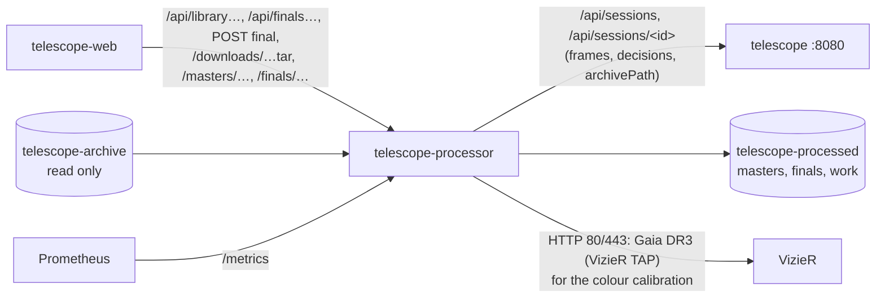

# telescope processor

The telescope's calibration library (D2) and final stacks with [Siril](https://siril.org) (D3), for the [telescope web app](../web/README.md): every bias, dark and flat the ASIAIR saved is indexed from the [telescope service's](../README.md) archive, grouped into sets and turned into masters; a target's accepted lights over chosen nights are calibrated with the best-matching masters (with warnings when something is missing or questionable), registered and stacked into a 32-bit linear FITS (the starting point for processing by hand in PixInsight or Siril) and the app's own processed version (TIFF, JPEG previews). Everything needed for processing by hand (raw lights, calibration sets, masters, the final, a README) downloads as one tar, streamed from the archive.



Cluster-internal only (`http://telescope-processor.telescope.svc:8080`, no Ingress). Python 3.13 (`python:3.13-slim`, stdlib + `numpy`) drives Siril's console mode with scripts; it reads frames and decisions only through the service's API and the archive volume, never writes either, and never talks to the ASIAIR.

## Siril

**Siril 1.4.4** (2026-06-17, the current stable release; 1.5 is the development branch), the official Linux build: the AppImage from free-astro.org, pinned by version and SHA-256 in the `Containerfile` and extracted at build time (`--appimage-extract`, no FUSE in a container). Why this one:

| Option | |
|---|---|
| Official AppImage, extracted (**chosen**) | Built and published by the Siril team for every release; bundles every library down to its own `ld-linux`, so it runs unchanged on the slim Python image; exact version and checksum pinned. 257 MB unpacked. `siril-cli` runs without a display |
| Debian package (`python:3.13-slim` is trixie, 13.7) | Trixie has 1.2.6; testing and sid 1.4.2 (behind the 1.4.4 fixes, and a moving suite) |
| Flatpak | Needs flatpak in the image and a session bus; the Siril team flags it as third party |
| Build from source | Long build with many dependencies, for no gain over the official binary |

Siril runs as `siril-cli -s <script>` (console mode, scripts of Siril commands), one script per step, at nice 19 and `ionice -c 3` (idle I/O) so the live service and the rest of the node always come first. Every script sets `core.mem_mode=1` and `core.mem_amount` (`SIRIL_MEM_GB`) for its stacking blocks and `setcpu` (`SIRIL_THREADS`); Siril 1.4 also reads the container's cgroup memory limit. Offline (`-o`) except the colour calibration step. Siril sets up a Python environment of its own in `HOME` (`/tmp`) at start; it is not used, its log lines are left out.

## Calibration library (D2)

`src/library.py`. Every `<YYYY>/<night>/Bias|Dark|Flat/**.fit` in the archive is indexed by header (read once per file, 2880-byte blocks; `library/index.json`): `IMAGETYP`, `EXPTIME`, `GAIN`, `OFFSET`, `CCD-TEMP`, `SET-TEMP`, `XBINNING`, `ROTATOR`, `INSTRUME`, size, `DATE-OBS`. Rescanned every `LIBRARY_SCAN_MIN` (10).

**Sets**: one night, one type, camera and size, gain, offset, binning, the same exposure (bias, darks) or camera angle (flats), sensor temperatures within ±2 °C of each other. Id like `dark-20261017-300s-g100-o70-b1-m20c`, `flat-20261018-g100-o70-b1-m20c-300deg`.

**Masters**, one per set of at least 3 frames, once no new frame arrived for `SETTLE_MIN` (10), with Siril:

| Type | Siril |
|---|---|
| Bias, dark | `stack … rej w 3 3 -nonorm -32b` (winsorized sigma clipping, no normalisation) |
| Flat | `calibrate … -dark=<dark-flat>` (a dark of the flat's exposure, ≤ 30 s, within 5 °C) or `-bias=<bias>` (same gain and offset, nearest temperature and night), then `stack pp_… rej w 3 3 -norm=mul -32b`. Without either: stacked uncalibrated and warned |

Masters are 32-bit float FITS (`masters/<id>.fits`, 36 MB; Siril's 0…1 for 0…65535 ADU). The id carries a digest of the set's files (and of the flat's bias or dark-flat): more frames or a better bias make a new master, and the old one is removed once the new one exists. `median` and `noise` (pixel-to-pixel, from differences of same-colour neighbours) are in 16-bit ADU. A master that fails is listed under `failed` and not retried until its set changes.

**Matching** a target's accepted lights (`match_group`), per calibration group (night, exposure, gain, offset, binning, temperature ±2 °C, camera angle modulo 180°):

| | Choice | Warning |
|---|---|---|
| Dark | Same gain, offset, binning and exposure, within ±2 °C, nearest in time | — |
| | … within 5 °C | `Dark at -15 °C, lights at -20 °C` |
| | Another exposure (> 30 s, at least half the lights') at the temperature, with a bias: scaled by Siril by the exposure ratio (the shortest longer one first) | `No dark for 180 s, gain 100, -20 °C: using the 300 s dark, scaled` |
| | None: hot and cold pixels found in the lights themselves | `No dark for 300 s, gain 100, -20 °C: hot pixels are taken out of the lights themselves` |
| | Older than 180 days | `Dark is 200 days older than the lights (hot pixels change)` |
| Flat | Same camera angle modulo 180°, nearest in time | — |
| | Only other angles | `Flat taken at camera angle 120°, lights at 93° (dust spots may not match)` |
| | More than `FLAT_MAX_DAYS` (7) from the lights | `Flat is 41 days older than the lights` (or newer) |
| | None | `No flat: vignetting and dust spots stay in the image` |
| Bias | Only when there is no matching dark, or for a scaled one: same gain, offset, binning, nearest temperature and time | `No bias for gain 100, offset 70: the lights keep their offset`; older than 365 days |

Camera angle modulo 180°: the ASIAIR's `ROTATOR` is the sky angle from its plate solve, which turns by 180° in a meridian flip (93° → 273° on 2026-10-17) while the camera does not turn against the optics, so dust and vignetting stay put; a flat at 93° fits lights at 273°. A camera turned by hand (to 120°, say) needs its own flats. Lights before and after a flip form one group.

## Final stacks (D3)

`src/finals.py`, `src/pipeline.py`. Only frames the service marks accepted (manual decisions included) and that are in the archive; frames of another size than the majority are left out (said in the log). Siril, per calibration group (CFA kept):

| Case | Siril |
|---|---|
| Dark of the exposure | `calibrate light -dark=<dark> -cc=dark 3 3 -cfa -flat=<flat> -equalize_cfa` (the dark includes the bias; hot and cold pixels from the dark) |
| Scaled dark | `load <dark>; isub <bias>; save thermal`, then `calibrate light -bias=<bias> -dark=thermal -opt=exp -cc=dark 0 3 -cfa -flat=… -equalize_cfa`: Siril scales the dark it is given, so the bias comes out of it first (with the raw master dark the frames came out ~1000 ADU too dark, checked); `-opt=exp` scales by the exposure ratio exactly (Siril's noise-minimising `-opt` gave 0.86 and 0.63 for a true 0.6 on these nearly dark-current-free frames) |
| No dark | `calibrate light -bias=… -flat=… -equalize_cfa`, then `seqfind_cosme_cfa pp_light 3 3` |

then all groups together: `convert light -debayer` (RGGB from `BAYERPAT`, rows top-down as the ASIAIR writes them: Siril's default), `seqsubsky light 1` (each frame's own gradient, a plane: the sky changes through the night and between nights; without it the night-2 frames' footprint showed as a step in the stack), `register bkg_light -2pass` (global star alignment; the best frame becomes the reference; frames after a meridian flip are a 180° rotation to it, other nights any rotation and shift), `seqapplyreg bkg_light -framing=max` and

```
stack r_bkg_light <rejection> -norm=addscale -maximize -weight=wfwhm -32b
```

| Frames | Rejection |
|---|---|
| < 3 | none |
| 3–6 | percentile clipping 0.2/0.1 |
| 7–29 | winsorized sigma clipping 3/3 |
| 30–49 | linear fit clipping 5/2.5 |
| ≥ 50 | generalized extreme studentized deviate test 0.3/0.05 |

`-maximize` puts every frame on one canvas (other nights and camera angles stick out of the reference's frame) and stacks each pixel from the frames that cover it, so frame edges leave no seams; the canvas's corners outside every frame are zero. Normalisation over whole frames: `-overlap_norm` (pairwise over the overlaps) took 88 s for 21 frames and grows with the square of the count, and the per-frame gradient removal already makes whole frames comparable. The result is **`linear.fits`**: 32-bit float RGB, linear, the reference frame's plate solve (from the ASIAIR) in the header.

**The app's own version**: cut to the largest rectangle with data everywhere (`imaging.crop_to_coverage`), `subsky 1` (a plane: spares nebulae that fill the field), **photometric colour calibration** `pcc -catalog=gaia` (Gaia DR3 from VizieR's TAP service, online; the plate solve comes with the stack, else `platesolve` from the header's RA/Dec, focal length and pixel size), `autostretch -linked -2.8 0.15`, `mirrorx` (rows top-down as in the ASIAIR app and the live stack), `savetif -astro -deflate` (**`processed.tif`**, 16-bit), `savejpg` at 1504 px (**`preview.jpg`**) and 300 px (**`preview-small.jpg`**). When PCC cannot run (VizieR unreachable, no plate solve, too few stars matched): background neutralised per channel and the channels scaled so the median of up to 400 stars' aperture photometry comes out white (`imaging.star_white_balance`, the average star as white reference); the final's `colour` says which was used and why.

**Jobs**: one at a time, oldest first, the same worker also builds masters when no final waits (and before each final). `POST /api/finals` queues one (all nights without `nights`); a newer request for a target replaces its queued (not running) final. **Automatic**: every `AUTO_CHECK_MIN` (10), when no session is active, the newest frame is at least `AUTO_QUIET_H` (1) old and the local time is within `AUTO_HOURS` (8–18), every target whose sessions changed (accepted frames, integration: new frames or decisions by hand) since its last final of all nights gets one over all its nights. A final that was running when the processor stopped is marked failed ("interrupted …": it may have been killed for memory) and is not retried by itself; new frames or a request start a new one. The newest `FINALS_KEEP` (3) done finals per target are kept, failed ones a week.

Intermediate frames are 32-bit unless that needs more than `WORK_MAX_GB` (40) or 90 % of the free space (~2.4 × 109 MB per frame); then 16-bit, said in the log. A job needs about 0.22 GB of work space per frame at 32 bit (debayered and registered frames, each step's input deleted as soon as it is used), freed when it ends.

## Downloads

`GET /downloads/<target>.tar?nights=<n1,n2>&include=rejected` (`src/downloads.py`): an uncompressed tar streamed straight from the archive (nothing copied; the length is computed in advance, so browsers show progress):

```
<target>/README.txt                            every frame with its decision and reason, numbers,
                                               integration, the calibration match with warnings,
                                               the final's method
<target>/lights/<night>/Light_….fit            accepted frames, byte for byte as archived
<target>/rejected/<night>/Light_….fit          rejected and unreadable ones (include=rejected)
<target>/calibration/<set id>/….fit            the raw sets of every master the match uses (and the
                                               flats' bias or dark-flat)
<target>/calibration/masters/<master id>.fits
<target>/final/<target>-linear.fits, -processed.tif, -preview.jpg, -preview-small.jpg   the latest
                                               done final of the target, if any (its nights in the README)
```

## What is stored where

| Where | What | Size |
|---|---|---|
| PVC `telescope-archive` (the service's, mounted **read only**; local-path RWO, same node) | Lights and calibration frames | |
| PVC `telescope-processed` (`/processed`, local-path, 100 Gi, **not backed up**: `EXCLUDE` in [backup](../../../platform/components/backup/README.md); everything here is rebuilt from the archive) | `library/index.json` (headers), `library/library.json` (masters, failures), `masters/<id>.fits`, `finals/<id>/` (`final.json`, `log.txt`, the four outputs), `work/` (the running job; emptied at start) | 36 MB per master; ~0.25–0.35 GB per final (canvas ~4100² for two nights 27° apart); work ~0.22 GB per frame |
| emptyDir `tmp` (`HOME`, 1 Gi) | Siril's settings and Python environment | ~15 MB |

## Measurements (synthetic data)

On the k3s node (i5-7600K, 4 cores), 3008×3008 frames shaped like the ASI533MC's (`tests/synthetic.py`), Siril at nice 19 with the machine otherwise lightly loaded:

| Job | Time | Memory |
|---|---|---|
| Master: 20 bias / 12 darks / 12 flats | 2–4 s each | Siril 0.3–0.5 GB |
| Final, 21 frames, 2 nights (11 × 300 s with a flip, 10 × 180 s at another camera angle) | 59 s: calibrate 2 s, debayer + gradients + register 33 s, stack 18 s, crop/background/PCC/stretch 7 s | Siril peak 1.8 GB (`SIRIL_MEM_GB=2`), Python 0.7 GB (cutting the 4098×4082 canvas, not at the same time) |
| Final, 98 frames (the same frames repeated), `SIRIL_MEM_GB=3` | 316 s: calibrate 7 s, register 185 s, stack 117 s (GESDT), process 7 s | Siril peak 3.2 GB, Python 0.7 GB; work area ~21 GB |

So about **5–6 minutes per 100 real frames** of 3008², growing linearly (registration and stacking dominate; real frames have about as many stars), and memory bounded by `SIRIL_MEM_GB` rather than the frame count. Limit 5 Gi: Siril's 3 GB cap plus Python and headroom; the frames written and read also fill the page cache up to the limit (`memory.peak` reached the limit in every run), which the kernel reclaims first.

## API

JSON, times in unix seconds.

| Path | |
|---|---|
| `GET /api/library` | `{ sets: [{ id, type, night, count, exposureS, gain, offset, sensorTempC (median), setTempC, binning, rotatorDeg (flats), camera, firstAt, lastAt }], masters: [{ id, type, builtAt, sets, frames, exposureS, gain, offset, tempC, rotatorDeg, night, median, noise, fitsUrl, binning, camera, calibratedWith ({bias} or {darkFlat}, flats), warnings }], pending: [master id], failed: [{ set, id, error, at }], updatedAt }` |
| `GET /api/library/match?target=<ASIAIR target>` | `{ bias, dark, flat, darkFlat, warnings, nights: [{ night, frames, exposureS, gain, offset, tempC, rotatorDeg, bias, dark, flat, darkFlat, darkScaled, lightsBias, warnings }] }`: master ids for the largest group at the top, one `nights` entry per calibration group (usually one per night), warnings of all groups (prefixed with the night when there are several). `bias` is the bias the lights use, else the one the flat was calibrated with; `lightsBias` only the former |
| `GET /api/finals` | `[{ id, target, nights, sessions, frames, integrationS, status (queued, running, done, failed), progress ("registering 34/80"), createdAt, startedAt, finishedAt, error, automatic, calibration (the match as above), outputs { linearFits, processedTiff, previewJpg, previewSmallJpg } (URLs or null), stacking { method, frames, registered, intermediate, timingsS }, colour, siril, durationS, peakMemoryBytes }]`, newest first |
| `GET /api/finals/<id>` | The same and `log` (the last 200 lines: the groups and their masters and warnings, Siril's messages, timings) |
| `POST /api/finals` | `{ "target": "<ASIAIR target>", "nights"?: ["YYYY-MM-DD", …] }` → 202 with the queued final; 404 for a target or night without sessions, 502 when the service does not answer |
| `GET /downloads/<target>.tar?nights=&include=rejected` | See Downloads; 404 without archived frames |
| `GET /masters/<id>.fits`, `/finals/<id>/<file>` | `linear.fits`, `processed.tif`, `preview.jpg`, `preview-small.jpg`, `log.txt`; cacheable forever (ids change with the content), as attachments with readable names |
| `GET /metrics` | `telescope_processor_queue_length`, `telescope_processor_job_running`, `telescope_processor_finals{status}`, `telescope_processor_masters{type}`, `telescope_processor_calibration_sets{type}`, `telescope_processor_masters_pending`, `telescope_processor_last_job_duration_seconds{kind}` (`final`, `master`), `telescope_processor_last_job_success{kind}`, `telescope_processor_last_job_timestamp_seconds{kind}`, `telescope_processor_disk_free_bytes` |

## Network

`deploy/networkpolicy.yaml`: in from the web app (the only caller of the POST) and Prometheus on 8080; out to the telescope service (8080), DNS, and the internet on 80 and 443, not the LAN (Siril 1.4.4 asks `tapvizier.u-strasbg.fr` for Gaia DR3 over plain HTTP). The service's policy admits this pod.

## Operations

Logs: `kubectl -n telescope logs deploy/telescope-processor` (library scans, each master with its numbers, finals queued, done or failed with the reason); a final's whole Siril log is `/processed/finals/<id>/log.txt` (also `GET /finals/<id>/log.txt`).

**Build a final by hand**: the web app's Finals page, or `kubectl -n telescope port-forward deploy/telescope-processor 8081:8080 &` and `curl -X POST localhost:8081/api/finals -d '{"target": "C 9"}'`.

**Rebuild masters** (after changing their Siril commands): raise `PIPELINE` in `library.py`; every master gets a new id and is rebuilt at the next scan. To force one, delete its entry from `library/library.json` (or the whole file) and restart.

<a id="restore"></a>**Restore**: nothing to restore; `telescope-processed` is not backed up. On an empty volume the masters are rebuilt from the archive within minutes and finals come back with the next automatic run (or by hand). Lost: older finals, which were rebuildable anyway as long as the archive has the frames.

## Tests

From `apps/telescope/processor` (numpy needed; in the image: `podman run --rm -v $PWD:/p:Z -w /p localhost/telescope-processor:<tag> python -m unittest discover -s tests`):

- `tests/test_library.py`: set grouping, every match rule and warning; `tests/test_downloads.py`: the streamed tar (length as announced, pax headers for long names, contents byte for byte) and the crop to the covered area.
- `tests/e2e.sh`: end to end with podman, nothing deployed: builds the image, writes a synthetic archive once (`tests/synthetic.py`, ~1.6 GB, ~80 s), runs a fake telescope service (`tests/fake_service.py`, sessions with `archivePath` and decisions) and the processor in one pod (archive read only, read-only root, memory limit), and `tests/check.py`: library and masters (bias level 1120 ADU = offset 70 × 16), the match (the deliberately missing 180 s dark, the 41-day-old flat), the automatic final, a superseded and a manual final, the stack's plate solve against Gaia, dust donuts (each frame's mapped into the stack: ring/outside 0.998–1.003 against 0.88–0.93 in a raw frame) and vignetting (sky lost from 650 to 1300 px off axis: −12 % in a raw frame, −0.02 % in the stack) gone, round stars (elongation 0.035), a satellite trail rejected, and the tar (87 members, 1.7 GB, a light byte for byte). Needs internet for the photometric colour calibration.

**The synthetic archive**: the real layout and headers (ASIAIR Plus, ASI533MC Pro, RGGB, 14-bit ×4, gain 100, offset 70, -20 °C, 670 mm, `ROTATOR`, TAN-SIP plate solve), the real sky (Gaia DR3 stars to G 16.5 around the Cave Nebula, C 9, with colours from BP−RP) plus a synthetic emission nebula, light pollution changing through the night, vignetting, three dust donuts on the optics (they move against the sensor when the camera is turned by hand), pixel response, hot pixels and dark current, column pattern, read and shot noise. Calibration: 20 bias and 2 × 12 flats (93°, 273°) on 2026-09-06, 12 darks of 300 s on 2026-10-17; lights of C 9: 2026-10-17, 12 × 300 s at 93° and, after a meridian flip, 273° (one through clouds, rejected by the service; one with a satellite), 2026-10-18, 10 × 180 s with the camera turned to 300° and that night's 12 flats.

**Not tested on real data** (the archive was still empty when this was written: the ASIAIR has not been online since the service's first release): real ASIAIR calibration frames and their headers (whether flats carry `ROTATOR`, how darks and dark-flats are named and grouped), real lights' star fields, gradients and satellite trails, PCC on a real stack, the timings on real frames, the NetworkPolicy and the PVC in the cluster (nothing deployed).

## Deploy

`./apps/telescope/processor/deploy.sh` (image build, import into k3s, apply; commit the new tag it writes). Apply `apps/telescope` first (the namespace, the archive PVC, and the service's policy admitting this pod). The PVC `telescope-processed` is created by the same apply.
