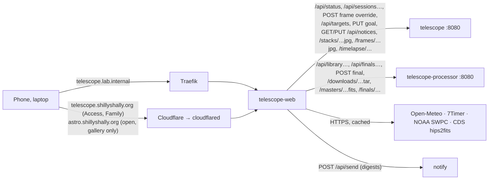

# telescope web

The cabin telescope's own web app at **http://telescope.lab.internal** (home network and VPN, no login, like homelab.lab.internal) and **https://telescope.shillyshally.org** (anywhere, behind Cloudflare Access with the family login, like the dashboard): the live session with its stack, tonight's conditions, a target planner, integration goals, the observing log, the calibration library, final stacks and the gallery. Published pictures can also be shown to anyone without a login at **https://astro.shillyshally.org** ([share link](#public-share-link)). Made for a phone at the telescope (red night mode) and a laptop. It shows what [apps/telescope](../README.md) (the Python service in the same namespace) archives, measures and stacks, and what its processor ([apps/telescope/processor](../processor/)) calibrates and stacks with Siril; nothing here talks to the ASIAIR. SvelteKit 2, Svelte 5, adapter-node, the same look and pinned versions as [apps/dashboard](../../dashboard/) and [apps/homelab](../../homelab/).



## Pages

| Page | |
|---|---|
| **Live** `/` | The current session, or the most recent one (*Last session*). **Stack** large with the latest frame over it (Stack / Latest buttons and a slider between them; tap for full screen). **Head**: ASIAIR online or offline (last contact, error), target, *Target n of m*, the exposure counting up or what the ASIAIR is busy with (meridian flip, auto focus …), frames `done / planned` with a bar, frames in and out of the stack, integration, and the estimated finish of the target and the whole plan (remaining frames × the session's average frame cadence so far, flips and refocusing included); under it (R6) the first calibration reminder that is a warning, shortened (*Calibration: Take flats at 93° before turning the camera (+1 more)*, linking to Library), from `/api/advice` every 10 min. **Timeline**: the night from sunset to sunrise with darkness shaded, the target's altitude (from the FITS header's RA/Dec and the site) with the moon, the meridian and the 20° line (*sets below 20° at …*), the events (plan, GoTo, centering, auto focus, meridian flip, guiding lost) and every frame (green in the stack, amber rejected), *Now* and *Finish*; the events also as a list. **Guiding** over the whole session: RA/Dec error with dithers, settling (shaded) and lost star, RMS per 5 min, each frame's elongation and guiding RMS, the wind and gusts at the site from Open-Meteo on the same time axis, and a scatter with the 1″ and RMS rings; the guider's state and star SNR now. **Frames**: every processed frame newest first with thumbnail, stars, HFR, FWHM, elongation, background, guiding RMS, *In stack* / *Rejected* with the reason, and *Reject* or *Accept* (manual override, *by hand*) and *Auto* (back to the automatic decision); a thumbnail opens the frame large (← → steps through). **Telemetry**: sensor against the set point, cooler power, ASIAIR board temperature, Wi-Fi (now and over the session), under-voltage and over-temperature flags, free space on the ASIAIR's storage. **Frame quality**: stars, HFR and background per frame, rejected ones marked |
| **Conditions** `/conditions` | Tonight at the site: a verdict line (longest clear run in darkness with cloud ≤ 30 %, how many models see clear hours, dew within 2°, gusts over 8 m/s, the moon, 7Timer seeing), astronomical and nautical darkness, sunset and sunrise, moon phase, illumination, rise and set. **Cloud by height**: low, mid and high cloud hour by hour from sunset to sunrise from ECMWF, ICON, GFS and MET Nordic side by side, with darkness and moon rows. **Seeing and transparency** (7Timer ASTRO, 3-hourly). **Wind and dew**: temperature against dew point, wind and gusts. **Aurora**: OVATION probability at the site and the most within ~1000 km to the north, Kp of the latest 3 h, Kp per 3 h for the past two days and the 3-day forecast, and a plain-language line (at ~61° N low in the north from Kp 3, overhead from Kp 5; ≥ 10 % also brightens north-facing frames). Each source fails on its own (*unavailable* with the reason). **Tonight's pick** (R6): the [digest](#notifications) as it would go out |
| **Planner** `/planner` | C1: which objects of the bundled catalog (below) are well placed on a night at the site, tonight or a chosen date: hours above a minimum altitude (30° by default, adjustable) during astronomical darkness (nautical on the light nights that have none), the highest altitude, transit, the moon's illumination and how close it comes while the object is usable, and the size against the camera's 0.96° × 0.96° field (670 mm, ASI533: *fits*, *fills the field*, *small in the field*, or an *n×m mosaic* with 15 % overlap, drawn as a framing hint). Best first (hours, a little for altitude, less with a bright moon nearby, weighted by size and kind: nebulae and galaxies of 15′ and more over small clusters), or by hours, altitude, transit, size, brightness; search by designation, alias (`M31`, `Sh2-155`, `Sh2-129`, `C 20`), common name, type or constellation; filters by kind, size and magnitude, *Wishlist*, *Not visible too*. Tap a row for its altitude curve with the moon, darkness and the longest window above the limit shaded, the framing with mosaic panels, other designations and the integration so far. The star puts it on the wishlist (the service's target store). `?q=<id>` opens one |
| **Goals** `/goals` | C5: accepted integration per target across every session against a goal in hours (editable, kept in the service's target store): progress bar, *needs N h more*, nights imaged with links to their reports, whether it is well placed tonight (the planner's numbers: at least 2 h above 30° in darkness, no bright moon within 40°), its latest final stack, links to the planner and finals. A session counts for the catalog object its ASIAIR target name names (`NGC 7000`, `M31`, `C 9`, `Sh2-155`, a common name), else for the nearest one within 0.3° of its plate-solved centre; anything else stays under its own target name (so targets outside the catalog still get goals). Filters: *With a goal* (unfinished first), *Wishlist*, *All targets* |
| **Sessions** `/sessions` | The observing log by month: stack thumbnail, target, night, mode, time, integration, frames in and out; *Imaging* on the running one |
| **Session report** `/sessions/<id>` | One night and target: stack (with the last frame), the numbers (frames, in stack, rejected, integration, exposure and gain, time, median HFR and stars, RA/Dec, camera, what is archived at home) and every rejection with its reason, the timeline, guiding with wind, frame quality, telemetry, and the frame list with the same override buttons; **Target**: the goal and integration across nights, the latest final stack with *Build final stack* and *Download for processing*. Refreshes every 30 s while the session runs. Sessions from before the release have no guiding, telemetry or live timeline events (the service could not record them). **Morning report** (R6): the night's [digest](#notifications) |
| **Framing** (B3): planner, Goals, session report | The camera's 0.96° × 0.96° field over a **DSS2 colour** survey cutout (`/survey`, below), north up, east left, with the object's catalog outline (OpenNGC axes and position angle), a scale bar and N/E arrows (drawn from the sky at the corner). The cutout is the smallest of 2, 2.5, 3, 4, 5, 6, 8, 10, 12, 15° that holds twice the field, 1.4× the object and the mosaic with room (1024 px square). The field is drawn at the **ASIAIR's camera angle** (FITS `ROTATOR`): the image's top edge points that many degrees west of north (measured on the ASIAIR's plate solves: `ROTATOR` 30 has the top 29.7° west of north, 93 and 273 have it at 93° and 273°; the rectangle at the frames' `ROTATOR` lands within 1–4 survey pixels, 7–26″, of the plate-solved corners on C 9, IC 1795, M 31 and NGC 1499); a small triangle marks the top edge. **Planner** (the framing hint in an object's details, *Survey view*) and **Goals** (the hint and *Framing*): a dialog with a camera angle slider 0–179° (with the angle after a meridian flip, +180°; it starts with the top edge along the object's major axis, 0° without a position angle) and the mosaic's panels (1–6 each way, 15 % overlap, starting at the planner's n×m along the major axis), centre and size. **Session report**, card *Framing*: the stack's plate-solved footprint (solid, 8 points per edge through the solve) against the planned field (dashed: the ASIAIR's target RA/Dec at the frames' most frequent `ROTATOR`), the solved camera angle and how far the solve's centre is from the target position (IC 1795 on 2026-10-19: 92.6°, 16′). The image is fetched only when a dialog opens or the card is shown (`loading="lazy"`), never for the planner's list; red mode filters it like every image |
| **Timelapse** (B4): session report | The session as a timelapse, built by the service on request (see the service's [Timelapse](../README.md#timelapse)): **Frames** (every analysed frame on the session's grid with one fixed stretch, so clouds, moon and dawn show as the sky brightening; rejected frames with a *Rejected* badge, their reason under the picture and a red tick on the scrubber; frames that did not align say how they were placed) or **Stack** (the running mean growing frame by frame, frames and integration so far). Switching keeps the moment of the night. Play/pause (or tap the picture), 2/4/8/15 steps per second, scrubber with the frame's time and number, ←/→/Home/End and space on the picture or the scrubber, the animated **WebP** for download. Pictures are preloaded four at a time from the current step (a counter shows how many are in); playing waits for the next one. The card asks for the timelapse only once it is on screen (a first build takes the service ~35–80 s), shows the build's progress (every 2 s; what is built so far already plays), and asks again whenever the report shows new frames, decisions or a new stack; while a session runs the service adds new frames at most every 5 min (the card says when). Red mode filters the pictures like every image |
| Session report: **Tilt and backfocus** card, frame **Inspect**, trails (A6, A7) | The card: the service's tilt summary from the median of the session's 5 best accepted frames (asked again when the number of accepted frames changes; the first answer takes ~4 s): the verdict (green, amber, red by level), the 3×3 grid of the sensor as a FWHM heat map (stronger = larger stars than the best cell, full strength at +25 %) with the FWHM in camera px and a tick along the stars' dominant elongation in each cell, corner-to-corner, left/right, top/bottom and corners-vs-centre in %, and the frames used, each opening the inspector. **Inspect** in the frame viewer (and the card's frames) opens it full screen: the same grid with FWHM in px and ″, HFR, elongation and stars measured per cell, the numbers, and the nine 256-px crops of the corners, edge middles and centre (`/frames/<id>-inspect.jpg`; tap for one image pixel per screen pixel). **Trails**: the frame list shows a *trail* chip (*n trails*), the count in its header and a *Trails* filter; the frame viewer draws two lines beside each trail (SVG over the picture, `--warn`, so red in night mode; *Trails* toggles them) |
| **Library** `/library` | D2: the processor's calibration library: masters (kind, exposure, gain, offset, temperature, camera angle, night and age, frames, median and noise, FITS download) and the raw sets by kind; ages past 7 days (flats), 180 (darks) and 365 (bias) are marked, the processor's own limits for warning against the lights. **To do** (R6): the calibration reminders ([Advice](#advice-r6)), warnings in amber, each with its kind. **Calibration for a target**: the masters the processor would use for its lights and every warning (no matching dark, flat older than the lights, flat at another camera angle …), per night on request |
| **Finals** `/finals` | D3: final stacks with Siril on the processor. Choose a target (`?target=` preselects one) and its nights, then **Build final stack** (one job at a time; a newer request for the same target replaces a queued one) or **Download for processing** (optionally *with rejected frames*): an uncompressed tar streamed from the processor with the raw lights by night exactly as archived, the calibration sets used and their masters, the latest final and a README of every frame, rejection reason, the integration and the calibration match. Below: running and queued finals with progress (refreshed every 5 s), finished and failed ones with the preview (tap for full screen, *1:1* for the full-size preview), the calibration used and its warnings, downloads (linear FITS, processed TIFF, JPEG) and the log's tail |
| **Gallery** `/gallery`, `/gallery/<target>` | D4: per target (grouped like the goals: catalog object, else the ASIAIR target name) the app's finished final stacks and the owner's **own processed images** (PixInsight/Siril exports uploaded here), newest first; on a target's page the newest large, then every version (finals numbered v1, v2 … as the integration grew, and own uploads), the target's accepted integration, nights (with links to the reports), equipment (camera, focal length, filter: the service's `filter` per session) and exposures. Per picture: **Publish/Unpublish**, title and note, the original file of an upload, **Delete** (uploads, with confirmation). **Upload own processing**: JPEG, PNG, TIFF (8/16 bit) or FITS up to 300 MB, a target from the sessions or the catalog (or any name), title, note, date of the data, with progress; a catalog target's position goes along (`raHint`, `decHint`) as the start of the service's plate solve (D8: ASTAP, after the upload, for anything without its own solution), which makes the picture annotated in the viewer. Published pictures are also in the **public gallery** (below) |
| **Stats** `/stats` (Overview) | D6: **Overview**: integration, rejected time, nights imaged, sessions, frames, acceptance, targets, clear nights imaged. **Hours per month**: accepted and rejected exposure stacked, every month from the first session on. **Clear nights** per month from ERA5 at the site (below): a night is clear with at least `CLEAR_NIGHT_HOURS` (3) hours of cloud ≤ `CLEAR_PCT` (30 %) during its darkness (astronomical, else nautical; none mid-May to July), or half its dark hours when the darkness is shorter (2–3 h of astronomical darkness in April and August); stacked as *clear, imaged*, *clear, missed* and *imaged, not clear*; nights ERA5 does not reach yet (about six days) are left out. 2026-10-19: 222 dark nights known since December 2025, 52 clear, 3 of them imaged, 49 missed; 2 nights imaged that ERA5 calls not clear (2026-02-13: 0 clear hours in ERA5, ~4 h of mostly clear frames; ERA5 is a 28 km reanalysis, not an observation). **By season** (winter Dec–Feb … autumn Sep–Nov) and **by year**: accepted and rejected hours, nights, sessions, frames, acceptance. **Rejections** by first reason (the service's `rejectReasons`). **Guiding over time**: total RMS per session from the live history (since 2026-10-19) and per PHD2 guide log (`/api/guidelogs`, D7; the card says so when the service has none). **Star size over time**: median HFR and FWHM (px) per session. **Targets**: integration, nights, frames, acceptance per target (grouped like the goals), linked to Goals and the latest report. 13 sessions: 26.3 h accepted, 4.3 h rejected, 7 nights, 489 frames, 87 % accepted; rejections 71 % few stars, 18 % HFR, 10 % elongation, 2 % guiding |
| **Forecasts** `/stats/forecasts` | C4: which model has been right at the cabin. For every hour of every session, the cloud **seen in the frames** against each model's forecast at the site (ECMWF, ICON, GFS, MET Nordic, the Conditions page's models), as the run current 24 h before the hour (**Day ahead**, Open-Meteo's `cloud_cover_previous_day1`) or the latest run before it (**Latest run**, `cloud_cover`, with low/mid/high in the hour's tooltip). **Leaderboard** over all judged hours: hit rate of the clear/cloudy call at `CLEAR_PCT`, mean absolute error and bias in percentage points (+ too cloudy), the other lead in grey; per session a chart (bars seen, a line per model, the clear line dashed) and its scores. **What the frames saw** (`src/lib/forecasts.ts`): a frame's stars against the session's clear reference (90th percentile of its judged frames): ≥ 80 % clear, < 50 % cloudy, linear in between; cloudy too when the service rejected it for few stars, or its background is 1.5× the session median with stars under 80 %; an hour (frames within ±30 min of the mark) is the exposure-weighted mean and needs 20 min of judged frames. Not judged: the sun above −12° (twilight fades stars: every session's end at dawn), the target under 20°, frames rejected first for HFR, trailing or guiding, Live stacking sessions, sessions with fewer than 10 judged frames. 2026-10-19: 32 hours in 9 sessions (14 cloudy); day ahead ICON 66 % (error 29, bias −2), ECMWF 50 % (33, −25), MET Nordic 50 % (34, −10), GFS 38 % (52, +11); latest run ICON 62 %, MET Nordic 53 %, ECMWF 47 %, GFS 44 %. Limits, also on the page: only imaged hours have a truth (a night skipped for a cloudy forecast never counts); the truth is relative (a session hazy throughout looks clear); dew, a tree or the cabin roof dim stars like cloud (2026-10-17, C 9: stars faded steadily to 22 % over four hours with an unchanged background and HFR while ECMWF and MET Nordic said 0 %; thin high cloud or dew, the frames cannot tell); few hours, so a single night moves the rates by several points |
| **Focus** `/stats/focus` | A5, from the service's `/api/focus` (every auto focus run in the archived Autorun logs). **Focus advice** (R6, [Advice](#advice-r6)): the summary, the tolerance in steps (quartiles) and °C, the V-curves fitted, the coefficient, the ASIAIR's triggers as its logs show them, and the check against the frames as a chart (HFR drop at each refocus against the drop its V-curve predicts, dashed where they agree) and in words. **Focus position against temperature**: every successful run, coloured by night, with the fitted steps per °C ± its standard error, the runs and nights it rests on, and a dashed line per night. One slope with a zero point per night (`fitFocus`, `src/lib/focus.ts`): the focus moved from ≈5000 steps (February, April 2026) to ≈6100 (from September), so a single line through all runs would fit the nights' offsets. It says so when there are fewer than `MIN_RUNS` (5) runs on nights with two or more, a night spans less than `MIN_RANGE_C` (3 °C; the reading is whole degrees), or the slope is within two standard errors of zero. 2026-10-19: **+20.5 ± 1.4 steps/°C** from 27 runs on 4 nights (widest span 10 °C); 2026-10-20: +20.6 ± 1.3 from 33 runs on 5 nights. **V-curves**: a night's runs as buttons, the chosen one's V-curve (star size against focuser position) with the focus search and final approach as dots, the chosen focus marked and the fitted hyperbola dashed (best, minimum, ± steps for 5 %), the night's other curves faint. **HFR drift between runs**: per interval between two successful runs with at least 4 frames, the median HFR of its last 3 frames minus its first 3 against the temperature change, as a chart and a table (frames from the session reports of nights with two runs or more), with Open-Meteo's air temperature change and the growth the focuser's change predicts |
| **Mount** `/stats/mount` | D7, from the service's `/api/guidelogs` ([Guide logs](../README.md#guide-logs-the-mount-d7)). Every PHD2 guide log by night with sections, guiding time and RMS RA/Dec/total (`?log=` picks one, else the newest); **RMS over time** per section of 10 min or more across nights. For the chosen log: RA/Dec error over the night with the sections marked, the sections table (start, length, pier side, Dec, hour angle, steps, lost/outliers, excluded, RMS, peaks, Dec drift, PE peak to peak); **Periodic error**: peak to peak on the sky and at the RA axis, the reconstructed RA curve (every step and its 30 s mean), the periodogram 20–1200 s with the three strongest periods marked and the top five listed (amplitude on the sky and at the axis), the method and the 40 min minimum; **Dec drift**: the polar alignment lower bound per section and its formula; **Dec backlash (estimate)**: the medians after a reversal and after a pulse the same way and their difference, the method; **Corrections**: share of steps with a pulse, mean and longest pulse, the directions' balance |
| **Focus card** (A5): session report | The frames' HFR (accepted; rejected grey) and focuser position (`FOCUSPOS`) over the session with the auto focus runs marked; the run labels under the charts (their result position) open the run's V-curve with its reason, temperature and result. **Temperature**: each run's focuser reading, the cabin's outdoor RuuviTag (*Terassi*, Prometheus) and Open-Meteo's hourly 2 m temperature at the site; Ruuvi data exists only from 2026-10-17 (and the Terassi tag has not been heard since: flat battery on 2026-10-17, `docs/shopping-list.md`), so the card says when there are no Ruuvi readings. While a run's Autorun log is not on the share yet the runs come from the live history (times only, dashed marks). A link to the night's guide log on the Mount page when there is one |
| **Exposure card**, sky brightness (R6): session report, Goals, Stats | From the service's [sky brightness](../README.md#sky-brightness-and-exposure-r6) (each plate-solved frame's zero point against the Gaia BP stars of ASTAP's D05, the sky in mag/arcsec², read noise from archived bias frames). **Session report**: the *Exposure* card (median sky and its range over the accepted frames, zero point, sky e-/s per pixel, read noise, read noise's share of the variance at the sub used, the best sub with the service's sentence; a warning when the zero point fell more than `ZERO_POINT_DROP` (0.5 mag) below the session's best: dew, haze or thin cloud, and those frames' sky reads brighter than it was), and two more rows in *Frame quality* (sky mag/arcsec², zero point). **Goals**: per target with measured sessions, the integration for SNR 10 per camera pixel (`SNR_TARGET`) at 23 mag/arcsec² (`FAINT_SB`, faint nebulosity) and, for galaxies, planetaries and nebulae with a catalog magnitude and size, at the catalog's mean surface brightness (magnitude over the OpenNGC ellipse): the whole integration at the newest measured session's sky and sub, the SNR of what was gathered (each session's own sky: a moonlit night counts for less) and what is still missing (`src/lib/exposure.ts`: O = B·10^(−0.4(μ − m)) e-/s per pixel from the sky's m and B, T = SNR²·(O + B + RN²/t)/O²; dark current left out, 0.0004 e-/s measured). Sessions without a measured sky are named and not counted; never-imaged targets get none. 2026-10-20 (from the archive's numbers): C 9 has 5.0 h, SNR 2.3 at 23 mag/arcsec², ~91 h in all at its (dew-brightened) 20.0 sky; M 51 has 0.8 h, ~7.5 h in all; IC 2574 has 5 h, SNR 10.5: reached. **Stats**: *Sky brightness*: each session's median over time (dots by the moon up or down at the session's middle, illumination in the tooltip and a table with the zero point) |

**Red night mode** (A10): *Off / Red / Auto* in the header, remembered per device (`localStorage`). Red turns everything deep red on black, images included (an SVG colour matrix puts their brightness into the red channel); *Auto* is red while the sun is below the horizon at the site. The page applies the last state before its first paint, so it never flashes white at the telescope.

Browser refresh on Live: status every 10 s, the session list every minute, the session's report every 30 s and whenever the status shows a new frame or stack, wind hourly. Conditions: every 10 min. Finals (also on the session report and Goals): every 5 s while one is queued or running.

**Viewer** (B1, B2): tapping the stack (Live, session reports), a final or a gallery picture opens one full-screen viewer, [OpenSeadragon](https://openseadragon.github.io/) **6.1.1** (BSD-3-Clause), on the full-resolution 8-bit picture (`/api/images/<kind>/<id>`: `url`, plate solve, histogram): wheel, pinch, double tap, *Fit* and *1:1* (one image pixel per screen pixel, up to 8× beyond, pixels drawn sharp). **Star**: a tap or click measures the brightest star within ~12 px on the linear data (refined centroid, FWHM in px and ″, HFR, elongation and angle, SNR, peak and background, saturation, the radial profile with a Gaussian of the measured FWHM); an upload without linear data is measured on its pixels and marked so. **Histogram**: per channel, log or linear, with each channel's median and noise. **Objects / Stars / Grid** (with a plate solve): the catalog's objects as outlines from their size and position angle (sampled on the sky and projected, so rotation, mirroring and distortion come out right), the named and Bayer/Flamsteed stars, an RA/Dec grid; TAN with SIP evaluated in the browser (`src/lib/wcs.ts`; the WCS describes the FITS data array, row 1 shown at the top, display pixel = FITS pixel − 1), labels at a fixed size that do not overlap at any zoom. Red mode and touch work as on the pages. The latest frame (slider past the middle) opens without tools.

The navigation's nine pages sit in one row on a laptop and in three rows of three on a phone. *Stats* has four pages of its own (Overview, Forecasts, Focus, Mount) in a second row of buttons.

## Public share link

The whole app is at `telescope.shillyshally.org` behind Cloudflare Access (application *Telescope*, policy *Family*), with no restriction of its own, exactly as at home. The **share link** host `astro.shillyshally.org` (`PUBLIC_HOST`) is open to anyone (Access application *Telescope share link* with the bypass policy *Everyone: telescope share link*): a request for that host (its `Host` or `X-Forwarded-Host`) is answered by `hooks.server.ts` only for `GET`/`HEAD` of `/gallery`, `/gallery/<target>` (and their `__data.json`), the built assets (`/_app/…`, `/favicon.svg`), and for **published** finals and uploads their details and star measurement (`/api/images/final|upload/<id>[/star]`) and pictures (`/finals/<id>/*.jpg|png`, `/uploads/<id>[-small].jpg`); its root `/` redirects to `/gallery` (302: temporary, so browsers do not keep it); everything else is **404**: Live, sessions, every other page and `/api/…`, unpublished items, FITS/TIFF/log and upload originals, every write. Published ids are asked from the processor and the service at most every 10 s (and again right after a change made here); when either does not answer, nothing of it counts as published. The share pages show the Gallery tab only, no site position, no upload, publish or edit controls, no links to session reports. The tunnel routes only those paths (and `/`) for the share host too (`platform/components/cloudflared/config.yaml`), but the app does not rely on it. A target without published pictures answers 404 (its `__data.json` carries the 404 inside SvelteKit's 200 data answer). A target's gallery page in the full app shows its share link (`https://astro.shillyshally.org/gallery/<target>`) once something is published.

Uploads through `telescope.shillyshally.org` are limited by Cloudflare to 100 MB per request (Free plan); larger TIFFs upload at home (`telescope.lab.internal`).

## Sources and caching

Server-side only (the browser talks to this app alone), each with a timeout, cached in memory per site; a failed refresh keeps serving the last good answer for a while, then the card says *unavailable*. A failure is retried after a minute at the earliest.

| Source | Endpoint | Fresh for | Last good kept |
|---|---|---|---|
| Open-Meteo, best match | `api.open-meteo.com/v1/forecast` hourly cloud, temperature, dew point, humidity, wind and gusts (m/s), yesterday + 3 days | 30 min | 3 h |
| Open-Meteo, models | same with `models=ecmwf_ifs025,icon_seamless,gfs_seamless,metno_seamless`, cloud total/low/mid/high | 30 min | 3 h |
| Open-Meteo, session wind | `start_date`/`end_date` over the session; older than 80 days from `historical-forecast-api.open-meteo.com` | 30 min (today), 24 h (past days) | 7 d |
| 7Timer ASTRO | `www.7timer.info/bin/astro.php?…&output=json` | 1 h | 12 h |
| NOAA SWPC Kp | `services.swpc.noaa.gov/products/noaa-planetary-k-index-forecast.json` (observed, estimated, predicted; *now* = the newest observed or estimated 3 h value) | 15 min | 6 h |
| NOAA SWPC OVATION | `services.swpc.noaa.gov/json/ovation_aurora_latest.json` (~1 MB, only the site's longitude column is kept) | 10 min | 2 h |
| CDS hips2fits | `alasky.cds.unistra.fr/hips-image-services/hips2fits` HiPS `CDS/P/DSS2/color`, TAN, ICRS, JPEG (1024 px: 50–140 kB, 3–4 s, measured; also from the pod) | for good (memory, least recently used out past 24 MB, ~240 cutouts of ~100 kB; the browser keeps it a year) | – (a failure answers 502, retried after a minute) |
| Open-Meteo, ERA5 (D6) | `archive-api.open-meteo.com/v1/archive` `models=era5` hourly `cloud_cover` from the first session's month to today, one request (~9000 hours). `era5` on purpose: the default best match fills the last days with the IFS forecast. ERA5 runs about six days behind (2026-10-19: last value 2026-10-13 23:00 UTC) | 24 h | 7 d |
| Open-Meteo, forecast history (C4) | `previous-runs-api.open-meteo.com/v1/forecast` per imaged night (UTC days of the night and the next), the four models' `cloud_cover`, `cloud_cover_previous_day1` (the API has no low/mid/high for earlier runs) and `cloud_cover_low/mid/high`; `cloud_cover` there equals the historical forecast API's (checked for 2026-10-17). One night after another (all nine at once: two answered HTTP 429). Live-only nights are not fetched | 30 days once the night is over, else 30 min | 7 d |
| Telescope service, session frames (C4) | `/api/sessions/<id>` for every non-Live session, 4 at a time; only time, exposure, stars, background and reason are kept, per session until its summary (frame counts, last frame) changes | per session version | – |
| Prometheus, RuuviTag (A5) | `PROMETHEUS_URL` `/api/v1/query_range` of `ruuvi_temperature_celsius{name="Terassi"}` over the session's window, ~300 points (step ≥ 60 s, the gateway's interval); cluster-internal | 2 min while the window reaches now, else 24 h | 30 min, 7 d |
| Open-Meteo, session temperature (A5) | as the session wind, `hourly=temperature_2m`; also over each night with two auto focus runs or more for the advice (R6) | 30 min (today), 24 h (past days) | 7 d |

Darkness, moon and the target's altitude are computed (`suncalc`, `src/lib/sky.ts`; the planner in `src/lib/planner.ts`, goals in `src/lib/goals.ts`), the same approach as the dashboard's Tonight card. Thresholds (`CLEAR_PCT`, `DEW_MARGIN_C`, `GUSTY_MS`, `AURORA_PCT`, `LOW_ALTITUDE`) are named constants in `src/lib/server/conditions.ts` and `src/lib/sky.ts`; the statistics' in `src/lib/stats.ts` (`CLEAR_NIGHT_HOURS`) and `src/lib/forecasts.ts` (`DARK_SUN_DEG`, `REFERENCE_PERCENTILE`, `CLEAR_RATIO`, `CLOUDY_RATIO`, `BACKGROUND_RATIO`, `MIN_SESSION_FRAMES`, `MIN_HOUR_EXPOSURE_S`). The Stats pages load on the server: Forecasts ~0.5 s with nothing cached (measured in dev: 9 nights, 9 session details), then ~0.1 s; Overview ~0.2 s (clear nights for ~320 nights computed per load).

## Advice (R6)

`src/lib/server/advice.ts` `adviceReport()` → `{ focus: FocusAdvice | null, calibration: CalibrationItem[], generatedAt }` (`src/lib/types.ts`), also `GET /api/advice`; for `/stats/focus`, Library, Live and the digests. Each half is rebuilt at most every 10 min (`ADVICE_TTL_MS`), a failed half after a minute; it never throws (an unavailable source leaves `focus` null or the list empty, logged as `advice: …`). Cold ~1.1 s (measured in dev against the deployed service and processor, without `TELESCOPE_SITE`, so without Open-Meteo: 9 session reports, 4 matches), then from memory. Pure logic in `src/lib/focus.ts` and `src/lib/calibration.ts`.

**Focus** (`analyseFocus`, `focusAdvice`), from every auto focus run, the session reports of nights with two successful runs or more, and Open-Meteo's temperature over those nights:

- **Tolerance**: each V-curve fitted as a hyperbola, size = √(min² + slope²·(pos − best)²) (seeing and defocus blur add in quadrature, defocus grows linearly with the offset: a V far out, round at the bottom; a parabola fits only the bottom few points, a V not the bottom), as a weighted linear least-squares fit of size² (weights 1/size²), points over `VCURVE_MAX_RATIO` (4) × the smallest left out, at least `VCURVE_MIN_POINTS` (6) points and `VCURVE_MIN_SIDE` (2) on each side of the best. The tolerance is where a curve is `TOLERANCE_PCT` (5 %) above its minimum: min/slope · √(1.05² − 1); background-limited, a star's SNR goes as 1/size, so 5 % larger stars cost ~10 % of the integration. Median over the curves; in °C at `fitFocus`'s coefficient. 2026-10-20: all 33 curves fit (residuals 0.1–0.8, median 0.3), **16 steps** (quartiles 15–19; wider in February's poorer seeing, 19–44), **0.8 °C** at +20.6 ± 1.3 steps/°C.
- **The ASIAIR's triggers** from the runs' reasons (`parseTrigger`): *when temperature changed N degrees, A℃ changed to B℃* and *N hours later*. Set to 2 °C it fired at 3 °C all 4 times (last 2026-04-10): it refocuses after a change of *more* than the setting on a whole-degree reading, so setting N refocuses at N + 1 °C; the advice is the largest N with N + 1 within the tolerance, at least 1 (`recommendedTrigger`). A temperature trigger counts as still set unless a later night changed more than it between two runs without it firing (none: since April the hourly trigger always came first, at most 2 °C). Between runs the focuser's temperature changed 1 °C (median), at most 3 °C.
- **Check against the frames** (`refocusMoves`): at each run with frames of the same session within `REFOCUS_WINDOW_S` (30 min) on both sides, the median HFR of the last 3 frames before against the first 3 after, against the growth the run's own curve predicts for the distance the focuser moved (from the frames' `FOCUSPOS`). Needs `MIN_CHECK_MOVES` (3) runs with ≥ 5 % predicted and 3 below. 2026-10-20: **10 runs that moved focus 36 steps (median) brought the HFR down 16 % against 15 % predicted; 14 smaller moves −1 %** (frame-to-frame HFR scatter 3 %): the curves hold for the long exposures. The temperature-triggered runs found stars 20–42 % larger. Drift between runs (`driftChecks`) is weaker evidence: the HFR grew 8 % over 13 intervals where the focuser's temperature change predicts ≥ 5 % (median 11 %), and 6 % over 14 below, so seeing and altitude move it as much. Open-Meteo's air temperature changed 0.4 °C (median) over the intervals where the focuser read 1 °C less (on 2026-02-13, 0.2–0.3 °C against 3 °C): the focuser follows the tube cooling down, so the air (or a forecast) cannot stand in for it; it is shown, not used.
- No advice without a coefficient (`fitFocus`'s caveats) or a fitted curve; the check says when there are too few runs. Not done: the focuser's step size and the aperture are unknown, so no critical focus zone from optics; the ASIAIR's own star size (2 s frames) and the frames' HFR are compared as ratios only.

**Calibration** (`calibrationReminders`), for the targets imaged in the last `RECENT_DAYS` (30) days or with a goal (every night of those): the processor's `/api/library/match` for each (its calibration groups and the masters it chose), its library, and the camera's angle now (the newest session's last frame, `ROTATOR`). The processor's constants are repeated (`apps/telescope/processor/src/library.py`: `ANGLE_MATCH_DEG` 2° modulo 180°, `FLAT_MAX_DAYS` 7, `DARK_MAX_DAYS` 180, `BIAS_MAX_DAYS` 365, `TEMP_MATCH_C` 2 °C), so a reminder says what makes a match warning go away and never contradicts one. Groups of fewer than `MIN_GROUP_FRAMES` (5) lights are framing shots and left out. Warnings first, then flats, darks, bias, the rest; one item per text; `target` only when an item is about one target:

| Kind | When | Example |
|---|---|---|
| Flat | Lights at the camera's present angle with no flat within ±2° and 7 days, recent enough for a new flat to count (warn) | *Take flats at 93° before turning the camera: IC 1848 (2026-10-19), IC 1795 (2026-10-17, 2026-10-19) and C 9 (2026-10-17) have no flat at this angle within 7 days; the only flats are at 210° (2026-02-13). Flats taken by 2026-10-24 count for all of them.* |
| | The same at another angle (info: the camera would have to go back exactly); too old for any new flat (info, once); every flat fine but the present angle's newest over 7 days old by tonight (info) | *The flats at 93° are from 2026-10-10, 10 days ago: take new ones with the next lights …* |
| Dark | Per exposure, gain, offset and temperature used: no dark of that exposure (none, or scaled from another), one more than 2 °C off, or one over 180 days older than the lights or than tonight (warn); `TAKE_FRAMES` 20 | *No dark for 300 s, gain 100, −20 °C: take 20 (IC 1795 and C 9 on 2026-10-17 use the 180 s dark, scaled).* |
| Bias | No bias for a gain and offset used, or the newest over 365 days old (warn); 30 | *No bias for gain 100, offset 70: take 30 (scaled darks and the flats need one).* |
| Other | The processor's other warnings for these lights (info), masters that failed to build (warn) | |

2026-10-20 the list is the first flat and the dark example above (the library: bias and 180 s darks of 2026-02-13 and 2026-10-19, one flat set at 210° from 2026-02-13).

## Notifications

R6: two push digests on apps/notify's topic **`telescope-digest`** (*Telescope digest*, off by default; sender `telescope-web`): `src/lib/server/digest.ts` composes them, `scheduler.ts` decides when, `notify.ts` sends (`POST ${NOTIFY_URL}/api/send`, bearer `NOTIFY_TOKEN`, 15 s timeout). The scheduler runs in the server process (`hooks.server.ts` `init`: a tick every 5 min, the first 30 s after start; one replica, so one scheduler). Times Europe/Helsinki.

| | |
|---|---|
| **Tonight's pick** | At `DIGEST_PICK_AT` (15:00). **Clear hours**: hour by hour in darkness (astronomical, else nautical) the Conditions page's four models vote clear (total cloud ≤ `CLEAR_PCT`, 30 %) or not, each weighted by its C4 day-ahead hit rate above a coin toss (`hitRate − 0.5`, at least `SKILL_FLOOR` 0.05; a model counts from `MIN_JUDGED_HOURS` 24 judged hours, with fewer than two models there all weigh the same and the message says so); an hour is clear when the clear votes carry `CLEAR_SHARE` (half) of the weight. 2026-10-20: ICON 64 %, ECMWF 50 %, MET Nordic 50 %, GFS 39 % over 36 h, weights 0.14, 0.05, 0.05, 0.05: ICON with one other model makes an hour clear, the three others without ICON do not. Under `PICK_MIN_CLEAR_H` (3) clear dark hours nothing is sent; the log says why (with `PICK_MIN_CLEAR_H=12` in dev: `digest pick:2026-10-20: not sent: 9.6 clear hours in astronomical darkness 20:08–05:41 (needs 12; weighted by …)`). **Targets**: the planner's `planTarget` counted over the clear dark hours only, at least `WELL_PLACED_HOURS` (2) above 30°; planner score × `appeal` × 3 for a current project (≥ 30 min in a non-Live session within 14 days, goal not reached), × 2 for an unfinished goal, × 1.5 on the wishlist, × 0.3 with the goal reached. **Message**: title `Clear tonight 20–05: C 9` (the longest clear run); body: the run, clear of dark hours and the weights; the pick and why (*current project, 5.0 h so far*, *needs 4.0 h more*, hours above 30° while clear, the moon's phase and distance); the runner-up; dew (air within 2° of the dew point) and gusts over 8 m/s during the run (Open-Meteo best match, as on Conditions); `adviceReport()`'s calibration warnings for the pick's ASIAIR target or for all targets (at most 2, only whole and within notify's 1000 characters). Link `/planner?q=<target>` |
| **Morning report** | At `DIGEST_REPORT_AT` (08:00) or an hour after the night's last frame (`REPORT_QUIET_S`), whichever is later, once no session of the night is active; nothing for a night without frames. Per Plan/Autorun session, most integration first: target and time, integration in accepted of analysed frames, the rejected with their two main reasons (the service's `rejectReasons`), guiding RMS, median HFR of the accepted frames in the first against the last hour (sessions of 2 h and more), sky brightness (`skyMag`, where the service has it), trails, the best frame (stars, capped at 1.25 × median, per HFR) with its numbers; Live sessions in one line. A session whose HFR grew by `HFR_DRIFT_PCT` (10 %) or more adds the first sentence of `adviceReport()`'s focus summary. Link: the report (with its timelapse) of the session with most integration. Title `Mon 19 Oct: IC 1795 3.8 h, IC 1848 1.2 h (5.0 h)` |
| **Sending** | Only within `DIGEST_WINDOW_MIN` (120) of the due time: a pod down for the whole window sends nothing late. First the service's sent marker (`GET /api/notices/pick:<night>`, `report:<night>`): there → nothing; the service not answering → no send this tick (better a missed message than a duplicate), tried at the next. One attempt per tick; after notify's 200 the marker is `PUT`; if that fails it is PUT again at the next ticks, never a second send. A cloudy night or one without frames is decided once per process and logged. Without `NOTIFY_TOKEN` each digest is composed and logged in full (`digest report:2026-10-19: not sent (no token): …`), never sent |
| **Cards** | *Tonight's pick* on Conditions and *Morning report* (the session's night) on the session report: the preview (`GET /api/digest/preview`, composed on request: 1–1.5 s with nothing cached, then ~0.2 s, measured in dev against the deployed services) with its state: sent at, due, *no notification* with the reason, or no token |

Not done: a skip is not stored, so a restart inside the window judges a cloudy night again on the newer forecast; no digest on the share host (its allow-list keeps the preview 404).

## Catalog

Bundled into the page (`src/lib/catalog/dso.json`, ~140 kB, ~40 kB gzipped; the planner works offline), 1804 objects, built by `scripts/catalog.mjs` (run by hand, commit the JSON):

- **OpenNGC** by Mattia Verga (<https://github.com/mattiaverga/OpenNGC>), release **v20260501** (pinned: the script checks the SHA-256 of its `NGC.csv` and `addendum.csv`), licensed **CC BY-SA 4.0** (<https://creativecommons.org/licenses/by-sa/4.0/>). Changes, as the licence asks: reduced to imaging targets north of −35° (nebulae, clusters, planetary and dark nebulae; galaxies brighter than magnitude 12 or with a Messier number or a common name), single stars, asterisms, duplicates and non-existent objects left out (a duplicate's name becomes an alias), coordinates in degrees, columns reduced. The Messier number is the display id when there is one (`M 31`); other designations are aliases (`NGC 224`, Caldwell `C 20`, and `Sh2-`, `LBN`, `LDN`, `Mel`, `Cr`, `vdB`, `Ced` where OpenNGC's identifiers list them).
- **Sharpless** (Sh2) positions from **Wikidata** (items with a catalogue code of the Sharpless catalogue, Q66381095), **CC0** (<https://creativecommons.org/publicdomain/zero/1.0/>): a Sh2 object becomes an alias of the OpenNGC object it is (by OpenNGC's identifiers, by Wikidata's label, or by position: within 0.25°, or half the radius of a large nebula), the rest (256) are objects of their own without size or constellation (Wikidata has neither), so their framing says *size unknown*. Wikidata has no releases to pin: the JSON records the query date (snapshot of 2026-10-19), and re-running the script may change a few positions.

The planner page credits both. To move to a newer OpenNGC release: change `RELEASE` and the two checksums in the script, run `node scripts/catalog.mjs`, commit the JSON. Not bundled: LBN, LDN and Barnard as catalogues of their own (only machine-readable as VizieR tables without a stated licence; OpenNGC's aliases and addendum cover the well-known ones). A session of a target outside the catalog still gets its goal under its own name.

**Bright stars** for the viewer's annotation (`src/lib/catalog/stars.json`, ~110 kB, ~44 kB gzipped, loaded only when the viewer annotates), 2759 stars (435 with a proper name), built by `scripts/stars.mjs`:

- **HYG database v4.4** by David Nash (astronexus, <https://codeberg.org/astronexus/hyg>), pinned to commit `53e3df31…` and its Git LFS SHA-256, licensed **CC BY-SA 4.0** (<https://creativecommons.org/licenses/by-sa/4.0/>); positions from Hipparcos and the Yale Bright Star Catalogue, proper names from the **IAU Working Group on Star Names** (WGSN, the official IAU names, merged into HYG in 2023). Changes, as the licence asks: reduced to stars north of −45° with a proper name (to magnitude 8) or a Bayer/Flamsteed designation (to 6.5), positions moved by their proper motion to epoch 2026.0, Bayer abbreviations as Greek letters, columns reduced. To move to a newer release: change `COMMIT`, `FILE` and `SHA256`, run `node scripts/stars.mjs`, commit the JSON.

**Survey images** for the framing (B3): **DSS2 colour** (`CDS/P/DSS2/color`) through **hips2fits** (<https://alasky.cds.unistra.fr/hips-image-services/hips2fits>), a service provided by CDS, Strasbourg, which asks for that acknowledgement. The Digitized Sky Survey is © STScI/AURA (NASA) and the plates' institutions (POSS-II: Caltech/Palomar; UK Schmidt: UK SERC/PPARC and the Anglo-Australian Observatory), distributed by agreement (<https://archive.stsci.edu/dss/copyright.html>); the colour HiPS is by CDS (CNRS/Unistra, ODbL-1.0). The planner page and every framing view credit them. Not bundled: fetched per view and cached in memory only.

## Server routes

| Path | |
|---|---|
| `GET /api/status`, `/api/sessions`, `/api/sessions/<id>` | The service's answers passed through (502 when it does not answer) |
| `POST /api/sessions/<id>/frames/<frameId>` | Body `{ "accepted": true \| false \| null }`, JSON only (a cross-site form cannot send it; a cross-site JSON fetch needs a CORS preflight that is never granted); checked, then passed to the service, which restacks in the background |
| `GET /stacks/<id>.jpg`, `-small.jpg` | Stack previews; with `?v=<imageId>` cached for good, without it `no-cache` |
| `GET /frames/<id>.jpg`, `-small.jpg` | Frame previews, cached for good (ids change with the file) |
| `GET /api/sessions/<id>/timelapse` | B4: the service's timelapse index and build state passed through (asking starts a build when it is missing or out of date) |
| `GET /timelapse/<id>/frames\|stack/<key>.jpg`, `/timelapse/<id>/frames\|stack.webp?v=<key>` | Timelapse pictures (named by a hash of their content: cached for good) and the animated WebP as a download (with `?v=` cached for good, without it `no-cache`) |
| `GET /api/targets`, `PUT /api/targets/<key>` | Goals and the wishlist (the service's target store). PUT: JSON only, `{ "goalHours"?, "wishlist"?, "note"? }` (hours 0–1000, note ≤ 500 characters, null clears, an omitted field stays), key `[A-Za-z0-9 +._()-]{1,64}` (a catalog id, or the session's target name with other characters as `_`); checked, then passed on |
| `GET /api/library`, `/api/library/match?target=` | The processor's calibration library and the masters it would use for a target (passed through) |
| `GET /api/finals`, `/api/finals/<id>`; `POST /api/finals` | Final stacks (newest first; one with its log's tail). POST: JSON only, `{ "target", "nights"?: ["YYYY-MM-DD", …] }` (all nights without), checked, then queued on the processor (202) |
| `GET /downloads/<target>.tar?nights=&include=rejected` | Everything for processing by hand, streamed through from the processor as it comes (no length, no buffering, `no-store`) |
| `GET /masters/<id>.fits`, `/finals/<id>/<file>` | Masters and a final's outputs (full-resolution JPEG, previews, linear FITS, TIFF) streamed through with their type and download name |
| `PUT /api/finals/<id>` | D4: JSON `{ "published"?, "title"?, "note"? }` (title ≤ 200, note ≤ 2000 characters, null clears), checked, then passed to the processor |
| `GET /api/images/<kind>/<id>`, `/api/images/<kind>/<id>/star?x=&y=` | B1: an image's details for the viewer and a star measurement (display pixels): `stack` (session id) and `upload` from the service, `final` from the processor, passed through |
| `GET /api/uploads`, `/api/uploads/<id>`; `POST /api/uploads`; `PUT`, `DELETE /api/uploads/<id>` | D4: own processed images. POST: `multipart/form-data` (`file`, `target`, `title`, `note`, `takenAt?`, `raHint?`, `decHint?`: the catalog position in degrees, for the plate solve) with a `Content-Length` of at most 300 MB (+ 1 MB for the form), streamed through to the service with node:http as it arrives (never held in memory: ~150 MB resident during a 290 MB upload, measured), up to 30 min; SvelteKit refuses form posts from another origin. PUT: JSON `{ "target"?, "title"?, "note"?, "published"?, "takenAt"? }` |
| `GET /uploads/<id>.jpg`, `-small.jpg`, `/uploads/<id>/original` | An upload's display JPEG (cached for good) and its original file as a download |
| `GET /api/sessions/<id>/inspect`, `/api/sessions/<id>/frames/<frameId>/inspect` | A6: the session's tilt summary and one frame's inspection, passed through (60 s timeout: the service measures from the archive on first request, ~1 s a frame); the crop mosaic `/frames/<frameId>-inspect.jpg` comes through the frame preview route |
| `GET /api/wind?from=&to=` | Hourly wind at the site, unix s, at most 3 days |
| `GET /api/temperature?from=&to=` | A5: `{ ruuvi, openMeteo }`, each `{ data: [[unix s, °C]], error, fetchedAt }` (the RuuviTag from Prometheus, Open-Meteo at the site), at most 3 days |
| `GET /api/focus` | A5: the service's auto focus runs passed through |
| `GET /api/advice` | R6: `adviceReport()` ([Advice](#advice-r6)) |
| `GET /api/digest/preview?kind=pick\|report&night=YYYY-MM-DD` | R6: what tonight's pick or a night's morning report would say now ([Notifications](#notifications)), never sends: `Digest { kind, night, send, reason, title, body, url, dueAt, sentAt, notifyConfigured, generatedAt }` (unix s; `send` false with the `reason` on a cloudy night or a night without frames; `dueAt` null while the night's imaging runs; `sentAt` from the service's marker). Default night: tonight (the pick), the newest night with frames (the report). 400 for another kind or a malformed night, 502 with the reason when a source fails |
| `GET /api/guidelogs`, `/api/guidelogs/<id>` | D7: the service's guide logs and one log's analysis passed through (id `PHD2_GuideLog_<date>_<time>`, else 404; the first request for a log waits for its analysis, ~0.3 s) |
| `GET /api/conditions` | Everything on the Conditions page as JSON |
| `GET /survey?ra=&dec=&fov=&w=&h=` | B3: a DSS2 colour cutout (JPEG) centred on RA/Dec (degrees), `fov` the width in degrees, `w`×`h` px; plain decimal numbers only, RA 0–360, Dec ±90, fov 0.1–20, 64–1600 px, rounded to the cache's grid (0.001°, 0.01°, 32 px) so keys repeat (the page asks for values on it); `private, max-age=31536000, immutable`; 400 out of range, 502 when hips2fits fails or takes over 20 s |
| `GET /healthz` | Probes |

Ids and file names are checked before they go into a URL to the service or the processor (`[A-Za-z0-9_-][A-Za-z0-9_.-]{0,127}`), target names too (1–128 characters, no control characters, slashes or leading dot; URL-encoded). Errors that come back as text become `{ "message" }` JSON.

## Settings

`deploy/kustomization.yaml` (`telescope-web-config`): `TELESCOPE_URL` (`http://telescope:8080`), `PROCESSOR_URL` (`http://telescope-processor:8080`; without it Library and Finals say *not configured*), `PROMETHEUS_URL` (`http://kube-prometheus-stack-prometheus.monitoring.svc:9090`: the RuuviTag temperature on the Focus card; without it the card says so), `TELESCOPE_SITE` (`name:latitude:longitude`, as the ASIAIR reports it; the session's own site from its FITS header wins for the altitude curve), `PROTOCOL_HEADER`/`HOST_HEADER` (origin from the proxy's headers, as in apps/dashboard), `PUBLIC_HOST` (`astro.shillyshally.org`, the share link: published gallery only; empty: no share host), `BODY_SIZE_LIMIT` (`310M`, for uploads). Memory limit 256 Mi.

Digests ([Notifications](#notifications)): `NOTIFY_URL` (`http://web.notify.svc:3000`), `DIGEST_PICK_AT` (`15:00`) and `DIGEST_REPORT_AT` (`08:00`, Europe/Helsinki, `HH:MM`), `DIGEST_WINDOW_MIN` (`120`), `PICK_MIN_CLEAR_H` (`3`), `DIGEST_LINK` (`https://telescope.shillyshally.org`: links in the notifications; the cards link by path); a malformed value logs and falls back to these defaults. Secret `telescope-web-notify` (optional, `envFrom` in `deploy/app.yaml`): `NOTIFY_TOKEN`, the sender `telescope-web`'s token; without it nothing is sent (logged once at start).

## Network

`deploy/networkpolicy.yaml`: in from Traefik and from cloudflared (namespace `cloudflare`, for `telescope.shillyshally.org`, the whole app, and `astro.shillyshally.org`, the share link: `platform/components/cloudflared/config.yaml`); out to the telescope service (8080), the processor (8080), Prometheus (namespace `monitoring`, the StatefulSet's pod `app.kubernetes.io/name: prometheus`, `operator.prometheus.io/name: kube-prometheus-stack-prometheus`, 9090; that namespace has no policies of its own), apps/notify's web pod (namespace `notify`, `app.kubernetes.io/name: web`, 3000: the digests), DNS, and the internet on 443 (not the LAN). The service's, the processor's and notify's own policies admit `telescope-web` (notify's `web-from-senders`), and only this app may send the frame override, the goals, a final stack request, publishing, uploads and the digests' sent markers.

## Deploy

1. DNS, once, by hand on the UDM Pro (*Settings > Policy Table > DNS*): `telescope.lab.internal` CNAME `ingress.lab.internal` ([apps/README.md](../../README.md#dns)).
2. `./apps/telescope/deploy.sh` first if the service changed (it owns the namespace and admits this app), `./apps/telescope/processor/deploy.sh` if the processor changed, then `./apps/telescope/web/deploy.sh` (image build, import into k3s, apply; commit the new tag it writes).
3. Digests, once: `./apps/notify/deploy.sh` (the topic `telescope-digest` and notify's policy admitting `telescope-web`), then the sender token on both sides ([apps/notify](../../notify/README.md#adding-a-sender)), then restart this app (`envFrom` is read at start):

   ```sh
   T=$(openssl rand -hex 32)
   kubectl -n notify get secret notify-senders -o json | jq --arg t "$(printf %s "$T" | base64 -w0)" '.data["telescope-web"] = $t' | kubectl apply -f -
   kubectl -n telescope create secret generic telescope-web-notify --from-literal=NOTIFY_TOKEN="$T"
   unset T
   kubectl -n telescope rollout restart deploy/telescope-web
   ```

   Then switch *Telescope digest* on in the Notify app (off by default).

Development: `npm install`, then `TELESCOPE_URL=http://localhost:8080 PROCESSOR_URL=http://localhost:8081 PROMETHEUS_URL=http://localhost:9090 TELESCOPE_SITE=Ristiina:61.496:27.576 npm run dev` with `kubectl -n telescope port-forward svc/telescope 8080`, `kubectl -n telescope port-forward svc/telescope-processor 8081:8080` and `kubectl -n monitoring port-forward svc/kube-prometheus-stack-prometheus 9090` (the policies admit only cluster pods, but port-forward goes around them). `npm run check` type-checks; `npm test` runs the unit tests in `tests/` (Node's test runner with type stripping: the integration estimate on worked examples).
