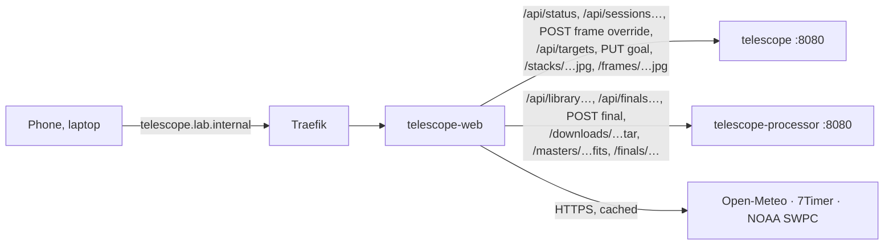

# telescope web

The cabin telescope's own web app at **http://telescope.lab.internal** (home network and VPN only, no login, like homelab.lab.internal): the live session with its stack, tonight's conditions, a target planner, integration goals, the observing log, the calibration library and final stacks. Made for a phone at the telescope (red night mode) and a laptop. It shows what [apps/telescope](../README.md) (the Python service in the same namespace) archives, measures and stacks, and what its processor ([apps/telescope/processor](../processor/)) calibrates and stacks with Siril; nothing here talks to the ASIAIR. SvelteKit 2, Svelte 5, adapter-node, the same look and pinned versions as [apps/dashboard](../../dashboard/) and [apps/homelab](../../homelab/).

## Pages

| Page | |
|---|---|
| **Live** `/` | The current session, or the most recent one (*Last session*). **Stack** large with the latest frame over it (Stack / Latest buttons and a slider between them; tap for full screen). **Head**: ASIAIR online or offline (last contact, error), target, *Target n of m*, the exposure counting up or what the ASIAIR is busy with (meridian flip, auto focus …), frames `done / planned` with a bar, frames in and out of the stack, integration, and the estimated finish of the target and the whole plan (remaining frames × the session's average frame cadence so far, flips and refocusing included). **Timeline**: the night from sunset to sunrise with darkness shaded, the target's altitude (from the FITS header's RA/Dec and the site) with the moon, the meridian and the 20° line (*sets below 20° at …*), the events (plan, GoTo, centering, auto focus, meridian flip, guiding lost) and every frame (green in the stack, amber rejected), *Now* and *Finish*; the events also as a list. **Guiding** over the whole session: RA/Dec error with dithers, settling (shaded) and lost star, RMS per 5 min, each frame's elongation and guiding RMS, the wind and gusts at the site from Open-Meteo on the same time axis, and a scatter with the 1″ and RMS rings; the guider's state and star SNR now. **Frames**: every processed frame newest first with thumbnail, stars, HFR, FWHM, elongation, background, guiding RMS, *In stack* / *Rejected* with the reason, and *Reject* or *Accept* (manual override, *by hand*) and *Auto* (back to the automatic decision); a thumbnail opens the frame large (← → steps through). **Telemetry**: sensor against the set point, cooler power, ASIAIR board temperature, Wi-Fi (now and over the session), under-voltage and over-temperature flags, free space on the ASIAIR's storage. **Frame quality**: stars, HFR and background per frame, rejected ones marked |
| **Conditions** `/conditions` | Tonight at the site: a verdict line (longest clear run in darkness with cloud ≤ 30 %, how many models see clear hours, dew within 2°, gusts over 8 m/s, the moon, 7Timer seeing), astronomical and nautical darkness, sunset and sunrise, moon phase, illumination, rise and set. **Cloud by height**: low, mid and high cloud hour by hour from sunset to sunrise from ECMWF, ICON, GFS and MET Nordic side by side, with darkness and moon rows. **Seeing and transparency** (7Timer ASTRO, 3-hourly). **Wind and dew**: temperature against dew point, wind and gusts. **Aurora**: OVATION probability at the site and the most within ~1000 km to the north, Kp of the latest 3 h, Kp per 3 h for the past two days and the 3-day forecast, and a plain-language line (at ~61° N low in the north from Kp 3, overhead from Kp 5; ≥ 10 % also brightens north-facing frames). Each source fails on its own (*unavailable* with the reason) |
| **Planner** `/planner` | C1: which objects of the bundled catalog (below) are well placed on a night at the site, tonight or a chosen date: hours above a minimum altitude (30° by default, adjustable) during astronomical darkness (nautical on the light nights that have none), the highest altitude, transit, the moon's illumination and how close it comes while the object is usable, and the size against the camera's 0.96° × 0.96° field (670 mm, ASI533: *fits*, *fills the field*, *small in the field*, or an *n×m mosaic* with 15 % overlap, drawn as a framing hint). Best first (hours, a little for altitude, less with a bright moon nearby, weighted by size and kind: nebulae and galaxies of 15′ and more over small clusters), or by hours, altitude, transit, size, brightness; search by designation, alias (`M31`, `Sh2-155`, `Sh2-129`, `C 20`), common name, type or constellation; filters by kind, size and magnitude, *Wishlist*, *Not visible too*. Tap a row for its altitude curve with the moon, darkness and the longest window above the limit shaded, the framing with mosaic panels, other designations and the integration so far. The star puts it on the wishlist (the service's target store). `?q=<id>` opens one |
| **Goals** `/goals` | C5: accepted integration per target across every session against a goal in hours (editable, kept in the service's target store): progress bar, *needs N h more*, nights imaged with links to their reports, whether it is well placed tonight (the planner's numbers: at least 2 h above 30° in darkness, no bright moon within 40°), its latest final stack, links to the planner and finals. A session counts for the catalog object its ASIAIR target name names (`NGC 7000`, `M31`, `C 9`, `Sh2-155`, a common name), else for the nearest one within 0.3° of its plate-solved centre; anything else stays under its own target name (so targets outside the catalog still get goals). Filters: *With a goal* (unfinished first), *Wishlist*, *All targets* |
| **Sessions** `/sessions` | The observing log by month: stack thumbnail, target, night, mode, time, integration, frames in and out; *Imaging* on the running one |
| **Session report** `/sessions/<id>` | One night and target: stack (with the last frame), the numbers (frames, in stack, rejected, integration, exposure and gain, time, median HFR and stars, RA/Dec, camera, what is archived at home) and every rejection with its reason, the timeline, guiding with wind, frame quality, telemetry, and the frame list with the same override buttons; **Target**: the goal and integration across nights, the latest final stack with *Build final stack* and *Download for processing*. Refreshes every 30 s while the session runs. Sessions from before the release have no guiding, telemetry or live timeline events (the service could not record them) |
| **Library** `/library` | D2: the processor's calibration library: masters (kind, exposure, gain, offset, temperature, camera angle, night and age, frames, median and noise, FITS download) and the raw sets by kind; ages past 7 days (flats), 180 (darks) and 365 (bias) are marked, the processor's own limits for warning against the lights. **Calibration for a target**: the masters the processor would use for its lights and every warning (no matching dark, flat older than the lights, flat at another camera angle …), per night on request |
| **Finals** `/finals` | D3: final stacks with Siril on the processor. Choose a target (`?target=` preselects one) and its nights, then **Build final stack** (one job at a time; a newer request for the same target replaces a queued one) or **Download for processing** (optionally *with rejected frames*): an uncompressed tar streamed from the processor with the raw lights by night exactly as archived, the calibration sets used and their masters, the latest final and a README of every frame, rejection reason, the integration and the calibration match. Below: running and queued finals with progress (refreshed every 5 s), finished and failed ones with the preview (tap for full screen, *1:1* for the full-size preview), the calibration used and its warnings, downloads (linear FITS, processed TIFF, JPEG) and the log's tail |

**Red night mode** (A10): *Off / Red / Auto* in the header, remembered per device (`localStorage`). Red turns everything deep red on black, images included (an SVG colour matrix puts their brightness into the red channel); *Auto* is red while the sun is below the horizon at the site. The page applies the last state before its first paint, so it never flashes white at the telescope.

Browser refresh on Live: status every 10 s, the session list every minute, the session's report every 30 s and whenever the status shows a new frame or stack, wind hourly. Conditions: every 10 min. Finals (also on the session report and Goals): every 5 s while one is queued or running.

The navigation's seven pages sit in one row on a laptop and in two rows of four on a phone.

## Sources and caching

Server-side only (the browser talks to this app alone), each with a timeout, cached in memory per site; a failed refresh keeps serving the last good answer for a while, then the card says *unavailable*. A failure is retried after a minute at the earliest.

| Source | Endpoint | Fresh for | Last good kept |
|---|---|---|---|
| Open-Meteo, best match | `api.open-meteo.com/v1/forecast` hourly cloud, temperature, dew point, humidity, wind and gusts (m/s), yesterday + 3 days | 30 min | 3 h |
| Open-Meteo, models | same with `models=ecmwf_ifs025,icon_seamless,gfs_seamless,metno_seamless`, cloud total/low/mid/high | 30 min | 3 h |
| Open-Meteo, session wind | `start_date`/`end_date` over the session; older than 80 days from `historical-forecast-api.open-meteo.com` | 30 min (today), 24 h (past days) | 7 d |
| 7Timer ASTRO | `www.7timer.info/bin/astro.php?…&output=json` | 1 h | 12 h |
| NOAA SWPC Kp | `services.swpc.noaa.gov/products/noaa-planetary-k-index-forecast.json` (observed, estimated, predicted; *now* = the newest observed or estimated 3 h value) | 15 min | 6 h |
| NOAA SWPC OVATION | `services.swpc.noaa.gov/json/ovation_aurora_latest.json` (~1 MB, only the site's longitude column is kept) | 10 min | 2 h |

Darkness, moon and the target's altitude are computed (`suncalc`, `src/lib/sky.ts`; the planner in `src/lib/planner.ts`, goals in `src/lib/goals.ts`), the same approach as the dashboard's Tonight card. Thresholds (`CLEAR_PCT`, `DEW_MARGIN_C`, `GUSTY_MS`, `AURORA_PCT`, `LOW_ALTITUDE`) are named constants in `src/lib/server/conditions.ts` and `src/lib/sky.ts`.

## Catalog

Bundled into the page (`src/lib/catalog/dso.json`, ~140 kB, ~40 kB gzipped; the planner works offline), 1804 objects, built by `scripts/catalog.mjs` (run by hand, commit the JSON):

- **OpenNGC** by Mattia Verga (<https://github.com/mattiaverga/OpenNGC>), release **v20260501** (pinned: the script checks the SHA-256 of its `NGC.csv` and `addendum.csv`), licensed **CC BY-SA 4.0** (<https://creativecommons.org/licenses/by-sa/4.0/>). Changes, as the licence asks: reduced to imaging targets north of −35° (nebulae, clusters, planetary and dark nebulae; galaxies brighter than magnitude 12 or with a Messier number or a common name), single stars, asterisms, duplicates and non-existent objects left out (a duplicate's name becomes an alias), coordinates in degrees, columns reduced. The Messier number is the display id when there is one (`M 31`); other designations are aliases (`NGC 224`, Caldwell `C 20`, and `Sh2-`, `LBN`, `LDN`, `Mel`, `Cr`, `vdB`, `Ced` where OpenNGC's identifiers list them).
- **Sharpless** (Sh2) positions from **Wikidata** (items with a catalogue code of the Sharpless catalogue, Q66381095), **CC0** (<https://creativecommons.org/publicdomain/zero/1.0/>): a Sh2 object becomes an alias of the OpenNGC object it is (by OpenNGC's identifiers, by Wikidata's label, or by position: within 0.25°, or half the radius of a large nebula), the rest (256) are objects of their own without size or constellation (Wikidata has neither), so their framing says *size unknown*. Wikidata has no releases to pin: the JSON records the query date (snapshot of 2026-10-19), and re-running the script may change a few positions.

The planner page credits both. To move to a newer OpenNGC release: change `RELEASE` and the two checksums in the script, run `node scripts/catalog.mjs`, commit the JSON. Not bundled: LBN, LDN and Barnard as catalogues of their own (only machine-readable as VizieR tables without a stated licence; OpenNGC's aliases and addendum cover the well-known ones). A session of a target outside the catalog still gets its goal under its own name.

## Server routes

| Path | |
|---|---|
| `GET /api/status`, `/api/sessions`, `/api/sessions/<id>` | The service's answers passed through (502 when it does not answer) |
| `POST /api/sessions/<id>/frames/<frameId>` | Body `{ "accepted": true \| false \| null }`, JSON only (a cross-site form cannot send it; a cross-site JSON fetch needs a CORS preflight that is never granted); checked, then passed to the service, which restacks in the background |
| `GET /stacks/<id>.jpg`, `-small.jpg` | Stack previews; with `?v=<imageId>` cached for good, without it `no-cache` |
| `GET /frames/<id>.jpg`, `-small.jpg` | Frame previews, cached for good (ids change with the file) |
| `GET /api/targets`, `PUT /api/targets/<key>` | Goals and the wishlist (the service's target store). PUT: JSON only, `{ "goalHours"?, "wishlist"?, "note"? }` (hours 0–1000, note ≤ 500 characters, null clears, an omitted field stays), key `[A-Za-z0-9 +._()-]{1,64}` (a catalog id, or the session's target name with other characters as `_`); checked, then passed on |
| `GET /api/library`, `/api/library/match?target=` | The processor's calibration library and the masters it would use for a target (passed through) |
| `GET /api/finals`, `/api/finals/<id>`; `POST /api/finals` | Final stacks (newest first; one with its log's tail). POST: JSON only, `{ "target", "nights"?: ["YYYY-MM-DD", …] }` (all nights without), checked, then queued on the processor (202) |
| `GET /downloads/<target>.tar?nights=&include=rejected` | Everything for processing by hand, streamed through from the processor as it comes (no length, no buffering, `no-store`) |
| `GET /masters/<id>.fits`, `/finals/<id>/<file>` | Masters and a final's outputs (previews, linear FITS, TIFF) streamed through with their type and download name |
| `GET /api/wind?from=&to=` | Hourly wind at the site, unix s, at most 3 days |
| `GET /api/conditions` | Everything on the Conditions page as JSON |
| `GET /healthz` | Probes |

Ids and file names are checked before they go into a URL to the service or the processor (`[A-Za-z0-9_-][A-Za-z0-9_.-]{0,127}`), target names too (1–128 characters, no control characters, slashes or leading dot; URL-encoded). Errors that come back as text become `{ "message" }` JSON.

## Settings

`deploy/kustomization.yaml` (`telescope-web-config`): `TELESCOPE_URL` (`http://telescope:8080`), `PROCESSOR_URL` (`http://telescope-processor:8080`; without it Library and Finals say *not configured*), `TELESCOPE_SITE` (`name:latitude:longitude`, as the ASIAIR reports it; the session's own site from its FITS header wins for the altitude curve), `PROTOCOL_HEADER`/`HOST_HEADER` (origin from Traefik's headers, as in apps/dashboard). Memory limit 256 Mi.

## Network

`deploy/networkpolicy.yaml`: in from Traefik only; out to the telescope service (8080), the processor (8080), DNS, and the internet on 443 (not the LAN). The service's and the processor's own policies admit `telescope-web`, and only this app may send the frame override, the goals and a final stack request.

## Deploy

1. DNS, once, by hand on the UDM Pro (*Settings > Policy Table > DNS*): `telescope.lab.internal` CNAME `ingress.lab.internal` ([apps/README.md](../../README.md#dns)).
2. `./apps/telescope/deploy.sh` first if the service changed (it owns the namespace and admits this app), `./apps/telescope/processor/deploy.sh` if the processor changed, then `./apps/telescope/web/deploy.sh` (image build, import into k3s, apply; commit the new tag it writes).

Development: `npm install`, then `TELESCOPE_URL=http://localhost:8080 PROCESSOR_URL=http://localhost:8081 TELESCOPE_SITE=Ristiina:61.496:27.576 npm run dev` with `kubectl -n telescope port-forward svc/telescope 8080` and `kubectl -n telescope port-forward svc/telescope-processor 8081:8080` (the policies admit only cluster pods, but port-forward goes around them). `npm run check` type-checks.
