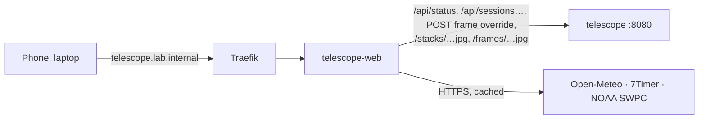

# telescope web

The cabin telescope's own web app at **http://telescope.lab.internal** (home network and VPN only, no login, like homelab.lab.internal): the live session with its stack, tonight's conditions, and the observing log. Made for a phone at the telescope (red night mode) and a laptop. It shows what [apps/telescope](../README.md) (the Python service in the same namespace) archives, measures and stacks; nothing here talks to the ASIAIR. SvelteKit 2, Svelte 5, adapter-node, the same look and pinned versions as [apps/dashboard](../../dashboard/) and [apps/homelab](../../homelab/).

## Pages

| Page | |
|---|---|
| **Live** `/` | The current session, or the most recent one (*Last session*). **Stack** large with the latest frame over it (Stack / Latest buttons and a slider between them; tap for full screen). **Head**: ASIAIR online or offline (last contact, error), target, *Target n of m*, the exposure counting up or what the ASIAIR is busy with (meridian flip, auto focus …), frames `done / planned` with a bar, frames in and out of the stack, integration, and the estimated finish of the target and the whole plan (remaining frames × the session's average frame cadence so far, flips and refocusing included). **Timeline**: the night from sunset to sunrise with darkness shaded, the target's altitude (from the FITS header's RA/Dec and the site) with the moon, the meridian and the 20° line (*sets below 20° at …*), the events (plan, GoTo, centering, auto focus, meridian flip, guiding lost) and every frame (green in the stack, amber rejected), *Now* and *Finish*; the events also as a list. **Guiding** over the whole session: RA/Dec error with dithers, settling (shaded) and lost star, RMS per 5 min, each frame's elongation and guiding RMS, the wind and gusts at the site from Open-Meteo on the same time axis, and a scatter with the 1″ and RMS rings; the guider's state and star SNR now. **Frames**: every processed frame newest first with thumbnail, stars, HFR, FWHM, elongation, background, guiding RMS, *In stack* / *Rejected* with the reason, and *Reject* or *Accept* (manual override, *by hand*) and *Auto* (back to the automatic decision); a thumbnail opens the frame large (← → steps through). **Telemetry**: sensor against the set point, cooler power, ASIAIR board temperature, Wi-Fi (now and over the session), under-voltage and over-temperature flags, free space on the ASIAIR's storage. **Frame quality**: stars, HFR and background per frame, rejected ones marked |
| **Conditions** `/conditions` | Tonight at the site: a verdict line (longest clear run in darkness with cloud ≤ 30 %, how many models see clear hours, dew within 2°, gusts over 8 m/s, the moon, 7Timer seeing), astronomical and nautical darkness, sunset and sunrise, moon phase, illumination, rise and set. **Cloud by height**: low, mid and high cloud hour by hour from sunset to sunrise from ECMWF, ICON, GFS and MET Nordic side by side, with darkness and moon rows. **Seeing and transparency** (7Timer ASTRO, 3-hourly). **Wind and dew**: temperature against dew point, wind and gusts. **Aurora**: OVATION probability at the site and the most within ~1000 km to the north, Kp of the latest 3 h, Kp per 3 h for the past two days and the 3-day forecast, and a plain-language line (at ~61° N low in the north from Kp 3, overhead from Kp 5; ≥ 10 % also brightens north-facing frames). Each source fails on its own (*unavailable* with the reason) |
| **Sessions** `/sessions` | The observing log by month: stack thumbnail, target, night, mode, time, integration, frames in and out; *Imaging* on the running one |
| **Session report** `/sessions/<id>` | One night and target: stack (with the last frame), the numbers (frames, in stack, rejected, integration, exposure and gain, time, median HFR and stars, RA/Dec, camera, what is archived at home) and every rejection with its reason, the timeline, guiding with wind, frame quality, telemetry, and the frame list with the same override buttons. Refreshes every 30 s while the session runs. Sessions from before the release have no guiding, telemetry or live timeline events (the service could not record them) |

**Red night mode** (A10): *Off / Red / Auto* in the header, remembered per device (`localStorage`). Red turns everything deep red on black, images included (an SVG colour matrix puts their brightness into the red channel); *Auto* is red while the sun is below the horizon at the site. The page applies the last state before its first paint, so it never flashes white at the telescope.

Browser refresh on Live: status every 10 s, the session list every minute, the session's report every 30 s and whenever the status shows a new frame or stack, wind hourly. Conditions: every 10 min.

## Sources and caching

Server-side only (the browser talks to this app alone), each with a timeout, cached in memory per site; a failed refresh keeps serving the last good answer for a while, then the card says *unavailable*. A failure is retried after a minute at the earliest.

| Source | Endpoint | Fresh for | Last good kept |
|---|---|---|---|
| Open-Meteo, best match | `api.open-meteo.com/v1/forecast` hourly cloud, temperature, dew point, humidity, wind and gusts (m/s), yesterday + 3 days | 30 min | 3 h |
| Open-Meteo, models | same with `models=ecmwf_ifs025,icon_seamless,gfs_seamless,metno_seamless`, cloud total/low/mid/high | 30 min | 3 h |
| Open-Meteo, session wind | `start_date`/`end_date` over the session; older than 80 days from `historical-forecast-api.open-meteo.com` | 30 min (today), 24 h (past days) | 7 d |
| 7Timer ASTRO | `www.7timer.info/bin/astro.php?…&output=json` | 1 h | 12 h |
| NOAA SWPC Kp | `services.swpc.noaa.gov/products/noaa-planetary-k-index-forecast.json` (observed, estimated, predicted; *now* = the newest observed or estimated 3 h value) | 15 min | 6 h |
| NOAA SWPC OVATION | `services.swpc.noaa.gov/json/ovation_aurora_latest.json` (~1 MB, only the site's longitude column is kept) | 10 min | 2 h |

Darkness, moon and the target's altitude are computed (`suncalc`, `src/lib/sky.ts`), the same approach as the dashboard's Tonight card. Thresholds (`CLEAR_PCT`, `DEW_MARGIN_C`, `GUSTY_MS`, `AURORA_PCT`, `LOW_ALTITUDE`) are named constants in `src/lib/server/conditions.ts` and `src/lib/sky.ts`.

## Server routes

| Path | |
|---|---|
| `GET /api/status`, `/api/sessions`, `/api/sessions/<id>` | The service's answers passed through (502 when it does not answer) |
| `POST /api/sessions/<id>/frames/<frameId>` | Body `{ "accepted": true \| false \| null }`, JSON only (a cross-site form cannot send it; a cross-site JSON fetch needs a CORS preflight that is never granted); checked, then passed to the service, which restacks in the background |
| `GET /stacks/<id>.jpg`, `-small.jpg` | Stack previews; with `?v=<imageId>` cached for good, without it `no-cache` |
| `GET /frames/<id>.jpg`, `-small.jpg` | Frame previews, cached for good (ids change with the file) |
| `GET /api/wind?from=&to=` | Hourly wind at the site, unix s, at most 3 days |
| `GET /api/conditions` | Everything on the Conditions page as JSON |
| `GET /healthz` | Probes |

Ids are checked before they go into a URL to the service (`[A-Za-z0-9_-][A-Za-z0-9_.-]{0,127}`).

## Settings

`deploy/kustomization.yaml` (`telescope-web-config`): `TELESCOPE_URL` (`http://telescope:8080`), `TELESCOPE_SITE` (`name:latitude:longitude`, as the ASIAIR reports it; the session's own site from its FITS header wins for the altitude curve), `PROTOCOL_HEADER`/`HOST_HEADER` (origin from Traefik's headers, as in apps/dashboard). Memory limit 256 Mi.

## Network

`deploy/networkpolicy.yaml`: in from Traefik only; out to the telescope service (8080), DNS, and the internet on 443 (not the LAN). The service's own policy admits `telescope-web`, and only this app may send the frame override.

## Deploy

1. DNS, once, by hand on the UDM Pro (*Settings > Policy Table > DNS*): `telescope.lab.internal` CNAME `ingress.lab.internal` ([apps/README.md](../../README.md#dns)).
2. `./apps/telescope/deploy.sh` first if the service changed (it owns the namespace and admits this app), then `./apps/telescope/web/deploy.sh` (image build, import into k3s, apply; commit the new tag it writes).

Development: `npm install`, then `TELESCOPE_URL=http://localhost:8080 TELESCOPE_SITE=Ristiina:61.496:27.576 npm run dev` with `kubectl -n telescope port-forward svc/telescope 8080` (the service's policy admits only cluster pods, but port-forward goes around it). `npm run check` type-checks.
