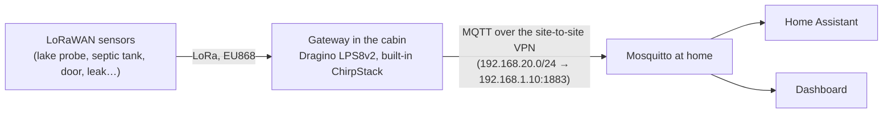

# Future plans

Ideas agreed in principle but not started. Each lists what it depends on, the hardware and the homelab changes it needs, so it can be picked up later without redoing the research.

## Cabin: LoRaWAN sensors

**Status:** idea (2026-10). **Depends on:** the site-to-site VPN in [other-site-network.md](other-site-network.md) (done, 2026-10) and the hardware below (not bought yet).

Battery sensors around the cabin plot (lake water, doors, leaks, septic tank) reporting over LoRa to one gateway in the house, which forwards their readings home over the VPN into Mosquitto, where Home Assistant and the dashboard pick them up.

### Why LoRaWAN

| Option | Verdict |
|---|---|
| **LoRaWAN, own gateway at the cabin** | Chosen. The cabin has mains power, a UniFi network (UCG Max, 6 PoE cameras) and internet over 5G (Teltonika RUTX50), so one gateway can serve every sensor on the plot. Sensors run for years on lithium batteries (fine in frost), reach the shore without cables (LoRa: hundreds of metres to over a kilometre outdoors), and need no SIM cards or cloud services. |
| NB-IoT / LTE-M sensor (Dragino D20-CB) | Rejected for the cabin: an IoT SIM per sensor and a cloud MQTT broker in between. Only worth it where there is no gateway. |
| Wi-Fi sensor at the shore (M5Stack AtomS3 Lite + waterproof DS18B20, ESPHome) | Cheapest and real-time, but only if the sauna or a shed by the water has power and Wi-Fi coverage. Fine for the lake temperature alone; LoRaWAN wins once there are several sensors. |

### Hardware

| Item | Use | Notes |
|---|---|---|
| **Dragino LPS8v2** (indoor LoRaWAN gateway, EU868) | Receives every sensor | Built-in ChirpStack network server and MQTT forwarding, so no separate network server or TTN account. Ethernet to the cabin's UniFi switch. Alternative: RAK WisGate Edge Lite 2 (RAK7268V2). |
| **Dragino D20-LB** (or LSN50v2-D20) | Lake water temperature | Waterproof stainless DS18B20 probe, −55…+125 °C, 2 m cable; 8500 mAh Li-SOCl2 battery. **D22-LB / D23-LB**: 2-3 probes, e.g. 0.5 m and 1.5 m deep to see the layering under the ice. |
| **Dragino LHT65N** | Temperature and humidity | Indoors, the crawl space or a storeroom (frost watch); optional external probe. |
| **Dragino LDS02** | Doors and windows | Shed and sauna doors. |
| **Leak sensor** (e.g. Dragino LWL03A) | Water leaks | Under the sink, by the water heater. |
| **Septic tank level sensor** | Fill level of the tank | See [below](#septic-tank-fill-level). |

### Lake probe in winter

- Ice there is typically 50-70 cm thick: probe 1-1.5 m deep, inside a weighted plastic pipe from the shore down into the water, which protects the cable and keeps the probe below the ice.
- Sensor box on a post or stake on the shore above flood level, not on a dock that is lifted out or pushed by ice; leave slack in the cable, as moving ice pulls or crushes a cable fixed tight.
- If 2 m of cable does not reach that depth from the post, DS18B20 cables extend to tens of metres, but the joint must be properly sealed (adhesive-lined heat-shrink) or water gets in over the winter.

### Homelab changes when the hardware arrives

1. **Mosquitto**: a `lora` user in `platform/components/mosquitto/users.sh` with its topics in `acl` (ChirpStack publishes `application/<id>/device/<eui>/event/up`), and the cabin LAN `192.168.20.0/24` in the NetworkPolicy, which admits only `192.168.1.0/24` today.
2. **Gateway**: register the sensors in its ChirpStack with Dragino's payload decoders (so the MQTT messages carry readable JSON: temperature, battery), and point its MQTT forwarding at `192.168.1.10:1883` with the `lora` login.
3. **Home Assistant**: MQTT sensors for each reading and battery level (YAML in `apps/homeassistant/deploy/configuration.yaml`, or a small translator to MQTT discovery); alerts for leaks, frost and the septic tank threshold to phones through the Companion app.
4. **Dashboard** (optional): a cabin card with lake temperature and tank level.
5. **Architecture diagram and devices**: the gateway and sensors in `apps/homelab/src/lib/architecture.ts` are marked `planned`; drop that, and add their addresses, MACs and status checks.

### Known limit

When the 5G link or the VPN is down, readings do not reach home. ChirpStack does not keep them for later, though some Dragino sensors can store readings and resend them, so a long outage leaves a gap in the history. Automations that must act at the cabin itself during an outage would need to run there.

## Septic tank fill level

**Status:** idea (2026-10). Part of the cabin LoRaWAN plan above (same gateway and path home).

Measure how full the cabin's septic tank is, so emptying can be booked before it fills up instead of on a fixed schedule or by lifting the lid. Most useful for a holding tank (*umpisäiliö*), which has no outflow and must be emptied when full.

**Sensor options** (LoRaWAN, battery):

| Type | How | Notes |
|---|---|---|
| **Ultrasonic distance sensor** under the lid (e.g. Dragino DDS75-LB) | Measures the distance down to the surface; level = tank depth − distance | The usual choice: nothing touches the sewage. Foam or a floating crust and heavy condensation can disturb the echo, so mount it straight above open liquid, away from the inlet pipe and the tank walls. |
| **Radar distance sensor** | Same idea with radar | Less affected by condensation and foam than ultrasonic; usually more expensive. |
| **Submersible pressure probe** (e.g. Dragino PS-LB with a water-level probe) | Hydrostatic pressure at the tank bottom gives the liquid depth | Unaffected by foam and crust, but the probe sits in the sewage and needs cleaning now and then. |

**Things to settle on site:**
- Tank type (holding tank vs septic tank with outflow), depth, lid size and where the sensor can be fixed; the tank's air holds corrosive hydrogen sulphide, so the sensor housing should be sealed (IP67 or better) and the bracket stainless or plastic.
- Whether the gateway reaches the tank through the lid and soil (a metal lid weakens the signal; the antenna may need to sit just under a plastic lid).
- Measurement interval: a few times a day is plenty, which keeps the battery going for years.

**In Home Assistant:** fill percentage from the measured distance and the tank's depth, an alert at a threshold (for example 75 % = book emptying), and the fill rate to estimate when it will be full; optionally on the dashboard's cabin card.

## DSC Neo alarms (home and cabin)

**Status:** planned (2026-10-18); the panels are not on the network yet. Research and decisions below.

**Hardware** (reported 2026-10-18): both sites have the same setup, a DSC PowerSeries Neo **HS2032** panel with a **TL2803G** communicator (Ethernet + 3G). No security company monitors them, and the installer code is at hand, so all four integration slots are free on both.

**How:** the Neo's integration protocol ITv2 through the TL280-family communicator: the panel *dials out* to a receiver on the LAN and pushes zone, partition, alarm and trouble changes (AES-encrypted). The tools for older DSC PowerSeries panels (Envisalink, dscKeybusInterface ESP32 boards) do not work with Neo. Receiver: the Home Assistant integration [HA_DSC_Neo_ITv2](https://github.com/LawPaul/HA_DSC_Neo_ITv2) (`dsc_neo_itv2`, GPL-3, v1.0.0 from 2026-07, developed against an HS2032 + TL280; supports the TL2803G). Alternative: [NeoHub](https://github.com/BrianHumlicek/NeoHub) (own web UI; its HA integration is unfinished). Fallback without the communicator: PGM outputs (armed, alarm, fire) into an ESP32 over optocouplers, status only.

**Panel programming** (per panel, `[*][8]` + installer code; sections for communicator firmware v5.0+, older boards differ):

| Section | Value |
|---|---|
| `[851][422]` | Integration ID: read only, write the 12 digits down |
| `[851][425]` | Integration options: bits 3, 4, 5 (`--345---`) |
| `[851][426]` | Polling / notifications: bit 3 only (`--3-----`) |
| `[851][428]` | Receiver IP: `192.168.1.10` (Home Assistant runs on the node's network) |
| `[851][429]` | Receiver port, **hex**: home `0C00` (3072), cabin `0C01` (3073) |
| `[851][700]` | Type 2 access key, 32 hex characters: a new random one, not the factory default |

**Homelab changes when the panels are connected:**
- TL2803G on the LAN by Ethernet (a fixed address at each site); the cabin panel reaches `192.168.1.10` over the Site Magic VPN.
- firewalld (`platform/host/prepare.sh`): 3072–3073/tcp from `192.168.1.0/24` and `192.168.20.0/24` only, never port-forwarded.
- Home Assistant: the integration from a pinned release in git (not HACS), one config entry per panel (ports 3072 and 3073); no user PIN stored, so HA asks for the code on every arm/disarm.
- **Dashboard: status only** (decided 2026-10-18; no arming or disarming there, it is too easy to tap by accident and the dashboard has no login): per site armed state, alarm / fire / trouble, open zones, recent events.
- Notifications through apps/notify: alarm and fire (with the cabin camera's latest picture), AC power loss (a power cut at the cabin), low battery, communicator trouble, armed/disarmed by which user.
- Optional: a reminder when everyone has left home (apps/presence) and the alarm is not armed; Grafana timeline of arming and zone activity.

**Cabin heating by alarm state** (idea to keep): *armed away* → economy (NIBE heating offset down, Innova lower or off; keep frost protection and hot water); *disarmed* → comfort. Disarming happens on arrival, which is too late to warm a cold cabin, so pre-warming needs its own trigger (a "heading to the cabin" action, or presence). Who acts (an HA automation calling apps/climate, or apps/climate reading the alarm state) is to be decided; apps/climate already controls both heat pumps.

**Risks:** a life-safety system and a young, reverse-engineered integration. The panel keeps protecting regardless; a Home Assistant restart or a broken link only makes HA's view stale. Never disarm from automations or untrusted input.

## Telescope web app

**Status:** deployed 2026-10-19 at http://telescope.lab.internal and https://telescope.shillyshally.org (Cloudflare Access, policy Family) ([apps/telescope](../apps/telescope/README.md); web app `apps/telescope/web`, Siril processor `apps/telescope/processor`): releases **R1**, **R2** (notifications, planner, goals), **R3** (calibration library, final stacks with Siril, downloads for own processing), **R4** (full-resolution viewer, annotation, gallery with own uploads; published pictures at the share link https://astro.shillyshally.org, open to anyone), **R5** (focus and temperature, tilt and backfocus, trails, survey framing, timelapse, forecast vs reality, statistics, mount analysis from the PHD2 logs, own plate solving with ASTAP; the analysis pages under the *Stats* tab) and **R6** (2026-10-20: tonight's pick and the morning report on notify topic `telescope-digest`, sky brightness per frame, best sub length and integration needed, focus advice, calibration reminders; section G). First real data arrived the same evening: the ASIAIR came online, ~360 archived frames were backfilled and stacked live, and every plan frame carries the ASIAIR's plate solve (alignment ran on it). First R5 findings on the archive: a 481 s periodic error (the worm) of ~20″ peak to peak on the sky, polar alignment off by at least ~5′, focus moving +20.5 ± 1.4 steps per °C (27 auto focus runs, 4 nights), no tilt beyond 5–7 % corner to corner (always largest at the bottom right), ICON the best day-ahead cloud forecast so far (66 % of 32 judged hours). R6 findings: moonless skies 21.4–22.2 mag/arcsec², 16.3–19.8 with the moon up; read noise 1.18 e- (gain 100, bias 2795 ADU, 0.251 e-/ADU in the files); best subs 90–300 s on moonless nights (180–300 s used); refocus every 0.8 °C, while the ASIAIR's 2 °C setting fires at 3 °C, when stars are already 20–42 % larger; the zero point is 1.6 mag lower since 2026-02-13: the **Baader UHC-L** (Ultra-L-Booster) in the train since then, so the sky values are the sky in its passbands, not SQM readings (the ASIAIR writes no FILTER keyword: the `FILTERS` setting of the service and processor records it; flats must match it). Not yet seen on real data: a Siril final with real calibration frames, the notifications in a real night, annotation on a real stack. The rest is the idea list to choose from later. Builds on the telescope service (frames from the ASIAIR's SMB shares, its live JSON-RPC state, read only) and the dashboard's Telescope tab, which stays.

**What it can build on:** every frame as FITS (3008², 18 MB) with target, exposure, gain, temperatures, focuser position, site and the ASIAIR's plate solve in the header (no filter: a Baader UHC-L is screwed into the train since 2026-02-13, recorded in the `FILTERS` setting); the Autorun and PHD2 logs at the end of each run; live: exposure and plan progress, auto-focus V-curves, meridian flip/GoTo state, guiding every ~3 s, sensor/cooler/board telemetry; around it: Ruuvi temperature and humidity at the cabin, the NIBE's outdoor temperature, Open-Meteo, the cabin camera, apps/notify, Prometheus. The k3s node (i5-7600K, 4 cores, 30 GB RAM, ~800 GB free) stacks a frame in seconds; the cabin's mobile link has no data cap. Nothing is ever written to the ASIAIR.

**A. Live session**

| # | Feature | Effort |
|---|---|---|
| A1 **R1** | Live stack of the current target, updated per frame: debayer, align (the ASIAIR's plate solve as a start, refined by star matching), outlier-rejecting combine, auto-stretch with background neutralisation; integration time and SNR growth; single frame vs stack slider | M |
| A2 **R1** | Automatic frame rejection from the stack (clouds, fog, trailing, focus drift: stars, HFR, background, elongation) with the reason; a frame can be put back by hand | S |
| A3 **R1** | Session timeline: plan targets, frames, estimated finish; meridian flip, auto focus and centering as events; time until the target sets or meets the horizon | S–M |
| A4 **R1** | Guiding over the whole session: RA/Dec graph, scatter, RMS curve, dithers and settling, star SNR, alongside wind and frame elongation | S–M |
| A5 **R5** | Focus and temperature: V-curves, HFR and focuser position against temperature (ASIAIR + Ruuvi) | S–M |
| A6 **R5** | Tilt and backfocus inspection: HFR and star shape in a 3×3 grid, 1:1 corner crops | M |
| A7 **R5** | Satellite and plane trails marked in frames | M |
| A8 **R1** | Telemetry: cooler power and sensor temperature against the set point, ASIAIR board temperature, under-voltage, Wi-Fi, free space on the ASIAIR's storage | S |
| A9 **R2** | More notifications: clouds (and clear again), dew suspected, guiding lost, meridian flip result, storage filling, sensor not cooling, under-voltage (images in notifications need a notify extension) | S each |
| A10 **R1** | Red night mode for use at the telescope | S |

**B. The image**

| # | Feature | Effort |
|---|---|---|
| B1 **R4** | Full-resolution viewer: zoom to 1:1 and beyond, histogram, star profile and FWHM on click | M |
| B2 **R4** | Annotation of objects and bright stars from the plate solve | M |
| B3 **R5** | Framing on a survey image (DSS): field of view 0.96° × 0.96° (670 mm, ASI533), mosaic planning | M |
| B4 **R5** | Session timelapse (frames or the growing stack) | S |

**C. Planning and conditions**

| # | Feature | Effort |
|---|---|---|
| C1 **R2** | Target planner: altitude curves, time above a limit, transit, moon distance, best window, framing in the field (OpenNGC catalogue) | M |
| C2 **R1** | Conditions forecast: cloud by height from several models side by side, seeing and transparency (7Timer), wind, dew point, a verdict | S–M |
| C3 **R1** | Aurora: Kp now and forecast, aurora probability at the cabin (NOAA), both as a subject and as a deep-sky spoiler | S |
| C4 **R5** | Forecast vs reality: which model has been right at the cabin, against clouds seen in the frames | M |
| C5 **R2** | Integration goals per target across nights | S–M |

**D. Archive and processing**

| # | Feature | Effort |
|---|---|---|
| D1 **R1** | Every FITS (lights, calibration frames) and log copied home over the VPN, by night and target (~1.8 GB per 100 frames); not in the Google Drive backup | S–M |
| D2 **R3** | Calibration library (darks, flats, bias by gain, temperature, exposure; age warnings) | M |
| D3 **R3** | Final stack after the session with Siril (headless): calibration, registration, multi-night stacking; the app's own processed version; FITS/TIFF and a tar of everything for own processing | M–L |
| D4 **R4** | Gallery per target (app finals and own uploads, versions); published pictures at a share link open to anyone, read-only | M |
| D5 **R1** | Observing log: a report per night and target (frames, integration, rejections and why, guiding, HFR, telemetry, events) | S–M |
| D6 **R5** | Statistics: hours per month and season, clear nights, guiding over time | S |
| D7 **R5** | Mount analysis from the PHD2 logs (periodic error, backlash) | M |
| D8 **R5** | Own plate solving (ASTAP) for frames without an ASIAIR solve | S |

**E. Science:** photometry (variable stars, exoplanet transits, comets; L), change detection against survey images (supernovae, asteroids; L).

**F. Homelab:** observatory status (cabin outdoor temperature, humidity, dew point, camera, link; S; grows into H's status page), session state into Home Assistant (e.g. outdoor lights off while imaging; needs controllable lights). The hardware (dew heaters, all-sky camera and more) is in H.

**G. Advice and the daily digest** (added after R5: acting on what R5 measured)

| # | Feature | Effort |
|---|---|---|
| G1 **R6** | Tonight's pick at 15:00 (notify topic `telescope-digest`): clear window from the Conditions models weighted by their C4 day-ahead hit rates, the best target (planner, goals, current project), runner-up, dew and gusts, calibration that matters tonight | S–M |
| G2 **R6** | Morning report after a night's imaging: per session integration, rejections and why, guiding, HFR drift, sky brightness, trails, the best frame | S |
| G3 **R6** | Sky brightness in mag/arcsec² per frame, calibrated on the field's stars (Gaia BP from ASTAP's D05 database), with the photometric zero point | M |
| G4 **R6** | Best sub length (read noise ≤ 5 % of the noise, from measured read noise 1.18 e- and sky rate) and integration needed per target (SNR 10 at 23 mag/arcsec² and at the object's mean surface brightness) | S–M |
| G5 **R6** | Focus advice: tolerance from the V-curves (stars 5 % larger at 16 steps) against the temperature coefficient (20.6 steps/°C) → refocus every 0.8 °C; the ASIAIR's own trigger compared | S |
| G6 **R6** | Calibration reminders: flats for the camera angle in use, missing or old darks and bias, consistent with the processor's match rules | S |
| G7 | Who made the trail: satellites matched to trails by time and position (CelesTrak orbits) | M |
| G8 | Known asteroids and comets (IMCCE SkyBoT) and transients (Transient Name Server) in the field, in the viewer | S–M |
| G9 | Finals: GraXpert gradient removal and denoise; mosaic panels planned with B3 assembled automatically | M |
| G10 | A dimming alert: the photometric zero point falling during a session (dew or thin cloud; seen on 2026-10-17, 18.5 → 16.2 over five hours, frames kept) into the rejection and the notifications | S |
| G11 | Sharing: a page per published picture with preview cards (OpenGraph), an RSS feed, export to AstroBin with the capture details | S–M |
| G12 | Offsite copy of the published targets' raw frames, a cleanup rule for old rejected frames (the archive is not backed up) | S |

**H. Equipment, and the way towards a remote observatory** (added 2026-10-20)

What the archive says the rig needs, and what it does not: **the mount can guide well** (0.6–0.8″ RMS total on the three nights with PHD2 logs, against 1.16″ per camera pixel), but on 2026-10-19 the frames' guiding was 1.9″ (IC 1795) and 2.3″ (IC 1848), and four frames were rejected for it: worth a look at balance, cables and wind before any mount upgrade (the Guiding card shows the wind beside it); the bigger losses are **dew or haze** (2026-10-17: the zero point fell 2.4 mag over five hours and every frame was kept), **flats at the camera angle in use** (the only flats are at 210°, the lights at 93°), **refocusing too late** (stars 20–42 % larger at each temperature-triggered run) and the **filter fixed in the train** (one filter for galaxies and nebulae, moon or not). A remote observatory then needs four things the rig does not have yet: a permanent place, power and pictures from it without being there, weather safety that works on its own, and control software that can drive a roof. The steps below go in that order; each is useful on its own. Costs are rough classes: € under 100 €, €€ 100–500 €, €€€ more.

| # | Equipment | Why (what the data shows) | App side | Cost |
|---|---|---|---|---|
| H1 | **Settings and checks, now**: the ASIAIR's auto focus trigger to 1 °C (G5), flats at 93°, 20 darks of 300 s at −20 °C (G6), a new polar alignment (≥ 5′ off by the Dec drift, D7), balance and cable drag (guiding 1.9–2.3″ on 2026-10-19 against 0.6–0.8″ before) | Free gains measured by R5/R6 | The advice and reminders clear themselves once done; the Mount page shows the next night's guiding | free |
| H2 | **Battery for RuuviTag *Terassi*** ([shopping list](shopping-list.md)) | The Focus card's outdoor temperature has been empty since 2026-10-17 | Nothing to change | € |
| H3 | **Dew heater straps** on the objective and the guide scope, with a controller that follows the dew point (or on/off from the ASIAIR's switchable 12 V outputs) | The dimming of 2026-10-17 (dew suspected), A9's dew notifications | G10's dimming alert says "heater on?"; the strap's state on the status page (H17) | € |
| H4 | **A camera watching the rig**: a UniFi Protect camera with infrared at the cabin (the UCG Max already records the cabin's cameras and the dashboard streams them) | See from home whether it points where the app says, a cable snag, frost on the dew shield, that it parked; the first piece of "being there" | A rig tile on Live and a snapshot in the morning report | €–€€ |
| H5 | **Remote power**: switchable relays (Shelly, through Home Assistant) for the ASIAIR and mount supply, the heaters and a flat panel | Power-cycle a hung ASIAIR from home (A9 already warns of under-voltage); switch heaters and the panel | A power card on the status page, actions through HA | € |
| H6 | **ZWO EFW filter wheel** (ASIAIR drives it): the UHC-L for nebulae and moonlit nights, a UV/IR-cut (L) for galaxies and clusters on moonless nights (M 51, M 81, M 106, IC 2574 and M 31 were imaged through the UHC-L or without a filter), a dual narrowband (e.g. Hα/OIII, ~7 nm) for bright moon | Change filters from home, the right filter per target and moon; the EFW writes `FILTER` into each frame | `FILTER` from the headers replaces the `FILTERS` history; flats per filter already match (processor); the pick and planner choose the filter by target and moon | €€ |
| H7 | **ZWO CAA camera rotator** (ASIAIR drives it) | Set the framing angle planned in B3's survey view from home, and return exactly to an angle that has flats | B3's angle and mosaic → the CAA angle to set; flats matched by angle (already) | €€ |
| H8 | **A flat panel switched remotely** (through H5) | Flats without being there (the reminders G6 come every few weeks); fully automatic flats need a motorized cover with a panel (flip-flat), which the ASIAIR does not drive: with H16 | The flat reminder's "take flats" becomes "panel on, run Autoflat" | €–€€ |
| H9 | **The ASIAIR app from home over the Site Magic VPN**: try whether the app connects to 192.168.20.121 without being on the cabin Wi-Fi (the service already reaches its control ports from home; the app may look for the ASIAIR by local broadcast) | Operating the real rig remotely with nothing new to buy | – | free |
| H10 | **Rented remote time** (Telescope Live, iTelescope and similar): plan, queue and download from a professionally run remote observatory | The workflow of remote imaging (scheduling, weather holds, no hands on the rig) before building one; also data from dark southern sites | Their FITS uploads go to the gallery and processing like own work | free–€€ |
| H11 | **A permanent pier** at a fixed spot at the cabin with an all-weather cover, later a small **roll-off-roof shed**; power and network to it | No setup, polar alignment kept, the rig ready on any clear night; the base for H12–H16 | Sessions keep their calibration (same angle, same flats) for weeks | €€–€€€ |
| H12 | **Weather safety sensors** at the pier: an infrared sky-temperature cloud sensor and a rain sensor (e.g. AAG CloudWatcher, Lunatico), wind | Clear or not every hour, not only in imaged hours (C4's truth today); the basis of "safe to open" | Into Home Assistant and the app: C4 scores every night, the pick learns from nights not imaged, a *safe / unsafe* verdict with notifications | €€ |
| H13 | **All-sky camera** (from F) | Clouds over the whole sky, meteors (A7), the night as a timelapse (B4) | Cloud cover per hour from the picture, a second truth for C4 | €€ |
| H14 | **UPS** for the rig and the cabin network | Power cuts at the cabin end a night and can corrupt the ASIAIR's storage | Power state on the status page; a notification on battery | € |
| H15 | **A mount that can find its home** (absolute encoders or homing sensors, e.g. a harmonic-drive mount with homing) | An unattended roof must close only over a parked scope; an EQMod mount without encoders cannot prove where it is after a power cut | The mount's state on the status page | €€€ |
| H16 | **Roof motor with its own safety** (rain sensor wired to the roof controller, closing without any computer) and an **open control stack**: NINA (Windows mini PC) or KStars/Ekos with INDI (Linux, like the homelab); the ASIAIR drives ZWO devices and supported mounts but no roof, safety monitor or cover-calibrator (check its device list before buying) | The remote observatory itself | The service reads INDI or NINA as it reads the ASIAIR today; a scheduler turns tonight's pick into tonight's plan, a deliberate exception to the read-only rule below, with the roof's safety independent of it | €€€, software L |
| H17 | **Observatory status page** (app): rig camera, power, heaters, weather sensors, roof and mount state, a *safe to open* verdict | Everything of H3–H16 in one place, at home and away | A page and notifications; grows with each step | S–M |

Suggested order: H1 and H2 now; H3–H5 and H9 this season (dew, a view of the rig and remote power make nights at home possible: start the run at the cabin, watch and power it from home); H6–H8 next (filters, framing and flats from home: what remains of "being there"); H10 any time to try the remote workflow; H11–H17 when the observatory becomes a project.

**Left out on purpose:** writing to the ASIAIR (plans, GoTo, settings) over the same JSON-RPC: possible, but it breaks the read-only rule and could disturb a running session.
