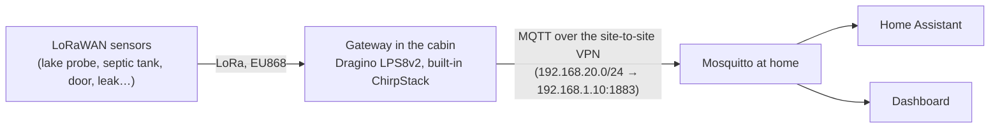

# Future plans

Ideas agreed in principle but not started. Each lists what it depends on, the hardware and the homelab changes it needs, so it can be picked up later without redoing the research.

## Cabin: LoRaWAN sensors

**Status:** idea (2026-10). **Depends on:** the site-to-site VPN in [other-site-network.md](other-site-network.md) (done, 2026-10) and the hardware below (not bought yet).

Battery sensors around the cabin plot (lake water, doors, leaks, septic tank) reporting over LoRa to one gateway in the house, which forwards their readings home over the VPN into Mosquitto, where Home Assistant and the dashboard pick them up.

### Why LoRaWAN

| Option | Verdict |
|---|---|
| **LoRaWAN, own gateway at the cabin** | Chosen. The cabin has mains power, a UniFi network (UCG Max, 6 PoE cameras) and internet over 5G (Teltonika RUTX50), so one gateway can serve every sensor on the plot. Sensors run for years on lithium batteries (fine in frost), reach the shore without cables (LoRa: hundreds of metres to over a kilometre outdoors), and need no SIM cards or cloud services. |
| NB-IoT / LTE-M sensor (Dragino D20-CB) | Rejected for the cabin: an IoT SIM per sensor and a cloud MQTT broker in between. Only worth it where there is no gateway. |
| Wi-Fi sensor at the shore (M5Stack AtomS3 Lite + waterproof DS18B20, ESPHome) | Cheapest and real-time, but only if the sauna or a shed by the water has power and Wi-Fi coverage. Fine for the lake temperature alone; LoRaWAN wins once there are several sensors. |

### Hardware

| Item | Use | Notes |
|---|---|---|
| **Dragino LPS8v2** (indoor LoRaWAN gateway, EU868) | Receives every sensor | Built-in ChirpStack network server and MQTT forwarding, so no separate network server or TTN account. Ethernet to the cabin's UniFi switch. Alternative: RAK WisGate Edge Lite 2 (RAK7268V2). |
| **Dragino D20-LB** (or LSN50v2-D20) | Lake water temperature | Waterproof stainless DS18B20 probe, −55…+125 °C, 2 m cable; 8500 mAh Li-SOCl2 battery. **D22-LB / D23-LB**: 2-3 probes, e.g. 0.5 m and 1.5 m deep to see the layering under the ice. |
| **Dragino LHT65N** | Temperature and humidity | Indoors, the crawl space or a storeroom (frost watch); optional external probe. |
| **Dragino LDS02** | Doors and windows | Shed and sauna doors. |
| **Leak sensor** (e.g. Dragino LWL03A) | Water leaks | Under the sink, by the water heater. |
| **Septic tank level sensor** | Fill level of the tank | See [below](#septic-tank-fill-level). |

### Lake probe in winter

- Ice there is typically 50-70 cm thick: probe 1-1.5 m deep, inside a weighted plastic pipe from the shore down into the water, which protects the cable and keeps the probe below the ice.
- Sensor box on a post or stake on the shore above flood level, not on a dock that is lifted out or pushed by ice; leave slack in the cable, as moving ice pulls or crushes a cable fixed tight.
- If 2 m of cable does not reach that depth from the post, DS18B20 cables extend to tens of metres, but the joint must be properly sealed (adhesive-lined heat-shrink) or water gets in over the winter.

### Homelab changes when the hardware arrives

1. **Mosquitto**: a `lora` user in `platform/components/mosquitto/users.sh` with its topics in `acl` (ChirpStack publishes `application/<id>/device/<eui>/event/up`), and the cabin LAN `192.168.20.0/24` in the NetworkPolicy, which admits only `192.168.1.0/24` today.
2. **Gateway**: register the sensors in its ChirpStack with Dragino's payload decoders (so the MQTT messages carry readable JSON: temperature, battery), and point its MQTT forwarding at `192.168.1.10:1883` with the `lora` login.
3. **Home Assistant**: MQTT sensors for each reading and battery level (YAML in `apps/homeassistant/deploy/configuration.yaml`, or a small translator to MQTT discovery); alerts for leaks, frost and the septic tank threshold to phones through the Companion app.
4. **Dashboard** (optional): a cabin card with lake temperature and tank level.
5. **Architecture diagram**: the gateway and sensors in `apps/dashboard/src/lib/architecture.ts`.

### Known limit

When the 5G link or the VPN is down, readings do not reach home. ChirpStack does not keep them for later, though some Dragino sensors can store readings and resend them, so a long outage leaves a gap in the history. Automations that must act at the cabin itself during an outage would need to run there.

## Septic tank fill level

**Status:** idea (2026-10). Part of the cabin LoRaWAN plan above (same gateway and path home).

Measure how full the cabin's septic tank is, so emptying can be booked before it fills up instead of on a fixed schedule or by lifting the lid. Most useful for a holding tank (*umpisäiliö*), which has no outflow and must be emptied when full.

**Sensor options** (LoRaWAN, battery):

| Type | How | Notes |
|---|---|---|
| **Ultrasonic distance sensor** under the lid (e.g. Dragino DDS75-LB) | Measures the distance down to the surface; level = tank depth − distance | The usual choice: nothing touches the sewage. Foam or a floating crust and heavy condensation can disturb the echo, so mount it straight above open liquid, away from the inlet pipe and the tank walls. |
| **Radar distance sensor** | Same idea with radar | Less affected by condensation and foam than ultrasonic; usually more expensive. |
| **Submersible pressure probe** (e.g. Dragino PS-LB with a water-level probe) | Hydrostatic pressure at the tank bottom gives the liquid depth | Unaffected by foam and crust, but the probe sits in the sewage and needs cleaning now and then. |

**Things to settle on site:**
- Tank type (holding tank vs septic tank with outflow), depth, lid size and where the sensor can be fixed; the tank's air holds corrosive hydrogen sulphide, so the sensor housing should be sealed (IP67 or better) and the bracket stainless or plastic.
- Whether the gateway reaches the tank through the lid and soil (a metal lid weakens the signal; the antenna may need to sit just under a plastic lid).
- Measurement interval: a few times a day is plenty, which keeps the battery going for years.

**In Home Assistant:** fill percentage from the measured distance and the tank's depth, an alert at a threshold (for example 75 % = book emptying), and the fill rate to estimate when it will be full; optionally on the dashboard's cabin card.
